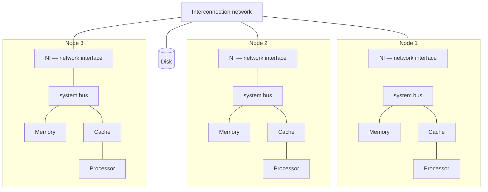
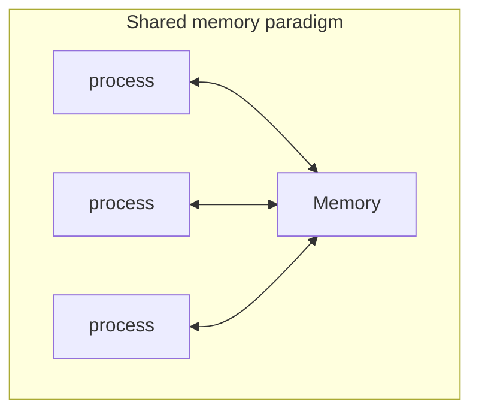
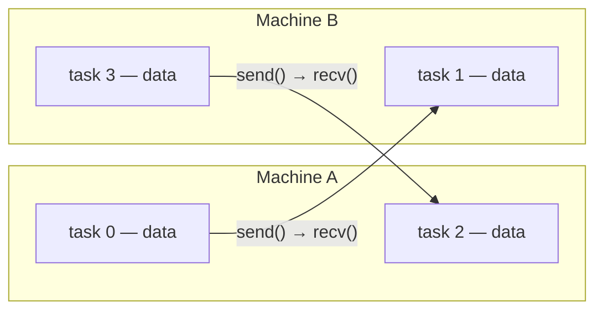

# COE 502 — Lecture 1: Introduction

**Parallel Processing Architectures** · KFUPM · Dr. Abdulaziz Tabbakh

---

## 1. Serial computing

Traditionally, software has been written for **serial computation**:

- A problem is broken into a discrete series of instructions
- Instructions are executed sequentially, one after another
- Executed on a **single processor**
- **Only one instruction may execute at any moment in time**

That last point is the actual definition. The others follow from it: one worker, one thing at a time.

### The payroll example (slide 7)

A program `Calculate Salary` runs four routines per employee:

```
Get_hrs()
Get_rate()
Get_deduct()
Issue_check()
```

With *n* employees, the single processor works through the whole list:

```
time ──────────────────────────────────────────────────────────▶

Processor:  [emp1: hrs rate deduct check][emp2: hrs rate deduct check] ... [empN: ...]
```

If one employee takes 1 second, 1000 employees take 1000 seconds. There is no way around it — the single processor is a hard bottleneck.

---

## 2. Parallel computing

> **Parallel computing is the simultaneous use of multiple compute resources to solve a computational problem.**

Four properties (slide 9):

- A problem is broken into discrete parts that **can be solved concurrently**
- Each part is further broken down to a series of instructions
- Instructions from each part execute **simultaneously on different processors**
- An overall **control / coordination mechanism** is employed

Same payroll, two processors:

```
time ───────────────────────────────▶

Processor 0:  [emp1   ...   emp500]
Processor 1:  [emp501 ...  emp1000]
```

1000 seconds becomes 500.

### Why this was allowed: independence

Employee 47's paycheque does not depend on employee 48's. They can be computed in any order, or all at once, and the answer is identical. They are **independent**.

**Independence is the precondition for everything in this course.** Where it exists you can parallelise; where it does not, you cannot — not because the hardware is weak, but because the problem forbids it.

A counterexample: the Fibonacci sequence.

```c
// Parallelisable: every iteration is self-contained
for (i = 0; i < N; i++)
    b[i] = a[i] * 2;          // no iteration reads another iteration's output

// NOT parallelisable: loop-carried dependency
fib[0] = 0; fib[1] = 1;
for (i = 2; i < N; i++)
    fib[i] = fib[i-1] + fib[i-2];   // iteration i needs iterations i-1 and i-2
```

No amount of hardware helps the second loop. The dependency is in the mathematics.

### [note] Concurrent is not the same as parallel

| Term | Meaning |
|---|---|
| **Concurrent** | Several tasks are *in progress* during the same period. One processor can interleave them — at any instant only one is actually running. |
| **Parallel** | Several tasks are *executing at the same instant*. Requires genuinely separate hardware. |

Parallel work is always concurrent; concurrent work is not necessarily parallel. Concurrency is a way of **structuring** a program; parallelism is a way of **executing** it faster.

### coordination

"An overall control and coordination mechanism is employed" is where the difficulty lives. Somebody has to:

- decide which employees go to which processor
- start the processors and detect when all have finished
- combine partial results (e.g. a grand total) without two processors clobbering each other

That coordination costs time the serial version never spent. It is why two processors never exactly halve the runtime. The four standard costs, which recur all term:

1. **Inter-processor communication**
2. **Load imbalance**
3. **Synchronisation**
4. **Redundant computation**

---

## 3. What counts as a parallel computer

> **(Parallel) Computer Architecture** is the science and art of selecting (or designing) and interconnecting hardware and software components to create (parallel) computers.

> *"A collection of processing elements that communicate and cooperate to solve large problems fast."*
> — Almasi & Gottlieb, 1989

Each word earns its place:

| Word | Why it matters |
|---|---|
| **collection** | More than one processing element — a core, a chip, or a whole machine |
| **communicate** | They can exchange data. Without this you have a server room, not a parallel computer |
| **cooperate** | They work on *the same problem together*, not unrelated jobs |
| **large problems fast** | The purpose. Parallelism is not for elegance |

Parallel architecture as a discipline involves:

- **ISA and micro-architecture** (processor design)
- **Programming model**
- **System-level hardware** — coherence, interconnection networks
- **System-level software** — runtime systems, OS, libraries

It is explicitly called out as *a fast-changing branch of computer architecture*.

---

## 4. The generic parallel machine

Several **processing nodes** connected through an **interconnection network** which lets them exchange data. Each node has a processor (possibly multicore), a memory, a cache, and a network interface. I/O devices connect to an I/O bus which reaches the nodes through the interconnection network.



### Vocabulary

| Term | Meaning |
|---|---|
| **Node** | One self-contained computer within the larger machine — think one server in a rack |
| **Processor** | Executes instructions. Possibly **multicore** = several independent processors on one chip |
| **Core** | A complete, independent processor: its own program counter, its own instruction stream |
| **Memory** | The node's own RAM. Large (GBs) but slow — ~100 ns, while a 3 GHz processor ticks every 0.33 ns |
| **Cache** | Small, very fast memory close to the processor holding recently-used data. ~1–40 cycles |
| **Network interface (NI)** | Translates between the node's internal signals and network packets. Without it a node is an island |
| **Interconnection network** | The wiring between nodes. Judged on **bandwidth**, **latency** and **topology** |
| **Bus** | A shared set of wires several components take turns using — so it becomes a bottleneck as you add participants |

### Three facts to carry forward

1. **Memory is distributed.** Each node owns its own. Any *shared* view of memory is something the system provides at a cost, not something that comes free.
2. **Caches are replicated.** The same data can sit in many caches at once → this is the origin of the **cache coherence** problem (topic 7).
3. **Communication cost grows with distance.** Register → cache → local memory → another node's memory, each roughly an order of magnitude slower. Fast code is largely code that keeps data close.

**[note]** Two levels of parallelism are stacked here: several **cores inside a node** (which share memory and talk in nanoseconds) and several **nodes inside the machine** (which send messages and talk in microseconds). That thousandfold gap is why large machines are programmed in a **hybrid** style — OpenMP within a node, MPI between nodes.

---

## 5. Why we need parallel computing

### The traditional engineering paradigm

1. Do **theory** or paper design
2. Perform **experiments** or build the system

**Limitations:** complex · costly · takes time · might be dangerous

You cannot crash a hundred prototype aircraft, run a controlled experiment on the Earth's climate, or test a reactor failure mode by causing one.

### The computational science paradigm

> Use high performance computing platforms to **simulate** the problem/solution, using known physical laws and efficient numerical methods.

We already know the governing equations — fluid dynamics, electromagnetism, molecular interaction. We usually cannot solve them exactly by hand for any realistic situation, but we can solve them *approximately*, numerically, by chopping the problem into millions of small pieces.

Every one of the four limitations dissolves: simulation is cheap, fast to iterate, safe, and handles complexity by brute force.

**[note] Why the demand never saturates.** Numerical simulation works by *discretisation*: divide a continuous thing into a grid of cells, compute each cell from its neighbours, step forward in time, repeat. Accuracy depends on how fine the grid is.

Halve the cell size in a 3D problem → **8×** as many cells. The time step usually has to shrink too, for stability → roughly **16×** the computation for one modest improvement in accuracy.

So there is always a finer grid to want. Weather forecasting is the clearest case: a forecast is worthless if it takes longer to compute than the weather takes to arrive, so the only way to improve it is more compute inside the same wall-clock window.

---

## 6. Can serial computing keep up?

Historically, the clock speed of microprocessors increased **exponentially — about 50% every year**, due to:

- **Process improvements** (smaller transistors switch faster)
- **Deeper pipelines**
- **Circuit design techniques**

The slide's graph shows Intel's highest clock rate each year from 1990 to 2008, with two reference curves: **EXP 1.19** (process improvements alone, ~19%/year) and **EXP 1.49** (the actual trend, ~49%/year). The gap between them is what architecture and circuit techniques contributed.

> **This historical trend has subsided over the past 10 years. If it had kept up, today's clock rates would be more than 30 GHz!!!!!**

They are not. Processors today run at 3–5 GHz, which is where they were twenty years ago. The curve peaks around 2004 at ~3.8 GHz and comes *down* slightly by 2008.

### Reminder of the terms

| Term | Meaning |
|---|---|
| **Clock cycle** | One tick of the processor's internal metronome; the hardware advances one step per tick |
| **Clock rate / frequency** | Ticks per second, in Hz. 2 GHz = 2 billion ticks/second |
| **Cycle time** | Duration of one tick = 1 ÷ clock rate. At 2 GHz, 1 ÷ 2×10⁹ = **0.5 ns** |

---

## 7. Moore's Law

> An observation made in **1965 by Gordon Moore**, co-founder of Intel: the number of transistors that could fit on a microchip was **doubling approximately every 18–24 months**, while the cost per transistor was decreasing.

The supporting figures from slide 14:

- A new process arrives **every 2 years**
- Feature size reduced by **~30% every process**, or **halved every 5 years**
- Transistor count **doubles every 2 years**
- **1 billion** transistors reached in 2008; **100 billion** in 2021

**Feature size** is the smallest structure a manufacturing process can produce, in nanometres. It names process generations (the "7 nm process"). For scale, a silicon atom is about 0.2 nm, so modern features are a few dozen atoms wide.

The link between the two curves is geometry: shrink each linear dimension by 30% and each transistor occupies about half the area (0.7 × 0.7 ≈ 0.49), so twice as many fit.

> ⚠️ **Moore's Law is about transistor COUNT, not speed.**
> It is an observation about manufacturing economics, not a law of physics, and it never promised faster chips. For decades count and speed happened to arrive together, so people fused them. When they came apart in the mid-2000s, the confusion became expensive.

The slide ends with the two questions the rest of the deck answers:

- **How do we use 100b transistors????**
- **Can this trend continue?**

---

## 8. Dennard scaling

> Proposed by **Robert Dennard** and colleagues at IBM: as transistors get smaller, their **power density stays constant**, so power use stays in proportion with area.

When you shrink a transistor:

- Voltage and current **scale down with size**
- Power consumption **per transistor decreases**
- You can **pack more transistors into the same area without increasing overall power use**

### Why this is the key to the whole story

Moore gives you more transistors. **Dennard is what made them free to use.** Together they produced thirty years of effortless performance: every couple of years you got twice the transistors, could run them faster, and the chip did not get any hotter. Your code got faster every year without you touching it.

**Dennard scaling broke in the mid-2000s**, because voltage stopped scaling down — below a threshold, transistors leak too much current to switch reliably. Once voltage stalls, every shrink *raises* power density.

| | Moore's Law | Dennard scaling |
|---|---|---|
| About | Transistor count | Power density |
| Promised | More transistors | Those transistors are free to run |
| Status | **Still holding** (100B in 2021) | **Broke in the mid-2000s** |

That asymmetry is the whole story. Transistors kept arriving but could no longer be spent making one processor faster.

---

## 9. Power — the equation that decided the industry

Total power = **dynamic** + **static (leakage)**

$$P_{dynamic} = \alpha C V^2 f$$

$$P_{static} = V I_{sub} \approx V e^{-KV_t/T}$$

| Symbol | Meaning |
|---|---|
| α | Activity factor — what fraction of transistors are switching |
| C | Capacitance being charged and discharged |
| V | Supply voltage |
| f | Clock frequency |
| I_sub | Subthreshold leakage current |

**Static power** is burned continuously, *whatever the frequency is*, because circuits leak. Transistors are imperfect switches: even "off," current seeps through. Leakage grows as transistors shrink and as temperature rises — which is nasty, because leakage makes heat and heat makes more leakage.

### The cube

The formula has V² and f as separate terms, but they are **not independent**: running faster requires higher voltage, because signals have less time to settle. V scales roughly with f, so V²f behaves like f² × f:

$$P_{dynamic} \propto f^3$$

### The comparison that decided everything

| Option | Speedup | Dynamic power |
|---|---|---|
| Take a processor and **replicate it 4 times** | 4× | **4×** |
| Take a processor and **clock it 4 times faster** | 4× | **64×** |

Identical performance. **Sixteen times** the power cost. 4³ = 64.

**This is why every chip you own is multicore.** Not because parallel programming is pleasant — it isn't — but because the cube law made the alternative physically impossible to cool.

### Why power is a hard limit

- **Power must be dissipated.** Otherwise temperature rises → affects performance, affects *correctness*, and may destroy the circuit, short or long term.
- **Effect on the supply of power to the chip** — delivering tens of watts to a small piece of silicon is its own engineering problem.
- **Energy is costly; a global problem.** At datacenter scale it dominates operating cost.
- **Battery-operated devices.**

---

## 10. Reliability

Shrinking transistors has a second cost. The charge stored in a circuit node is:

$$q = C \times V$$

Shrink the transistor and **both C and V go down**, so there is less charge representing each bit — so **it is easier to flip a bit**.

### Three failure classes

| Class | Cause | Response |
|---|---|---|
| **Transient (soft errors)** | Cosmic rays; alpha particles radiating from the packaging material | Device is still operational but the *value* is corrupted → **detect, correct, continue** |
| **Intermittent / temporary** | Temporary: environmental variation (e.g. temperature). Intermittent: aging | **Try to continue execution** |
| **Permanent** | Device will never function again | **Isolate and replace by a spare** |

> **Process variations increase the probability of failures.** No two manufactured transistors come out quite identical, and the spread grows as features shrink.

---

## 11. Trends in computer architecture — the 2004 inflection

Slide 17 plots five quantities from 1970 to 2022 on a log scale, with a red dashed line at **~2004**:

| Curve | Before 2004 | After 2004 |
|---|---|---|
| Transistors (thousands) | Rising | **Still rising, same slope** |
| Frequency (MHz) | Rising | **Flat** |
| Single-thread performance | Rising | **Nearly flat** |
| Typical power (Watts) | Rising | **Flat** |
| Number of logical cores | **1** for thirty years | **Climbing** |

Read it as one sentence: **the transistors kept coming, but Dennard scaling and the power wall meant they could no longer be spent on making one processor faster — so they were spent on more processors instead.**

That answers slide 14's "how do we use 100b transistors?"

> **[note] And it is why this is now *your* problem.**
> Before 2004, your code got faster for free every year. After 2004, it only gets faster if you write it to use multiple processors. That is the entire reason this course exists.

---

## 12. Amdahl's Law

$$\text{Speedup} = \frac{\text{Old execution time}}{\text{New execution time}} = \frac{1}{(1-f) + \dfrac{f}{s}}$$

| Symbol | Meaning |
|---|---|
| *f* | The **fraction of the original execution time** spent in the part you are improving |
| *s* | How many times faster you made that part |

### Reading it in words

> The part you did **not** improve still costs exactly what it always cost — that is the `(1 − f)` term.
> The part you **did** improve now costs its original share divided by how much faster you made it — that is the `f/s` term.
> Add them to get the new runtime as a fraction of the old, then flip it over to get the speedup.

### The ceiling

Make the improved part *infinitely* fast, so `f/s → 0`:

$$S_{max} = \frac{1}{1-f}$$

If 40% of your program cannot be improved, your maximum possible speedup is 1/0.4 = **2.5**, no matter how much money or engineering you throw at the other 60%.

### For parallel processing

Adding processors is just another enhancement, with *s* = *P* (number of processors) and *f* = *F* (the parallel fraction):

$$S_P = \frac{1}{(1-F) + \dfrac{F}{P}} < \frac{1}{1-F}$$

Slide 21 plots this for several values of F. Every curve **flattens against a horizontal asymptote** and never reaches the ideal line S = P:

| Parallel fraction F | Ceiling = 1/(1−F) |
|---|---|
| 50% | 2 |
| 60% | 2.5 |
| 70% | 3.33 |
| 80% | 5 |
| 90% | 10 |
| 95% | 20 |

Note how brutal that is. At **F = 0.95** — 95% of your program parallel, which is excellent — a thousand cores buys you at most **20×**. The last 5% dominates everything.

### Worked example

> 80% of a program can be parallelised, 20% is serial.

**(a) Upper limit:**

$$S_{max} = \frac{1}{1 - 0.8} = \frac{1}{0.2} = 5$$

**(b) On 4 processors:**

$$S = \frac{1}{0.2 + \frac{0.8}{4}} = \frac{1}{0.2 + 0.2} = \frac{1}{0.4} = 2.5$$

Half the theoretical ceiling, from four processors.

**(c) The curve:**

| P | 1 | 2 | 4 | 8 | 16 | 32 | 64 | 100 | ∞ |
|---|---|---|---|---|---|---|---|---|---|
| Speedup | 1.00 | 1.67 | 2.50 | 3.33 | 4.00 | 4.44 | 4.71 | 4.81 | **5.00** |


### [note] Why real speedup falls short even of Amdahl

Amdahl assumes the parallel part divides perfectly and costs nothing to coordinate. Reality adds:

1. **Inter-processor communication** — processors must exchange data
2. **Load imbalance** — you are paid at the rate of your *slowest* processor
3. **Synchronisation** — waiting at barriers and locks is not working
4. **Redundant computation** — the parallel version sometimes does work the serial version never did

Add an overhead term that **grows with P** (e.g. sequential thread creation, `P × T_init`) and the curve no longer just flattens — it **peaks and comes back down**, so past some point more processors make the program *slower*. The optimum is:

$$P_{opt} = \sqrt{\frac{T_{work}}{T_{per\text{-}processor\ overhead}}}$$

---

## 13. The memory wall

> **"Hitting the Memory Wall: Implications of the Obvious"** — Wm. A. Wulf and Sally A. McKee, University of Virginia, December 1994.

The graph plots processor performance and memory performance from 1980 to 2010 on a log scale. Processor performance climbs steeply; memory performance climbs gently. The **Processor–Memory Performance Gap** opens and opens — about **four orders of magnitude** by 2010.

In practical terms: the processor can execute **thousands of instructions** in the time one fetch from main memory takes to return.

### The implication (slide 23)

> **Over 60% of die area is just caches.**

Look at the two die photographs — Intel i7-5960X and Intel Ivy Bridge Xeon E7 v2. The large regularly-structured regions are cache, not logic. **Most of your processor is not computing anything.** It is storing data close enough to the cores to keep them fed.

### Why this matters for parallelism specifically

If a single processor already spends most of its time waiting on memory, adding more processors does not automatically help — you may just get more processors waiting. And more processors generate **more memory traffic through the same finite paths**.

This is why memory, caching and coherence take up so much of the course.

---

## 14. Spectrum of parallelization

Parallelism appears at four nested scales:

| Scale | Examples |
|---|---|
| **Within a processing core** | Processor pipelines · Superscalar processors · Hardware multi-threading |
| **Within a single chip** | Multicores · Systems-on-Chip (e.g. smart phones) · GPUs |
| **Within a single machine** | Multi-socket machines · Accelerator + CPU configurations (GPU + CPU) |
| **Collection of machines** | Clusters · Datacenters and warehouse-scale computers (WSCs) · Supercomputers |

These are **not alternatives** — a real supercomputer has all four at once. They differ by orders of magnitude in communication cost, which is why different levels get programmed with different tools.

---

## 15. Shared memory vs message passing

The fundamental organisational split, and it determines how you program the machine.





### Shared memory architecture

> Allows all processors to access all memory locations as a **shared global address space**.

- Multiple processors can operate **independently** but share the same memory resources
- **Changes in a memory location committed by one processor are visible to all other processors**

Two sub-types:

| Type | Meaning |
|---|---|
| **UMA** — Uniform Memory Access | Every processor reaches any memory location in the same time |
| **NUMA** — Non-Uniform Memory Access | Some memory is physically closer to some processors, so *data placement affects performance* |

**Advantages**

- Global memory space shared by all processors
- Fast and uniform data sharing between threads/tasks

**Disadvantages**

- **Scalability** in terms of interconnection, coherence protocols, and traffic due to cache/memory management
- **Program responsibility** for thread/task synchronisation to ensure "correct" access of global shared data

The code example (slide 29) — matrix multiply, each thread taking a slice of rows:

```c
/* A, B, C, BAR, LV and sum are shared          */
/* All other variables are private               */
1a  low   = pid*N/nproc;      /* pid = 0...nproc-1        */
1b  hi    = low + N/nproc;    /* identifies rows of A      */
1c  mysum = 0; sum = 0;
2   for (i=low; i<hi; i++)
3     for (j=0; j<N; j++){
4       C[i,j] = 0;
5       for (k=0; k<N; k++)
6         C[i,j] = C[i,j] + A[i,k]*B[k,j];
7       mysum += C[i,j];
8     }
9   BARRIER(BAR);
10  LOCK(LV);
11    sum += mysum;
12  UNLOCK(LV);
```

Note what is and is not needed: **lines 2–8 do 99.9% of the work and need no protection at all**, because threads touch disjoint rows. Line 11 does one addition and needs a **lock**, because it is the one shared write. Shared data is not dangerous; *shared data that someone writes* is.

- **LOCK/UNLOCK** create a **critical section** — at most one thread inside at a time. Needed because `sum += mysum` is really three steps (read, add, write) and interleaving them loses an update.
- **BARRIER** forces every thread to stall until all have arrived. Needed because threads are *asynchronous*, and no partial sum may be added before every thread has finished multiplying.

They do different jobs. A lock alone gives a correct-looking program with a wrong answer.

### Message-passing architecture

> A set of tasks that use their **own local memory** during computation.

- Multiple tasks can reside on the same physical machine and/or across an arbitrary number of machines
- Tasks exchange data by **sending** and **receiving** messages
- Data transfer usually requires **cooperative operations performed by each process** — *a send operation must have a matching receive operation*
- Implementations are usually a **library of subroutines** called from source code. **The programmer is responsible for determining all parallelism.**

**Advantages**

- Scalable with the number of processors
- Fast access to local data
- Cost efficient — can be built using existing processors and networking
- Simple to reason about the outcome of an execution because they **enforce synchronisation**

**Disadvantages**

- Programmer is responsible for detailed data communication and synchronisation between processors — **prone to deadlock**
- **Non-uniform memory access**: data residing on a remote node takes longer to access than local data

#### Working example (slide 31)

```
Code for process P1:                 Code for process P2:
A = 10;                              B = 5;
SEND(&A, sizeof(A), P2, SEND_A);       RECV(&B, sizeof(B), P1, SEND_A);
A = A + 1;                           B = B + 1;
RECV(&C, sizeof(C), P2, SEND_B);       SEND(&B, sizeof(B), P1, SEND_B);
printf(C);
```

P1 sends, P2 receives. The ordering works out.

#### Deadlock example (slide 32)

```
Code for process P1:                 Code for process P2:
A = 10;                              B = 5;
SEND(&A, sizeof(A), P2, SEND_A);     SEND(&B, sizeof(B), P1, SEND_B);
RECV(&B, sizeof(B), P2, SEND_B);     RECV(&A, sizeof(B), P1, SEND_A);
```

**Both processes SEND first.** If sends block until the matching receive is posted, both sit waiting for the other — **forever**. Swap one pair and it works. This is the characteristic message-passing bug.

### The trade, in one sentence

> **Message passing makes you write all the data movement and gives you the synchronisation for free. Shared memory gives you the data movement for free and makes you write all the synchronisation.**

| | Shared memory | Message passing |
|---|---|---|
| Address space | One global | Private per task |
| Communication | **Implicit** — loads and stores | **Explicit** — send / receive |
| Synchronisation | Programmer's job (locks, barriers) | Comes free with the message exchange |
| Scales? | Poorly — coherence traffic | Well |
| Typical failure mode | Silent wrong answer (race) | Hang (deadlock) |
| API | OpenMP, pthreads | MPI |

---

## 16. Types of parallelism — ILP, DLP, TLP

> Any given application exhibits a specific property that dictates which form of parallelism is most suitable.
> These properties are **inherent**; however, they can be influenced by the implementation — a poor implementation can impact the level of such property.
> **Note: these properties are not mutually exclusive, even if they seem to be.**

That framing is the important part: **these describe the application, not the hardware.** You do not choose them; you discover them.

### ILP — Instruction-Level Parallelism

> The intrinsic property of a **single stream of instructions** to have instructions that can be executed **independently of the others**.

```c
I1:  a = b + c;     // independent
I2:  d = e + f;     // independent  → I1 and I2 could run simultaneously
I3:  g = a + d;     // depends on BOTH I1 and I2 → must wait
```

- Simple five-stage pipelines exploit ILP to **increase throughput**
- Other microarchitectures that exploit it: superscalar, out-of-order execution, VLIW (deck 05)
- **Drawback:** it is limited, and expensive to extract — lots of complex hardware for diminishing returns

**Invisible to the programmer.** You write ordinary serial code and the hardware finds it.

### DLP — Data-Level Parallelism

> The intrinsic property of a program to apply the **same sequence of instructions on multiple independent input data**.

```c
for (i = 0; i < N; i++)
    c[i] = a[i] + b[i];     // every iteration independent → N-way DLP
```

- Exploited by **SIMD / vector hardware** and GPUs
- Advantage: one instruction drives many operations → very efficient
- Disadvantage: only applies when the data really is independent and uniform; branching within the data ruins it

### TLP — Thread-Level Parallelism

> While ILP and DLP are properties of a *single* stream of instructions, thread-level parallelism is the intrinsic property of a program to have **multiple independent streams of instructions that can be executed concurrently**.

> **TLP is the most prevalent form of expressing parallelism due to its easiness and intuitiveness.**

Whether it is *efficient* is the question the slide poses — it is not especially, since threads carry real creation, scheduling and synchronisation overhead.

### Which hardware exploits which

| Parallelism in the problem | Hardware that exploits it |
|---|---|
| **ILP** | Pipelining, superscalar, out-of-order — **inside one core** |
| **DLP** | SIMD units, vector processors, GPUs — *or* SPMD threads on MIMD |
| **TLP** | MIMD — multicore, clusters |

---

## 17. Flynn's taxonomy

> Flynn's taxonomy distinguishes multi-processor computer architectures according to how they can be classified along the **two independent dimensions** of **Instruction Stream** and **Data Stream**. Each dimension can have only one of two possible states: **Single** or **Multiple**.

|  | **Single Instruction** | **Multiple Instruction** |
|---|---|---|
| **Single Data** | **SISD** | **MISD** |
| **Multiple Data** | **SIMD** | **MIMD** |

### SISD — Single Instruction, Single Data

- A **serial (non-parallel)** computer — the oldest type
- **Single Instruction:** only one instruction stream is being acted on by the CPU during any one clock cycle
- **Single Data:** only one data stream is being used as input during any one clock cycle
- **Deterministic execution**
- Examples: older generation of single processor/core PCs

### SIMD — Single Instruction, Multiple Data

- A type of parallel computer
- **Single Instruction:** all processing units execute **the same instruction at any given clock cycle**
- **Multiple Data:** each processing unit can operate on a **different data element**
- **Simple programming model, low overhead**
- Examples: Vector Processor, Array Processor (and, in practice, GPUs)

### MISD — Multiple Instruction, Single Data

- **Multiple Instruction:** each processing unit operates on the data independently via separate instruction streams
- **Single Data:** a single data stream is fed into multiple processing units
- **Few (if any) actual examples have ever existed** — e.g. C.mmp built by Carnegie-Mellon University
- Possible usage: multiple frequency filters operating on a single signal stream; multiple cryptography algorithms attempting to crack a single coded message

> 📌 **Exam trap:** if asked which category has essentially no real examples, the answer is **MISD**.

### MIMD — Multiple Instruction, Multiple Data

- **Multiple Instruction:** every processor may be executing a different instruction stream
- **Multiple Data:** every processor may be working with a different data stream
- Execution can be **synchronous or asynchronous, deterministic or non-deterministic**
- **Currently the most common type of parallel computer** — most modern supercomputers fall into this category
- Processors can run **independent processes or applications**, or **threads belonging to one parallel application**
- Examples: most current supercomputers, networked parallel computer clusters and "grids", multi-processor SMP computers, multi-core PCs
- **Note: many MIMD architectures also include SIMD execution sub-components**

That last note matters — the categories describe a *level*, not the whole machine. A GPU-equipped cluster is MIMD at the top with SIMD inside.

---

## 18. Putting the taxonomies together

**[note]** This section is not on the slides. It exists because the lecture introduces four different classification schemes and does not say how they relate. They are not competing lists — they are **different lenses, stacked**:

| Layer | Question it answers | Categories |
|---|---|---|
| **1. The problem** | Where is the independent work? | ILP · DLP · TLP |
| **2. The hardware** | What does the machine support? | SISD · SIMD · MISD · MIMD |
| **3. Memory model** | Can processors see each other's memory? | Shared memory (UMA/NUMA) · Message passing |
| **4. What you write** | How do you express it? | Threads (OpenMP, pthreads) · Processes (MPI) |

Three consequences worth holding on to:

**A SISD machine can be deeply parallel inside.** ILP is exploited entirely within a single core, so your laptop's single core is pipelined, superscalar and out-of-order — and Flynn still calls it SISD, because from the outside there is one instruction stream and one data stream. That is the clearest proof these are different lenses.

**DLP has two different routes to exploitation.** Feed it to SIMD hardware (lockstep), *or* hand chunks of the array to independent threads on MIMD hardware. The second is called **SPMD** — Single Program, Multiple Data — where every thread runs the same program text but independently, with its own program counter. SPMD is not SIMD, and almost all real parallel code is SPMD.

**Layer 3 and layer 4 should match.** You *can* program a message-passing machine in a shared-memory style; it works, and it works slowly, because every innocent-looking variable access becomes a network round trip. This mismatch is the most common cause of parallel code that is correct and useless.


---

*Next: [Lecture 2 — Introduction to Computer Architecture (Refresher)](./02-architecture-refresher.md)*
