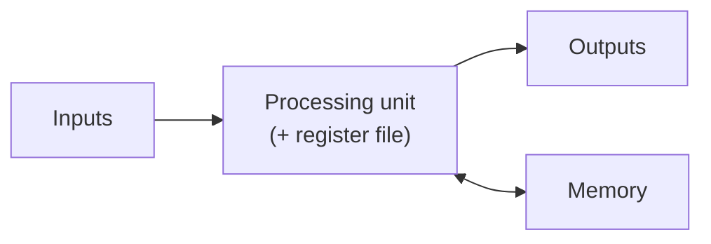
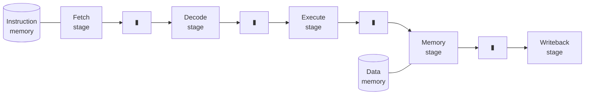
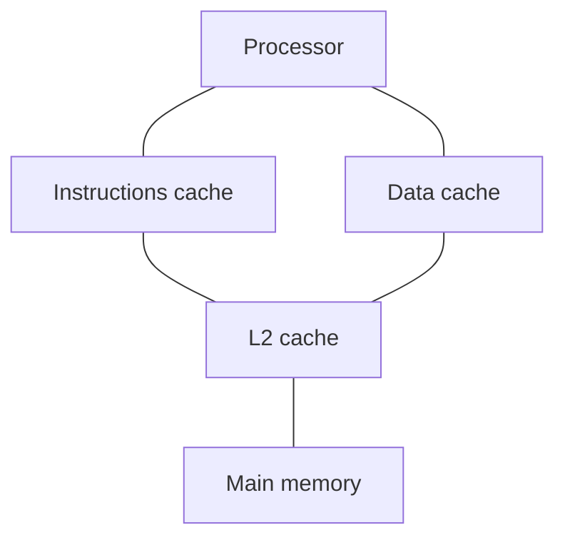
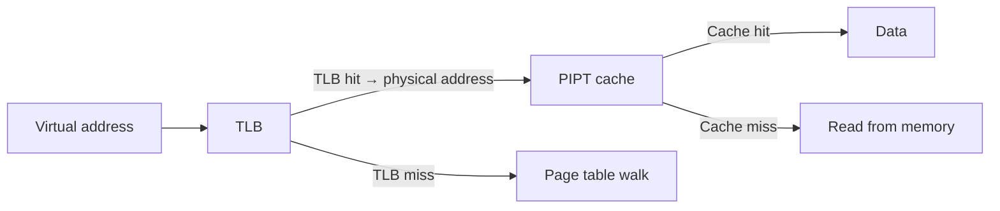

# COE 502 — Lecture 2: Computer Architecture Refresher

**Parallel Processing Architectures** · KFUPM · Dr. Abdulaziz Tabbakh

> These notes follow deck `02 - Introduction to Computer Architecture (Refresher).pdf`.
> It is an 89-slide refresher of undergraduate material (COE 301). It will not be examined
> directly, but three parts of it are load-bearing for the rest of COE 502 — see [Scope](#0-scope).
> Anything marked **[note]** is extra context not on the slides.

---

## Contents

0. [Scope — what matters and what doesn't](#0-scope)
1. [Digital circuits](#1-digital-circuits)
2. [The ISA: software–hardware contract](#2-the-isa-softwarehardware-contract)
3. [Single-cycle processor](#3-single-cycle-processor)
4. [Multi-cycle processor](#4-multi-cycle-processor)
5. [Pipelined processor](#5-pipelined-processor)
6. [Hazards](#6-hazards)
7. [Register renaming](#7-register-renaming)
8. [The memory wall and locality](#8-the-memory-wall-and-locality)
9. [Caches](#9-caches)
10. [Virtual memory](#10-virtual-memory)
11. [Memory performance — AMAL](#11-memory-performance--amal)
12. [Summary sheet](#12-summary-sheet)
13. [Self-test](#13-self-test)

---

## 0. Scope

The deck's own outline:

1. Digital Circuits: MOSFET, CMOS Circuits, and Digital Logic
2. Software-Hardware Abstraction: The Instruction Set Architecture
3. Single-Cycle Processor Design and Performance
4. Multi-Cycle Processor Design and Performance
5. Pipelined Processor Design and Performance
6. Memory: Caches, Virtual Memory, and Memory Performance
7. Benchmarking and Performance
8. Precise Exceptions

**[note] Triage for COE 502.** Three parts genuinely feed the rest of the course:

| Priority | Topic | Why |
|---|---|---|
| 🔴 **Essential** | Pipelining and hazards | `CPI = 1 + stalls` is the spine of every later performance argument; feeds ILP/superscalar (deck 05) |
| 🔴 **Essential** | Register renaming, RAW/WAR/WAW | 12 slides in the deck; feeds out-of-order execution |
| 🔴 **Essential** | Caches and AMAL | Cache coherence is topic 7 and a stated course outcome — unintelligible without this |
| 🟡 Useful | Single-cycle vs multi-cycle | You need the *conclusion* (the Iron Law trade), not the datapath internals |
| 🟡 Useful | Virtual memory, TLB, PIPT/VIVT/VIPT | Rarely surfaces in parallel architecture, but it's 13 slides so it's covered below |
| ⚪ Background | MOSFET, CMOS, Boolean algebra, gates | COE 301 material; one section below for completeness |

---

## 1. Digital circuits

⚪ *Background — skim.*

### MOSFET

Early semiconductor circuits used **bipolar junction transistors (BJT)** — essentially two PN junctions side by side. A BJT can act as a switch, but its base (gate) is controlled by **current**, which makes it inefficient.

Later circuits used the **metal-oxide-semiconductor field-effect transistor (MOSFET)**:

- BJTs operate using both electrons and holes as carriers; MOSFETs use **either** electrons **or** holes
- MOSFETs use **field-effect** to act as a switch, relying on **voltage** rather than current — so they are very efficient

**[note]** That voltage-not-current switching is exactly why the dynamic power formula from Lecture 1 is `P = αCV²f` — voltage squared, no current term. CMOS burns power charging and discharging capacitance, not by sustaining current.

### CMOS circuits

**Complementary** metal-oxide-semiconductor: NMOS and PMOS transistors complement each other's functionality, making the output **always-driven and never floating**.

Each gate is built from two networks:

| Network | Built from | Role |
|---|---|---|
| **PUN** — pull-up network | PMOS transistors | drive the output **high** |
| **PDN** — pull-down network | NMOS transistors | drive the output **low** |

The PDN is the logical complement of the PUN, and vice versa. **PMOS switches on a voltage-low gate; NMOS switches on a voltage-high gate.** That complementarity means exactly one network conducts at a time, so the output is always driven and no direct path from Vdd to Vss exists in steady state.

The timing diagram on the deck shows **T_HL** (high-to-low transition time) and **T_LH** (low-to-high) — the propagation delays that ultimately set how short a clock cycle can be.

### Digital logic

Since transistors are good switching devices, the idea is to use **discrete (logical) mathematics** to represent and analyze functionality. Logical mathematics has been around since 1850.

- Logic gates are **chained** to perform a specific functionality
- **Boolean algebra** is used to design and simplify
- **Karnaugh maps (K-maps)** and advanced methods (e.g. **Quine–McCluskey**) are used to simplify further

Gates have two aspects:

| Aspect | What it covers |
|---|---|
| **Logical** | The logical operation performed by the gate |
| **Electrical** | The delay, and the energy consumed |

Cascade gates into a network and you use the **logical representation to verify functionality** and the **electrical representation to verify correctness** (i.e. that signals actually settle in time).

Some gates serve a logical purpose (an inverter when you need a complement); others serve an electrical purpose (**buffers** added to long wires to rectify signals).

### Why the instruction was invented

> The use of transistors as switching devices and Boolean algebra as a mathematical representation enabled the use of digital circuits to execute various functions. Eventually, there has been a need for adding more **programmability and flexibility** to these circuits.

Which produced:

> **An instruction: a command issued to the hardware to be executed, specifying a clear functionality, well-defined inputs, and outputs.**

---

## 2. The ISA: software–hardware contract

🟡 *Useful.*

### The von Neumann machine

John von Neumann introduced the concept when he led the design and implementation of the **IAS machine in 1945**. It became the standard abstraction of modern computer systems' organization, and its defining feature is the **separation between compute and memory**.



**When programming a computer, that is the abstracted view of the system.** This is also the model that every programming language assumes — and the one parallel machines violate, which is why Lecture 4 opens by saying parallel programming is hard.

The deck then asks four questions that drive the rest of the course:

- How would you address the memory?
- What happens when memory is slow?
- How would you distinguish between the slower (main) memory and faster on-board memory?
- **What happens when the memory keeps becoming slower?**

### The memory hierarchy

> The technology used for storage determines the **density** and **speed** of the storage.
> - Main memory technology is predominantly optimized for **density**
> - Register file technology is predominantly optimized for **performance**

> "Performance" for memory is an **overloaded term** used to designate both **latency** and **bandwidth**.

| Level | Technology | ← Density · Performance → |
|---|---|---|
| Registers | — | fastest, smallest |
| Caches | SRAM | |
| Main memory | DRAM | |
| High Bandwidth Memory | HBM | |
| Solid State Drive / Magnetic Disk | — | |
| Optical Disk | — | |
| Magnetic Tape | — | slowest, densest |

> As memory's performance scales much slower than the processors', we have to keep innovating new techniques to mitigate the **memory wall**.

### The IBM story

By the early 1960s IBM had several computer models with **incompatible instructions**:

- Defense: 701
- Scientific: 704, 709, 7090, 7094
- Business: 702, 705, 7080

These systems had different technology, implementation, set of supported instructions, and representation of those instructions. Software written for one would not run on another — so every program had to be rewritten for every machine, and IBM maintained several entirely separate ecosystems.

> To solve this division and resource-wasting, **IBM 360** was designed as the first line of machines to **abstract the implementation**, thus unifying the set of instructions.

### Instruction Set Architecture

IBM 360 introduced the concept of an ISA, defined as:

> *"… the structure of a computer that a **machine language programmer** must understand to write a **correct** program for that machine."*
> — Amdahl, Blaauw, Brooks, 1964

> The ISA is an **abstraction and a contract** between the software and hardware.

> Software written for IBM 360 machines **can still be executed by modern machines** that adopt the same ISA.

**[note]** That is a sixty-year compatibility guarantee, and it is the whole point of the abstraction. It is also why the first term of the Iron Law belongs to the ISA: the ISA fixes what instructions exist, so it fixes how many the compiler must emit.

### Architectural state vs physical state

> As there is a contract between the software and hardware, the hardware must preserve an **architectural state** that does not necessarily equate to the **physical state**.

The ISA defines:

- available storage and their addressing modes
- execution state and how it is handled
- exception handling and precise-exception requirements

| | Contents |
|---|---|
| **Architectural state** | PC, architectural registers, data stored in memory |
| **Physical state** | Temporary registers, physical registers, speculated values … |

**This distinction is the entire licence for register renaming** (section 7). The hardware may keep 200 physical registers and speculate wildly, as long as the architectural state it exposes matches what the ISA promises.

---

## 3. Single-cycle processor

🟡 *Useful — you need the conclusion, not the datapath.*

> The purpose is to design a micro-architecture to execute all instructions outlined by a given ISA. **The micro-architecture must respect the contract detailed by the ISA.** Many possible micro-architectures exist for a given ISA.

Execution is broken down into five subtasks:

| Stage | What happens |
|---|---|
| **Fetch** | The instruction to be executed is fetched from memory to the processing unit |
| **Decode** | Instruction is decoded to determine the functionality, inputs, and outputs |
| **Execute** | Begin executing the instruction functionality using functional units in the backend |
| **Memory** | Memory portion of the instruction functionality is executed (i.e. finish the execution) |
| **Writeback** | The result and outcome of the instruction is written back, and the instruction is **retired** |

In the single-cycle design these all happen inside **one** clock tick. The datapath is a straight chain: PC → Instruction Memory → Decode Logic → Operand Fetch → Execution Logic → Data Memory → Memory Response Logic → Writeback Logic, with a Control Unit driving everything.

### The Iron Law

$$\frac{\text{Time}}{\text{Program}} = \frac{\text{Instructions}}{\text{Program}} \times \frac{\text{ClockCycles}}{\text{Instruction}} \times \frac{\text{Time}}{\text{ClockCycles}}$$

or equivalently

$$\text{Time} = \text{num\_insts}_{dyn} \times \text{Average CPI} \times \text{time}_{cycle}$$

Note the subscript: **dynamic** instruction count — how many instructions actually execute, not how many are in the source. A 10-instruction loop running a million times has a dynamic count of 10 million.

| Term | Owned by |
|---|---|
| Instructions per program | **ISA design** (and the compiler) |
| Clock cycles per instruction | **Micro-architecture** |
| Time per clock cycle | **Physical design** |

### CPI and IPC

> CPI can be seen as the **inverse throughput** of the micro-architecture, while the throughput would be the **IPC** (instructions per clock cycle).

$$\text{IPC} = \frac{1}{\text{CPI}}$$

### The two questions on slide 32

**What is the CPI of a single-cycle processor?** → **Exactly 1.** Every instruction completes in one cycle, always. This is the best CPI achievable.

**What is the cycle time of a single-cycle processor?** → The cycle must span the **entire datapath**, PC through Writeback (the slide marks this `t_cycle` across the whole diagram) — and it must be long enough for the **slowest instruction**, because the clock is one fixed rate for the whole chip.

**The waste:** an arithmetic instruction never touches Data Memory. It genuinely finishes its work early. But it waits, because the clock will not tick until the longest path has settled. **Simple instructions pay for complex ones.**

> **Single-cycle buys a perfect CPI of 1 at the price of an enormous cycle time.**

---

## 4. Multi-cycle processor

🟡 *Useful.*

The datapath is nearly the same, but **latches are inserted** between stages (visible on the deck's diagram as `Inst`, `Operands`, `Result` registers). Each stage now gets **its own clock tick**.

Consequences:

- **Cycle time** drops to the slowest **single stage**, not the whole chain
- Instructions that don't need all five stages **stop early** — a branch finishes in 3 cycles, an ALU op in 4, a load in 5
- **CPI rises** to a weighted average over the instruction mix (typically ~3–5)
- **Hardware can be reused** across stages, since only one stage is active per cycle — so it's cheaper to build

Slide 37 shows this directly on the Iron Law: a **red arrow up** on CPI, a **green arrow down** on time per clock cycle. One term traded for another.

### The questions on slide 36, answered

| Question | Answer |
|---|---|
| What aspect of the Iron Law did we enhance? | **Time per clock cycle** — the cycle now covers one stage, not five |
| Was there any drawback? | **CPI rose** from 1 to ~4 |
| What flexibility did we add? | Instructions can take **different numbers of cycles**; hardware can be **reused** across stages |
| Can we do better? | Yes — **pipelining** |
| What downsides to enhancing further? | Deeper division means more latches (each adds delay), more control complexity, and larger branch penalties |

### Worked comparison

Assume five stages of 2 ns each, and a mix of 25% loads (5 cycles), 10% stores (4), 50% ALU (4), 15% branches (3).

**Single-cycle:** cycle time = 10 ns, CPI = 1 → **10 ns per instruction**

**Multi-cycle:** cycle time = 2 ns, and

$$\text{CPI} = (0.25 \times 5) + (0.10 \times 4) + (0.50 \times 4) + (0.15 \times 3) = 1.25 + 0.40 + 2.00 + 0.45 = 4.1$$

→ 4.1 × 2 ns = **8.2 ns per instruction**, about 18% faster.

**[note]** The speed win is real but modest, and it depends entirely on the instruction mix. Multi-cycle's bigger practical advantage is **hardware cost**.

### What both designs share

**Only one instruction is in the machine at a time.** Instruction 2 does not begin until instruction 1 has completely finished. At any moment, **four of five stages sit idle**.

That idle hardware is the opening pipelining exploits.

---

## 5. Pipelined processor

🔴 *Essential.*

Once an instruction leaves Fetch, the Fetch hardware is free — so start the next instruction immediately. At steady state, five instructions are in flight, each in a different stage, and **one completes every cycle**.



The `▮` boxes are **pipeline registers** — latches between every pair of stages, holding each in-flight instruction's operands and control signals so that five instructions don't overwrite each other. They are not free: each adds delay to every cycle, which limits how deep a pipeline can usefully go.

### Latency vs throughput

> ⚠️ **Pipelining improves throughput, not latency.**

An individual instruction still takes five cycles to traverse the machine. What changes is the **rate of completion** — one per cycle instead of one per five.

This is a standard exam question and the most commonly inverted one.

### Timing

With *k* stages and *n* instructions:

$$\text{Total cycles} = k + (n - 1)$$

$$\text{Speedup} = \frac{n \times k}{k + n - 1} \xrightarrow{n \to \infty} k$$

| Instructions | Unpipelined | Pipelined (5 stages) | Speedup |
|---|---|---|---|
| 5 | 25 | 9 | 2.8 |
| 100 | 500 | 104 | 4.8 |
| 1000 | 5000 | 1004 | 5.0 |

Short runs don't amortise the fill cost.

### Balanced stages matter

The tick must cover the **slowest** stage, since all stages share one clock. Stages of 1, 1, 5, 1, 1 ns still force a 5 ns cycle — 25 ns of pipeline for 9 ns of actual work. Real pipeline design is largely about splitting work evenly.

### The real CPI

$$\text{CPI} = 1 + \text{stalls per instruction}$$

Slide 59 marks **both** CPI and cycle time with green down-arrows — the pipelined design improves both at once, which is what makes it the winning design.

> **[note] Carry this equation forward.** Every cache miss, coherence miss and synchronisation delay you meet for the rest of COE 502 ends up as a contribution to that stall term.

---

## 6. Hazards

🔴 *Essential.*

> **Execution hazards:** Data, Control, Structural.

| Hazard | Definition (deck's wording) |
|---|---|
| **Data** | Dangers in execution between instructions that manifest through **registers or memory dependencies** |
| **Control** | Dangers in executing instructions that manifest through **PC dependencies** (i.e. determining which instructions are to be executed) |
| **Structural** | Dangers in execution where **two instructions may require the same structure in hardware** |

### Data hazards — the four combinations

> Data is passed from one instruction to the other. One instruction is a **producer** and the other is a **consumer**. There are two possibilities for each instruction: **read** or **write**.

| Dependence | Pattern | Verdict |
|---|---|---|
| **RAW** — Read After Write | first writes, second reads | ✅ **Actual dependency** |
| **WAR** — Write After Read | first reads, second writes | ⚠️ **Fake dependency** |
| **WAW** — Write After Write | both write | ⚠️ **Fake dependency** |
| **RAR** — Read After Read | both read | ❌ **Not a dependency at all** |

RAR is included for completeness: two instructions reading the same register never conflict, because reading doesn't change anything.

```asm
# RAW — true. SUB needs the value ADD produces.
ADD  $r1, $r2, $r3
SUB  $r4, $r1, $r5

# WAR — fake. Only the NAME $r1 is shared; no data flows.
ADD  $r4, $r1, $r5
SUB  $r1, $r2, $r3

# WAW — fake. Both write $r1; whoever writes last wins.
ADD  $r1, $r2, $r3
SUB  $r1, $r4, $r5
```

> **How to solve fake dependencies? How to solve real dependencies?**
> - Fake → **register renaming** (section 7)
> - Real → **forwarding**, and a stall when forwarding can't help

### Forwarding

The deck's slide 55 adds a **Forwarding Network** across the top of the pipeline: wires carrying results backwards from the Execute, Memory and Writeback stages into the Decode stage's inputs.

The reason it works: an `ADD` computes its result at the end of Execute, but doesn't *write* it to the register file until Writeback — two cycles later. The value **exists** in a pipeline register before it is officially stored, so forwarding routes it directly to whoever needs it.

**The one case forwarding can't fix** — the **load-use hazard**:

```asm
LW   $r1, 0($r2)    # value available at end of MEM
SUB  $r4, $r1, $r5  # needs it at start of EX — the same cycle
```

Forwarding moves a value sideways through the pipeline; it cannot move it **backwards in time**. One unavoidable stall. Compilers try to schedule an unrelated instruction into that slot.

### Control hazards

> **Every instruction poses a control hazard on the next instruction.** Why?

> The determination of the new PC (i.e. which next instruction in the sequence to fetch) **requires the completion of the current instruction under execution**. As a result, every instruction imposes a control hazard on subsequent instructions. Depending on the type of the instruction, the point at which this hazard can be **resolved can vary from being early to being late**.

**[note]** This is stronger than the usual "branches cause control hazards." Strictly, you cannot know the next PC until the current instruction has resolved. For ordinary instructions the answer is trivially `PC + 4`, so it resolves in Fetch. For a branch it resolves in Execute. For an indirect jump, later still. *All* instructions pose the hazard; most resolve it immediately.

The mitigation, shown on slide 57: a **BP (branch predictor)** in the Fetch stage, a **Branch Result** path feeding back from Execute, a **Prediction Result** path from Writeback, and **Squash** signals running into every stage.

**Squash** = discard the speculative instructions already fetched down the wrong path. The deeper the pipeline, the more there are to squash — which is why deep pipelines (Pentium 4, ~20 stages) eventually lost more to mispredictions than they gained in clock rate.

> **When will BP prediction be very important?** → When the pipeline is deep, when branches are frequent, and when the misprediction penalty is large. All three worsen together.

### Structural hazards

> When an instruction is going through a pipeline transitioning from one source hardware structure to another destination hardware structure, there is a possibility that **an earlier instruction might be occupying the destination hardware structure or contending for its use.** Depends on the **bandwidth** of the destination hardware structure.

**How to resolve?** Two general techniques:

1. **Add hardware resources** — e.g. split the unified memory into separate **Instruction Cache** and **Data Cache**, so Fetch and Memory stop fighting (this is exactly the design on the Caching slide)
2. **Stall instructions** to serialize the conflict

> **Can structural hazards be avoided without hardware addition?** → Yes: by scheduling. If the compiler spaces out the instructions that contend, the conflict never arises. Also by noticing that some instructions don't actually use the contended stage (an ALU op in MEM does nothing).

---

## 7. Register renaming

🔴 *Essential — 12 slides in the deck.*

### The problem

Fake dependencies (WAR, WAW) exist only because architectural registers are **scarce**. MIPS has 32; x86-64 has 16. Compilers reuse the same handful constantly, so unrelated instructions collide on names.

> The most simple and naïve method to resolve fake dependencies is to **induce stalls**.

That works and is slow. The better method:

> **Register renaming:**
> - Have **more physical registers than architectural registers**
> - Establish a **mapping** between architectural and physical registers
> - Introduce a **"renaming" step in decode**
>
> Renaming will rename the architectural registers to their mapped physical registers. Renaming will also **allocate a new physical register to the destination** architectural register.
>
> Allocated physical registers must be **"freed"** when they are no longer needed.

### The deck's worked example

Starting code:

```asm
divu   $r5, $r6, $r7
addu   $r6, $r5, $r6
addiu  $r3, $r6, -3
addu   $r3, $r3, $r6

mul    $r5, $r1, $r2
addu   $r6, $r5, $r1
```

The dependency graph: `divu → addu → addiu → addu`, and separately `mul → addu`. Two independent chains — except that both write `$r5` and `$r6`, which creates a **WAW/WAR entanglement between the chains** that has nothing to do with data.

Renaming proceeds instruction by instruction. Every **destination** gets a fresh physical register; every **source** is looked up in the table.

| Step | Instruction renamed to | Map updated |
|---|---|---|
| 1 | `divu $p33, $p6, $p7` | r5 → **p33** |
| 2 | `addu $p34, $p33, $p6` | r6 → **p34** |
| 3 | `addiu $p35, $p33, -3` | r3 → **p35** |
| 4 | `addu $p36, $p35, $p34` | r3 → **p36** |
| 5 | `mul $p37, $p1, $p2` | r5 → **p37** |
| 6 | `addu $p38, $p37, $p1` | r6 → **p38** |

> ⚠️ **Watch step 3.** The original reads `$r6`, and at that moment the map says r6 → p34 — but the slide renames it to `$p33`. Follow the deck's table as given; the mechanism is what matters. In a correct rename, each source takes whatever the map holds *at that instant*.

Final renamed code:

```asm
divu   $p33, $p6,  $p7
addu   $p34, $p33, $p6
addiu  $p35, $p33, -3
addu   $p36, $p35, $p34

mul    $p37, $p1,  $p2
addu   $p38, $p37, $p1
```

> **Let's see if we have any fake-dependencies left after we finished renaming all instructions:**

**None.** Every destination is a distinct physical register (p33–p38), so no two instructions write the same place and no reader can be clobbered. The two chains are now genuinely independent and can be executed in any interleaving.

### What renaming can and cannot do

| | Removed by renaming? | Why |
|---|---|---|
| **WAR** | ✅ Yes | The reader is bound to the *old* physical register; the writer gets a *new* one. The old value stays readable whenever the write lands |
| **WAW** | ✅ Yes | Each writer gets its *own* physical register. Neither can destroy the other's result; the map records which is current. The superseded value is orphaned and recycled |
| **RAW** | ❌ **Never** | The consumer needs the producer's **value**, not its location. Renaming redistributes locations; it has no power over the flow of data |

The map is updated **in program order** during the rename stage, even though execution is out of order. That is what preserves correctness: a later reader is bound to the right physical register at rename time, regardless of when anything actually executes.

### The freeing problem

> How about freeing physical registers so they can be remapped to some other architectural register? **When do we know that the data in a physical register is no longer required?**
>
> Accurate methods are too difficult to implement; for example, **reference counting** for each architectural register.
>
> **What possible heuristics can we use? Would such a heuristic lower the theoretical efficiency of register renaming? How?**

**[note] The standard answer.** The usual heuristic: free a physical register when the *next* instruction that writes the same architectural register **commits** (retires). At that point nothing that reads the old mapping can still be in flight.

It is conservative — the register is often dead well before that, so it sits unusable for a while. That lowers the effective number of free registers below the theoretical maximum, so the machine runs out of rename resources sooner and stalls earlier than an ideal scheme would. You trade some efficiency for an implementation that is actually buildable.

### Why this matters for COE 502

Renaming, out-of-order issue and branch prediction are the high-water mark of making *one* core fast — and they are **expensive**: a large physical register file, a map consulted for every operand several times per cycle, recovery machinery for mispredictions, and reclamation logic.

That cost, against diminishing returns, is precisely why the industry spent its transistors on **more cores** instead. This section is the bridge from Lecture 1's power argument to the whole premise of the course.

---

## 8. The memory wall and locality

🔴 *Essential.*

The deck repeats the Hennessy & Patterson graph from Lecture 1: processor performance and memory performance from 1980 to 2010, with the **Processor–Memory Performance Gap** widening to about four orders of magnitude.

### Data locality

> Inherently, there are **two locality dimensions** for any used data in an algorithm: temporal and spatial.

| | Definition |
|---|---|
| **Temporal locality** | Data used in an algorithm **will be used again** by the algorithm after a certain length of time |
| **Spatial locality** | When data is used, its **adjacent neighbors** in a given well-defined space will be used |

The deck poses two sharp questions:

> **What is the constraint or limitation of the length of time?** (temporal)

**[note]** The data must be re-used before it is **evicted**. "Soon" is not absolute — it is measured in *how many other distinct cache-lines get touched in between*. A reuse 1000 instructions later still hits if those instructions touched few other lines; a reuse 10 instructions later misses if those 10 swept a huge array.

> **What is the constraint or limitation of the distance between the used data and its neighbors?** (spatial)

**[note]** The neighbours must fall within the **same cache-line** (typically 64 bytes). Stride matters enormously: walking an array of 4-byte ints by 1 gets 16 useful values per line; walking by 16 gets one per line and the cache does nothing for you.

> We can exploit both localities to **reduce dependencies on the main memory**.

### Caching



Note the **split L1**: separate instruction and data caches. Besides doubling bandwidth, this is what removes the structural hazard between the Fetch and Memory stages. **Multi-level caching** adds a unified L2 behind them.

---

## 9. Caches

🔴 *Essential.*

### Cache lines

> Cache is capable of storing multiple **cache-lines**. Each cache-line is composed of multiple **consecutive bytes**. Each cache-line has its own cache-line address, which is **aligned** to cache-line size.

> Cache-line will be the **smallest entity the cache is capable of understanding**. When the cache requests data from main memory, it asks for chunks equivalent to a cache-line and aligned to the cache-line size.

The deck's questions, answered:

| Question | Answer |
|---|---|
| Why is each cache-line address aligned to cache-line size? | Alignment makes the line's address determinable by **dropping the low bits** of the byte address — no arithmetic, just wiring. Unaligned lines would let one address span two lines |
| What aspect of locality does the **cache-line** exploit? | **Spatial** — fetch one byte, get its 63 neighbours |
| What aspect does **keeping lines until evicted** exploit? | **Temporal** — the line stays around for the re-use |
| Why might requesting a cache-line evict another? | The cache is finite, and (below direct-mapped/set-associative) a given line may only live in **specific places** |

### The four questions a cache design must answer

> - Where should a given cache-line with address A be stored?
> - How to determine a given data exists in the cache-line or not?
> - If the chosen place is preoccupied, which cache-line to evict?
> - When to store data, should we allocate a cache-line for the data?

### Placement — associativity

| Organization | Rule | Trade-off |
|---|---|---|
| **Fully-associative** | A line may go **anywhere** — the whole cache is one set | Fewest conflict misses; most expensive to search (compare every tag) |
| **Set-associative** | The cache is divided into sets; a line maps to **one set**, and may sit in any way within it | The practical middle ground (4-way, 8-way, …) |
| **Direct-mapped** | Each line maps to **exactly one** location — every set holds one line | Cheapest and fastest to look up; most conflict misses |

The deck draws this as a spectrum with **associativity increasing to the left** (fully-associative) and decreasing to the right (direct-mapped).

### Locating a cache-line

> Based on the cache organization, the memory address is divided into **byte index (offset)**, **set index**, and **tag**.

```
 31                                    9  8        6  5        0
┌─────────────────────────────────────────┬──────────┬──────────┐
│                  Tag                    │ Set Index│  offset  │
└─────────────────────────────────────────┴──────────┴──────────┘
```

| Field | Role | Size from |
|---|---|---|
| **offset** | which byte within the line | log₂(line size) — here 6 bits → **64-byte lines** |
| **Set Index** | which set the line is assigned to | log₂(number of sets) — here 3 bits → **8 sets** |
| **Tag** | the remaining bits; identifies **which** line is stored there | whatever is left |

Worked the other way: a 32 KB cache, 64-byte lines, 4-way set-associative →
512 lines total ÷ 4 ways = **128 sets** → 7 index bits, 6 offset bits, 19 tag bits.

### Hits, misses, and the three Cs

> If the cache-line exists in the cache, then we have a **cache hit**; otherwise, a **cache miss**. We need to profile the **root cause** of a cache miss.

| Miss type | Cause | Fix |
|---|---|---|
| **Compulsory** | First-ever access to this line. The cache could not have had it | Larger lines; prefetching |
| **Capacity** | The working set exceeds the cache, so useful data was evicted to make room | Bigger cache; restructure the program (tiling/blocking) |
| **Conflict** | The line was evicted because too many addresses map to the same **set**, even though the cache had room elsewhere | Higher associativity |

> **There is a simple algorithm to classify a cache miss to one of the three C's:**
> 1. Assume the cache is **fully-associative**; if no miss, it was a **conflict miss**.
> 2. If the miss persists, assume **infinite cache capacity**; if no miss, it was a **capacity miss**.
> 3. If the miss persists, it was a **compulsory miss**.

That ordering is worth memorising — it's a mechanical procedure, and it's exactly the kind of thing that appears as a short exam question.

> **[note] The fourth C.** Multiprocessors add **coherence misses** — your copy was invalidated because another processor wrote the line. That category does not exist on a single core, and it is the entire subject of topic 7.

### Replacement policies

> Answer the question as to **which cache-line to evict**, if needed.
>
> There are multiple algorithms; the most popular is **pseudo-LRU** (least recently used).
> - Implementing **exact LRU is costly** / not possible
> - Approximation is found to be **close enough** to theoretical performance of the exact algorithm
>
> A smart solution can be proposed, but often a simple pLRU can perform very close to more costly and expensive solutions.

**[note]** Exact LRU in an *n*-way set requires maintaining a full ordering of *n* items and updating it on **every access** — O(n log n) bits per set, updated at cache speed. Pseudo-LRU uses a binary tree of 1-bit "go left / go right" hints: *n*−1 bits per set, one path updated per access. It picks a *fairly* old line rather than *the* oldest, and loses almost nothing.

---

## 10. Virtual memory

🟡 *Useful — lower priority for COE 502.*

### Why

> With the rise of **multi-processing**, we require to run multiple programs on the same processor. Each program has been compiled with some assumption about the memory space (e.g. PC of the main function, memory addresses for statically allocated data).
>
> To allow these programs to co-exist without tailoring these addresses, we **virtualize the memory**: the addresses generated by a program are no longer physical memory addresses, but **virtual addresses**, which need to be translated and mapped to physical addresses.

> The main question is **how to balance complexity and flexibility?** We can allow very fine mapping, but then the translation function is overly complex.

The deck shows three points on that granularity spectrum: per-address mapping (finest, unmanageable), per-large-region mapping (coarsest), and the middle ground that everyone actually uses.

### Pages

> Instead of making the mapping very fine (i.e. for each address), we translate **chunks of consecutive memory**. We call these chunks **"pages"**.
> - All pages have the **same size**
> - Each page is assigned to a program; one or multiple pages are allocated for a program

> Each page will have a **base address**; when translating a memory address, we translate the base address (i.e. the **page number**), and the **page-offset will be exactly the same** between the virtual space and physical space.

That is the key simplification: only the high bits get translated. The low bits pass straight through.

> **Bigger page-size** can potentially minimize how many translations are needed in a program; however, bigger page-size can affect **memory utilization**.

(Bigger pages → fewer translations, but more wasted space when a program needs only part of a page — internal fragmentation.)

Two more questions from the slide:

| Question | Answer |
|---|---|
| How can we minimize translations? | Cache the translations in a **TLB**; use **larger / huge pages** |
| Who handles setting the translation metadata? | The **operating system** builds and maintains the page tables; the hardware (page-table walker + TLB) consults them |

### Impact on caches

> Since the application only understands virtual addresses, the issued memory request to the cache will be a **virtual address**. However, the request to main memory must have a **physical address**. This poses an interesting and challenging question: **how can we address the cache?**

> We assume a **translation lookaside buffer (TLB)** that caches page table entries (PTE) and can mitigate an expensive **page-walk**.

A cache lookup requires two operations — **indexing** the cache and **checking the tag**. Each can use either the physical or the virtual address, giving four combinations:

| Config | Index | Tag | Context switch | Translation needed before access? |
|---|---|---|---|---|
| **PIPT** | physical | physical | **Nothing required** — aliasing between processes impossible | **Yes** — translate first, then access |
| **VIVT** | virtual | virtual | **Complete flush** — virtual tags are not unique and may alias between processes | **No** for hits |
| **VIPT** | virtual | physical | **Nothing required** — physically tagged | Both needed, but **in parallel** |
| **PIVT** | physical | virtual | **Complete flush** — virtually tagged | Yes, and **cannot overlap** |



**PIPT** is strictly serial: translate, then look up. Safe and simple, but the TLB latency sits in front of every access.

**VIVT** inverts it: hit in the cache with no translation at all (fastest hits), and only translate on a miss. The price is a full flush on every context switch, because the same virtual address means different things in different processes.

**VIPT** is the one real machines use. Because the **page offset is identical in virtual and physical space**, if the index bits fall entirely within the page offset you can index the cache with the virtual address **at the same time** as the TLB translates — then compare the physical tag. You get VIVT's speed with PIPT's safety.

> **PIVT configuration does not make sense; ergo, it is often skipped and not discussed.**

And now it's clear why: you pay the translation **before** the lookup (like PIPT, with no overlap possible), *and* you still need a full flush on context switch (like VIVT). It has both costs and neither benefit.

---

## 11. Memory performance — AMAL

🔴 *Essential.*

> While accessing the memory, we care about the **average memory access latency (AMAL)**.

$$\text{AMAL} = \text{Hit}_{latency} + \text{Miss}_{rate} \times \text{Miss}_{penalty}$$

And for multi-level caches, recursively:

$$\text{AMAL}_i = \text{Hit}_{latency} + \text{Miss}_{rate} \times \text{AMAL}_{i+1}$$

> *(Also written AMAT — average memory access time — in most textbooks. Same formula.)*

**Read it as:** every access pays the hit latency; a fraction of them additionally pay the miss penalty.

### Worked example

Hit latency 1 cycle, miss rate 5%, miss penalty 200 cycles:

$$\text{AMAL} = 1 + (0.05 \times 200) = 1 + 10 = \mathbf{11 \text{ cycles}}$$

**95% of accesses are fast and the average is still 11× the hit latency.** The misses dominate completely. Drop the miss rate to 2% and AMAL falls to 5 cycles — more than twice as fast from a 3-percentage-point change.

### Multi-level worked example

L1: hit 1 cycle, miss rate 5%. L2: hit 12 cycles, miss rate 20%. Memory: 200 cycles.

$$\text{AMAL}_{L2} = 12 + (0.20 \times 200) = 52$$
$$\text{AMAL}_{L1} = 1 + (0.05 \times 52) = \mathbf{3.6 \text{ cycles}}$$

The L2 turned an 11-cycle average into 3.6.

> While AMAL takes into consideration caching and can be extended to accommodate multi-level caching, **paging is an important aspect of accessing memories and incurs higher penalty.** Often, multiple benchmarks are written to measure empirically multiple aspects of a micro-architecture.

(A TLB miss requiring a page walk costs far more than a cache miss; a *page fault* requiring disk costs millions of cycles.)

---

## 12. Summary sheet

### Formulas

$$\text{Time} = \text{num\_insts}_{dyn} \times \text{CPI} \times \text{time}_{cycle} \qquad\qquad \text{IPC} = \frac{1}{\text{CPI}}$$

$$\text{CPI}_{pipelined} = 1 + \text{stalls per instruction}$$

$$\text{Pipeline cycles} = k + (n-1) \qquad\qquad \text{Speedup} = \frac{nk}{k+n-1} \to k$$

$$\text{AMAL} = \text{Hit}_{latency} + \text{Miss}_{rate} \times \text{Miss}_{penalty}$$

### The three designs

| Design | Cycle time | CPI | Trade |
|---|---|---|---|
| **Single-cycle** | Whole datapath, set by slowest instruction | **Exactly 1** | Perfect CPI bought with an enormous cycle time |
| **Multi-cycle** | Slowest single stage | **~4** (3 branch / 4 ALU / 5 load) | Short cycle time bought with high CPI; reuses hardware |
| **Pipelined** | Slowest single stage | **→ 1** | Gets both; pays in hazard stalls |

### Dependencies

| | Type | Renaming removes it? |
|---|---|---|
| **RAW** | Actual dependency | ❌ No |
| **WAR** | Fake dependency | ✅ Yes |
| **WAW** | Fake dependency | ✅ Yes |
| **RAR** | Not a dependency | — |

### Hazards

| Hazard | Manifests through | Main fix |
|---|---|---|
| **Data** | Register or memory dependencies | Forwarding; stall for load-use; renaming for fake deps |
| **Control** | PC dependencies | Branch prediction + squash |
| **Structural** | Two instructions needing the same hardware | Add resources (split I/D cache) or stall to serialize |

### The three Cs, and how to classify

1. Pretend **fully-associative** → no miss? **conflict**
2. Pretend **infinite capacity** → no miss? **capacity**
3. Still a miss? **compulsory**

*(+ **coherence** misses in multiprocessors — topic 7)*

### Cache configurations under virtual memory

| | Translate before access? | Context switch |
|---|---|---|
| **PIPT** | Yes, serial | Nothing |
| **VIVT** | No (hits) | Full flush |
| **VIPT** | In parallel | Nothing ← *what real machines use* |
| **PIVT** | Yes, cannot overlap | Full flush ← *all cost, no benefit* |

### What carries forward into COE 502

- **`CPI = 1 + stalls`** is the spine of every later performance argument
- **ILP is expensive and nearly exhausted** — renaming's cost is why transistors went to more cores
- **Pipelining is free to the programmer; multicore is not**
- **Replicated caches + deferred writes ⇒ cache coherence** (topic 7, a stated course outcome)

---

## 13. Self-test

<details>
<summary><b>1.</b> What is the CPI and the cycle time of a single-cycle processor, and what is the waste?</summary>

CPI is **exactly 1** — the best possible. The cycle time must span the **entire datapath** and must accommodate the **slowest instruction**, because one clock rate serves the whole chip.

The waste: an instruction that doesn't need the Memory stage finishes its work early but still waits for the full tick. Simple instructions pay for complex ones.
</details>

<details>
<summary><b>2.</b> Which Iron Law term does multi-cycle improve, and what does it cost?</summary>

It improves **time per clock cycle** — the cycle now covers the slowest single *stage* instead of the whole chain. The cost is **CPI**, which rises from 1 to a weighted average of ~3–5 depending on the instruction mix.
</details>

<details>
<summary><b>3.</b> Does pipelining reduce the latency of an individual instruction?</summary>

**No.** An individual instruction still takes *k* cycles to traverse the pipeline. Pipelining improves **throughput** — the rate of completion goes from one per *k* cycles to one per cycle. Latency unchanged.
</details>

<details>
<summary><b>4.</b> Name the four read/write combinations between two instructions and classify each.</summary>

- **RAW** (Read After Write) — **actual dependency**
- **WAR** (Write After Read) — **fake dependency**
- **WAW** (Write After Write) — **fake dependency**
- **RAR** (Read After Read) — **not a dependency**
</details>

<details>
<summary><b>5.</b> Why can register renaming eliminate WAR and WAW but never RAW?</summary>

WAR and WAW are **name collisions** — no data flows between the instructions; they merely share an architectural register name. Giving each write its own physical register removes the collision entirely.

RAW is a **real data dependence**: the consumer needs the producer's *value*, not its location. Renaming redistributes locations and has no power over the flow of data.
</details>

<details>
<summary><b>6.</b> Why does the deck say EVERY instruction poses a control hazard, not just branches?</summary>

Determining the new PC requires the **completion of the current instruction**. For most instructions the answer is trivially PC+4 and resolves immediately in Fetch; for a branch it resolves in Execute; for an indirect jump, later still. The hazard always exists — what varies is how early it is resolved.
</details>

<details>
<summary><b>7.</b> Give the two general techniques for resolving structural hazards, and one case where no hardware is needed.</summary>

1. **Add hardware resources** — e.g. split the unified memory into separate instruction and data caches.
2. **Stall instructions** to serialize the conflict.

Without hardware: **scheduling**. If the compiler spaces out the contending instructions, the conflict never arises.
</details>

<details>
<summary><b>8.</b> Walk the algorithm for classifying a cache miss into one of the three Cs.</summary>

1. Assume the cache is **fully-associative**. If the miss disappears → it was a **conflict miss**.
2. If it persists, assume **infinite capacity**. If it disappears → it was a **capacity miss**.
3. If it still persists → **compulsory miss**.
</details>

<details>
<summary><b>9.</b> A cache has 64-byte lines and 8 sets. How is a 32-bit address split?</summary>

- **offset** = log₂(64) = **6 bits** (bits 5–0)
- **set index** = log₂(8) = **3 bits** (bits 8–6)
- **tag** = 32 − 6 − 3 = **23 bits** (bits 31–9)
</details>

<details>
<summary><b>10.</b> Why is VIPT the configuration real machines use, and why is PIVT nonsense?</summary>

**VIPT:** the page offset is identical in virtual and physical space, so if the index bits fall within the offset you can **index the cache with the virtual address while the TLB translates in parallel**, then compare the physical tag. You get the speed of virtual indexing with the safety of physical tagging — and no flush on context switch.

**PIVT:** you must translate **before** indexing (so no overlap, like PIPT) *and* you are virtually tagged (so you need a full flush on context switch, like VIVT). Both costs, neither benefit.
</details>

<details>
<summary><b>11.</b> AMAL with hit latency 2, miss rate 4%, miss penalty 150?</summary>

AMAL = 2 + (0.04 × 150) = 2 + 6 = **8 cycles**
</details>

<details>
<summary><b>12.</b> What is the architectural state vs the physical state, and why does the distinction matter?</summary>

**Architectural state** = PC, architectural registers, data in memory — what the ISA promises the programmer.
**Physical state** = temporary registers, physical registers, speculated values — what the hardware actually holds.

The distinction is what **licenses register renaming and speculation**: the hardware may keep 200 physical registers and execute down wrong paths, as long as the architectural state it exposes matches the contract.
</details>

---

*Previous: [Lecture 1 — Introduction](./01-introduction.md)*
*Next: [Lecture 3 — Performance](./03-performance.md)*
