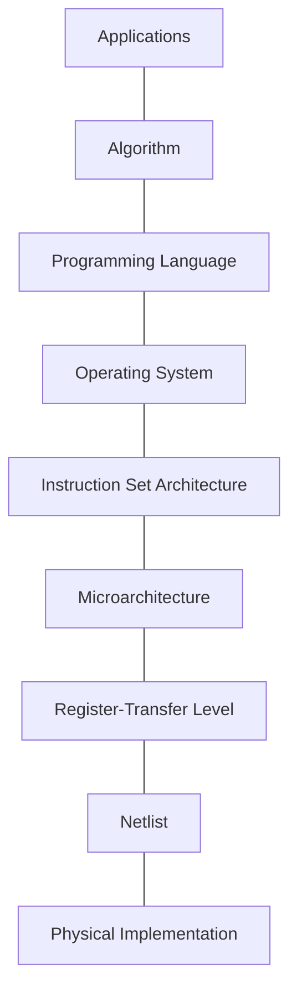

# COE 502 — Lecture 3: Performance

**Parallel Processing Architectures** · KFUPM · Dr. Abdulaziz Tabbakh
*(Based on slides by Dr. Khalid Alhawaj, KFUPM)*

> These notes follow deck `03-Performance.pdf`. Anything marked **[note]** is extra context
> not on the slides.
>
> This is the most *quantitative* deck in the course — nearly every section is a formula you
> will be asked to apply. Work the examples by hand before trusting the summary.

---

## Contents

1. [Evaluating computing systems](#1-evaluating-computing-systems)
2. [The two performance metrics](#2-the-two-performance-metrics)
3. [Processor performance — the Iron Law](#3-processor-performance--the-iron-law)
4. [How do you evaluate a machine that doesn't exist?](#4-how-do-you-evaluate-a-machine-that-doesnt-exist)
5. [Benchmarking](#5-benchmarking)
6. [Performance reporting — which average?](#6-performance-reporting--which-average)
7. [Amdahl's Law](#7-amdahls-law)
8. [Parallel speedup](#8-parallel-speedup)
9. [The four overheads, made concrete](#9-the-four-overheads-made-concrete)
10. [FLOPS](#10-flops)
11. [Energy and power](#11-energy-and-power)
12. [Rpeak, Rmax and the Top500](#12-rpeak-rmax-and-the-top500)
13. [Summary sheet](#13-summary-sheet)
14. [Self-test](#14-self-test)

---

## 1. Evaluating computing systems

> There are important metrics used to evaluate any compute system; and thus, these metrics can be used to **quantify the merits of any idea or proposal**.

**The three main metrics:**

| Metric | Measured as |
|---|---|
| **Performance** | latency or throughput |
| **Power and energy** | watts and joules |
| **Area** | silicon area (mm²) |

### Efficiency metrics

> We can **normalize one metric to the others**, thus creating an **efficiency metric** (i.e. value achieved in a metric per one unit in some other metric).
>
> - Efficiency allows us to **understand trade-offs better**.
> - The two metrics used for efficiency **ought to be related**, where one metric is often spent to increase/decrease another.

Examples: performance per watt (GFLOPS/W — this is literally the Green500 ranking), performance per mm², performance per dollar.

**[note] Why "ought to be related" matters.** Performance per watt is meaningful because you really do burn power to go faster — there's a causal trade behind the ratio. Performance per *employee* is a number you can compute and cannot reason with. When you invent an efficiency metric, check that the denominator is actually *spent* to buy the numerator.

Any single metric alone is meaningless: a chip that is twice as fast but four times the area and eight times the power is not obviously better.

---

## 2. The two performance metrics

> There are **2 basic measures** of Performance.

### Execution time

> **Execution Time (response time, wall-clock time):** time to complete a task (t_exe).
> The wall-clock time elapsed between the start and the end of its execution (**including time spent by the operating system on behalf of the process**).

$$T_{exe} = \text{Instruction Count} \times \text{Clocks per Instruction} \times \text{machine clock time}$$

> **"X is n times faster than Y"** means
> $$\frac{t_{exe}(Y)}{t_{exe}(X)} = n$$

> ⚠️ The **slower** machine's time goes in the **numerator**. This is the single most commonly
> inverted formula in the course, and everything downstream inherits the error.
> Sanity check: a speedup is always > 1 when X really is faster.

### Throughput

> **Throughput:** number of tasks completed in a specific period of time (day, hour, sec, ns, … etc).
>
> The throughput for x is n times higher than y if
> $$\frac{\text{throughput}(x)}{\text{throughput}(y)} = n$$

Note the ratio goes the **other way round** from execution time. More throughput is better; less time is better.

> - **Not the same as latency** (example of multiprocessors)
> - **More important in the era of multicore microprocessors**

**[note] Why multiprocessors are the example.** Add a second processor and throughput doubles — two tasks complete per unit time instead of one. But any individual task takes **exactly as long as before**. Latency unchanged, throughput doubled.

This is the same distinction as pipelining in Lecture 2, one level up. And the shift in which one we optimise for is itself a consequence of 2004: if you're running a web server handling thousands of requests, you care how many you serve per second, not the latency of any single one.

---

## 3. Processor performance — the Iron Law

$$\frac{\text{Time}}{\text{Program}} = \frac{\text{Instructions}}{\text{Program}} \times \frac{\text{ClockCycles}}{\text{Instruction}} \times \frac{\text{Time}}{\text{ClockCycles}}$$

$$= \frac{\text{num\_dyn\_insts}}{\text{prog}} \times \frac{\text{total\_num\_cycles}}{\text{num\_dyn\_insts}} \times \frac{\text{time}}{\text{cycle}} = \text{num\_insts}_{dyn} \times \text{Average CPI} \times \text{time}_{cycle}$$

The middle form shows *why* it's a law and not a model: the units cancel. Instructions cancel against instructions, cycles against cycles, leaving time per program. It is true by construction.

> - **Instructions per program** is mainly determined by the **ISA design**
> - **Clock cycles per instruction** is mainly determined by the **micro-architecture**
> - **Time per clock cycle** is mainly determined by **physical design**

Note **dynamic** instruction count — how many instructions actually execute, not how many are in the source. A 10-instruction loop running a million times has a dynamic count of 10 million.

### Where each term lives in the compute stack

Slide 5 puts this on the stack diagram, with the bottom five layers boxed in red:



| Iron Law term | Owned by | Stack layer |
|---|---|---|
| Dynamic instructions per program | ISA design (+ compiler) | **Instruction Set Architecture** |
| Average cycles per instruction | choice of microarchitecture | **Microarchitecture** |
| Cycle time | physical design | **RTL / Netlist / Physical Implementation** |

**[note] Why this framing is useful.** When someone proposes a change, the Iron Law forces you to ask *which term it touched* and *what it did to the other two*. Deeper pipeline → cycle time ↓ but CPI ↑ (more mispredictions). Richer ISA → instruction count ↓ but CPI ↑ (complex instructions take longer). There is no free lunch, only relocated cost.

---

## 4. How do you evaluate a machine that doesn't exist?

> To measure performance, we can simply measure the wall-clock time taken to execute a specific task (i.e. program) by a given machine.
>
> - **What can we do if the machine is not built yet?**
> - **What can we do if we require some deep understanding of the different determining factors of the performance?**

> To quantify the contribution of the different aspects of processor design to the overall performance of a machine (**either hypothetical or otherwise**), we can use the Iron Law.

Each term can be estimated **separately**:

| Term | Estimated using |
|---|---|
| Number of dynamic instructions per program | **functional-level simulators / emulators** |
| Average cycles per instruction | **cycle-level simulators** |
| Time per cycle | **time-analysis of netlists** |

**[note] What these tools are.**

- A **functional simulator** just *runs* the program and counts what it does. Fast, no timing detail. It answers "how many instructions?" and nothing about speed.
- A **cycle-level simulator** models the microarchitecture cycle by cycle — so it reports stalls, hazards, cache behaviour. Often **1000× slower than real execution**, which is why simulation studies run small benchmark slices.
- A **netlist** is the gate-level description of the circuit; **static timing analysis** finds the slowest path through it, which sets the minimum clock period.

This is the practical reason the Iron Law matters in industry: it decomposes an unmeasurable quantity into three separately estimable ones.

---

## 5. Benchmarking

> **Which programs to consider?**
>
> **Multiple real-world applications representative of the behaviors of programs in an application area** must be selected for a more rigorous comparison (**use-cases**).
>
> The wall-clock time required to execute the benchmark will quantify the performance of the machine.

Benchmark suites by domain:

| Suite | Domain |
|---|---|
| **SPEC** — Standard Performance Evaluation Corporation (last version 2018) | PCs, workstations, microprocessors. Separate **integer** and **floating point** scores |
| **TPC** — Transactional Processing Council | Servers |
| **EEMBC** / **MiBench** | Embedded systems |
| **MediaBench** | Multimedia capabilities |
| **Rodinia** | Heterogeneous / GPU computing |
| **PARSEC** *(written "PASRSEC" on the slide)* | Shared-memory multicore workloads |

The last two matter for this course specifically — they are the suites built to stress parallel systems.

### SPEC release 1

| Benchmark | Type | Application description |
|---|---|---|
| 001.gcc | INT | GNU C compiler |
| 008.espresso | INT | PLA optimizing tool |
| 013.spice2g6 | FP | Circuit simulation and analysis |
| 015.doduc | FP | Monte Carlo simulation |
| 020.nasa7 | FP | Seven floating-point kernels |
| 022.li | INT | LISP interpreter |
| 023.eqntott | INT | Conversions of equations to truth table |
| 030.matrix300 | FP | Matrix solutions |
| 0.42fpppp | FP | Quantum chemistry application |
| 047.tomcatv | FP | Mesh generation application |

> INT = Integer intensive benchmark · FP = Double-precision floating-point benchmark

**[note]** Every one is a **real application doing real work** — a compiler compiling, an interpreter interpreting. That's deliberate. A synthetic benchmark can be gamed by special-casing it in the compiler; a real workload is much harder to fake.

---

## 6. Performance reporting — which average?

You have run a suite. Ten programs, ten execution times. You want **one number**.

### Attempt 1: arithmetic mean of execution times

$$\bar{T} = \frac{1}{N}\sum_{i=1}^{N} T_i$$

> The problem here is that the **programs with longest execution times dominate the result**.

If one benchmark runs 10 s and another 1000 s, the mean is 505 and the short one contributes nothing. Make the 10 s program twice as fast and the mean barely moves; make the 1000 s program 10% faster and it moves far more. Your "score" is really measuring one program.

### Attempt 2: normalise against a reference machine

For a single program:

$$S_i = \frac{T_{ref,i}}{T_i}$$

Each program now contributes a **ratio**, so a program that is slow on both machines no longer dominates. For the whole benchmark, combine the N speedups:

| Mean | Formula |
|---|---|
| **Arithmetic** | $\overline{S_a} = \dfrac{1}{N}\sum_{i=1}^{N} S_i$ |
| **Harmonic** | $\overline{S_h} = \dfrac{N}{\sum_{i=1}^{N} \frac{1}{S_i}}$ |
| **Geometric** | $\overline{S_g} = \sqrt[N]{\prod_{i=1}^{N} S_i}$ |

> The comparison of two machines using **arithmetic or harmonic means yields different conclusions with a different reference machine**, but **not with geometric mean**.
>
> **Geometric mean is used to report SPEC numbers** for integer and floating point.

### The worked example (slide 10)

Execution times:

| | Program A | Program B | Arithmetic mean |
|---|---|---|---|
| **Machine 1** | 10 s | 100 s | 55 s |
| **Machine 2** | 1 s | 200 s | 100.5 s |
| Reference 1 | 100 s | 10000 s | 5050 s |
| Reference 2 | 100 s | 1000 s | 550 s |

By raw arithmetic mean of *times*, Machine 1 (55 s) beats Machine 2 (100.5 s).

Now compute speedups against each reference:

| | | Program A | Program B | Arithmetic | Harmonic | Geometric |
|---|---|---|---|---|---|---|
| **Wrt Reference 1** | Machine 1 | 10 | 100 | 55 | 18.2 | **31.6** |
| | Machine 2 | 100 | 50 | 75 | 66.7 | **70.7** |
| **Wrt Reference 2** | Machine 1 | 10 | 10 | 10 | 10 | **10** |
| | Machine 2 | 100 | 5 | 52.5 | 9.5 | **22.4** |

Check one so the numbers aren't magic: Machine 1 on program B against Reference 1 is 10000 ÷ 100 = 100. Machine 2 on B is 10000 ÷ 200 = 50. ✓

### Now read what happened

**Arithmetic mean** — Machine 2 wins under both references, but by **75/55 = 1.36** under one and **52.5/10 = 5.25** under the other. The margin changed by a factor of four because a *third* machine changed.

**Harmonic mean** — under Reference 1, Machine 2 wins 66.7 to 18.2. Under Reference 2, **Machine 1 wins** 10 to 9.5. ⚠️ **The winner flipped.** Neither machine changed. Neither program changed. A machine not under test was swapped, and the verdict reversed.

**Geometric mean** — 70.7 ÷ 31.6 = **2.24**, and 22.4 ÷ 10 = **2.24**. Identical.

### Why geometric mean is immune

Not luck — algebra. The geometric mean is a product under a root, and each term is $T_{ref,i}/T_i$. Since multiplication separates:

$$\overline{S_g} = \sqrt[N]{\prod_i \frac{T_{ref,i}}{T_i}} = \frac{\sqrt[N]{\prod_i T_{ref,i}}}{\sqrt[N]{\prod_i T_i}}$$

The reference contributes a single **constant factor**. Change the reference and *both* machines' geometric means scale by the same constant, so their **ratio is untouched**.

Arithmetic and harmonic means involve **sums**, and sums don't factor that way. Each program's reference time weights that program differently, so changing the reference reweights the programs and the comparison shifts.

> 📌 **If asked why SPEC uses geometric mean:** *because the reference machine cancels out of the ratio, so rankings stay consistent.* Not "because it's standard."

> **[note] The caveat.** Geometric mean's consistency costs it physical meaning. There is no workload for which the geometric mean *is* the speedup you would experience. Arithmetic mean of times at least corresponds to running each program once. So geometric mean answers "which machine is better in general"; it is the wrong tool for "how long will my job take."

---

## 7. Amdahl's Law

> Much like comparing the performance of benchmarks, we can quantify the speedup of the improved system **normalized to the old execution time of the unimproved system** (i.e. the system without the improvement becomes our baseline machine).

$$\text{speedup} = \frac{\text{exec\_time}_{old}}{\text{exec\_time}_{new}}$$

### Setting it up

> Let **f** = fraction of the computation time that is enhanced
> Let **S** = speedup factor of the enhancement only

Slide 11 draws it as three bars. Start with old execution time **t**:

```
old:        │████████████████ t ████████████████│
            │                                   │

split:      │ (1-f)·t │█████████ f·t ███████████│
            └─────────┴───────────────────────┘
              untouched        to be enhanced

new:        │ (1-f)·t │ f·t/S │
            └─────────┴───────┘
```

The untouched part still costs exactly `(1−f)·t`. The enhanced part now costs `f·t/S`. So:

$$\text{Speedup}_{overall} = \frac{t}{(1-f)t + \frac{f \cdot t}{S}} = \boxed{\frac{1}{(1-f) + \frac{f}{S}}}$$

**Read it in words:** the part you did **not** improve still costs what it always cost; the part you **did** improve costs its original share divided by how much faster you made it. Add them to get the new runtime as a fraction of the old, then flip it over.

### The ceiling

> The maximum possible speedup is limited by **the fraction of the code that cannot be enhanced**.

$$\text{Speedup} < \frac{1}{1-F}$$

Set S → ∞ and the `f/S` term vanishes. If 40% of your program cannot be improved, the maximum possible speedup is 1/0.4 = **2.5**, no matter how much money or engineering goes into the other 60%.

### The four curves on slide 13

With F = 0.5, plotted against acceleration factor S from 1 to 20:

| Curve | Meaning | Behaviour |
|---|---|---|
| **Maximum speedup** | 1/(1−F) = 2 | Flat line at 2 |
| **Amdahl speedup** | 1/((1−F) + F/S) | Rises, asymptotes to 2 |
| **Marginal speedup gain** | What the *next* unit of S buys you | Peaks early, collapses to ~0 |
| **Remaining speedup gain** | How much is still left on the table | Decays toward 0 |

The marginal curve is the one to look at. At S = 2 it is already small; by S = 5 it is nearly flat. **Almost all the benefit arrives in the first few units of acceleration.**

### Implications (slides 14–15)

> **Optimize the common case.**
> - Focus on mechanisms that can speed up the **largest fraction** of the execution time.
> - **Execute the rare case in software** (e.g. Exceptions).

> **The law of diminishing return.**
> - Once a candidate function to accelerate has been identified based on the common case rule, **do not throw unlimited resources** to improve the speedup for that function.
> - **Marginal speedup gain drops rapidly as S increases.**

**[note] "Execute the rare case in software"** is the design principle behind a lot of real hardware. Exceptions are rare, so you don't build fast exception hardware — you trap to a software handler and accept that it's slow. Same reasoning puts rarely-used instructions in microcode rather than dedicated circuits.

### Worked example (slide 16)

> Floating-point square root is responsible for **20%** of the execution time of a graphics benchmark, and **ALL FP instructions are responsible for 60%**.
>
> - **Choice 1:** speed up FP SQRT by a factor of 10
> - **Choice 2:** make ALL FP instructions 2× faster
>
> Which is better?

**Choice 1:** f = 0.2, S = 10

$$S = \frac{1}{0.8 + \frac{0.2}{10}} = \frac{1}{0.82} = \mathbf{1.22}$$

**Choice 2:** f = 0.6, S = 2

$$S = \frac{1}{0.4 + \frac{0.6}{2}} = \frac{1}{0.7} = \mathbf{1.43} \quad \textbf{← Better}$$

**The weaker improvement wins**, because it applies to three times as much of the program.

**[note] Look at the ceilings to see why.** Choice 1 is capped at 1/0.8 = **1.25** — so a *tenfold* improvement already extracted 1.22 of an available 1.25. Going to 100× would buy almost nothing. Choice 2 is capped at 1/0.4 = **2.5**, so at 1.43 there is still plenty of room.

> ⚠️ **Watch the overlap.** The 60% for all FP instructions **includes** the 20% for square root — square root *is* a floating-point instruction. They are not separate portions you can add.

### Reproducing the plots

```python
import numpy as np
import matplotlib.pyplot as plt

S = np.arange(1, 21)
F = 0.5

amdahl   = 1 / ((1 - F) + F / S)
maximum  = np.full_like(S, 1 / (1 - F), dtype=float)
marginal = np.diff(amdahl, prepend=1.0)       # gain from the previous S
remaining = maximum - amdahl                   # how much is left

plt.figure()
plt.plot(S, maximum,   marker='d', label="Maximum speedup")
plt.plot(S, amdahl,    marker='s', label="Amdahl speedup")
plt.plot(S, marginal,  marker='o', label="Marginal speedup gain")
plt.plot(S, remaining, marker='x', label="Remaining speedup gain")
plt.xlabel("Acceleration factor, S"); plt.ylabel("Speedup")
plt.xticks(S); plt.legend(); plt.grid(True); plt.show()
```

---

## 8. Parallel speedup

> Increasing the number of processors in a multiprocessor system or the number of cores in a chip multiprocessor **can be seen as an enhancement to a single core**. The acceleration factor is the **number of processors or cores (P)**.

$$S_P = \frac{T_s}{T_P} = \frac{1}{1 - F + \frac{F}{P}} = \frac{P}{F + P(1-F)} < \frac{1}{1-F}$$

The middle and right forms are the same expression; the right one is handy when solving for P.

> If **P** processors are deployed to solve a problem, the maximum speedup should be **P**. **P is called the ideal speedup.**

You never get it. How brutal the ceiling is:

| Parallel fraction F | Ceiling = 1/(1−F) |
|---|---|
| 50% | 2 |
| 75% | 4 |
| 90% | 10 |
| 95% | **20** |
| 99% | 100 |

At **F = 0.95** — 95% parallel, which is an excellent result — a thousand cores buys you at most **20×**. The last 5% dominates everything.

### The Mortar curve (slide 18)

Slide 18 plots four curves against P from 0 to 50:

| Curve | Shape |
|---|---|
| **Ideal** | Straight line, S = P |
| **Maximum** | Flat at 1/(1−F) = 20 |
| **Amdahl** | Rises, asymptotes to 20 |
| **Mortar** | Rises, **peaks around P ≈ 30, then comes back down** |

Mortar is the one that matters, because it is what real systems do.

> This kind of speedup curve is observed in practice **when the amount of computation per thread decreases when P increases** — overwhelmed by the costs of communication between the threads.
>
> **Adding more cores to the computation may become harmful to performance.**

**[note] The scissors.** Fix the problem size and divide it among P threads: each thread's useful work shrinks as **1/P**. But coordination cost **grows with P** — more threads to talk to, synchronise with, wait for. Eventually the overhead curve crosses the work curve and you pay more to coordinate than you save by dividing.

Deck 04 turns this into calculus: with per-thread startup cost `T_init` paid sequentially,

$$T = P \times T_{init} + \frac{T_{MM}}{P} \qquad\Rightarrow\qquad P_{opt} = \sqrt{\frac{T_{MM}}{T_{init}}}$$

### The four overheads

Listed on slides 18 and 19 — **memorise these**, they are prime short-answer material:

1. **Inter-processor communication**
2. **Load imbalance**
3. **Synchronization**
4. **Processing redundancy** — extra computation

---

## 9. The four overheads, made concrete

Slide 19 is the clearest thing in the deck. A task takes **100 time units** on one processor. Four cases on **four** processors:

| Case | Per-processor times | Speedup |
|---|---|---|
| **Perfect parallelization** | 25, 25, 25, 25 | $S_p = \frac{100}{25} = \mathbf{4.0}$ |
| **Perfect load balancing, parallelization overhead of 10** | 35, 35, 35, 35 | $S_p = \frac{100}{35} = \mathbf{2.85}$ |
| **Load imbalance** | 30, 20, 40, 10 | $S_p = \frac{100}{40} = \mathbf{2.5}$ |
| **Load imbalance + parallelization overhead** | 50, 50, 50, 50 | $S_p = \frac{100}{50} = \mathbf{2.0}$ |

Stare at the **third** case. The work still totals 100 (30+20+40+10). **No overhead was added at all.** But you finish when the *last* processor finishes, so the 40 sets your time. Processors 2, 3 and 4 sit idle for 20, 0 and 30 units. Pure waste from uneven division.

> 📌 **You are always paid at the rate of your slowest processor.**

That is why load balancing gets so much attention in practice: unlike communication cost, it can often be fixed **for free** by dividing the work better.

And case 2 shows the other half: work split perfectly, and you still lost 29% to overhead alone.

---

## 10. FLOPS

> Standard rate for indicating the number of floating-point arithmetic calculations the system can perform on a **per-second** basis.

$$\text{FLOPS} = \frac{\text{Number of Floating Point Operations}}{\text{Execution Time in Sec}}$$

| Prefix | Operations per second |
|---|---|
| **GFLOPS** | 10⁹ |
| **TFLOPS** | 10¹² |
| **PFLOPS** | 10¹⁵ |
| **ExaFLOPS** | 10¹⁸ |

> - Computer vendors and service providers report the **theoretical peak performance (Rpeak)** of their systems expressed in FLOPS.
> - The **exaFLOPS barrier was first broken in March 2020 by the distributed Folding@home project.**
> - In June 2020 the Japanese supercomputer **Fugaku** achieved **1.42 exaFLOPS** in the HPL-AI benchmark (it reached **2 ExFLOPS in 2021**).

**[note]** Folding@home was not a supercomputer at all — it was hundreds of thousands of volunteers' home machines. Which tells you the metric measures **aggregate arithmetic throughput**, not architectural quality. A machine with terrible latency and no interconnect can still post a huge FLOPS number on an embarrassingly parallel workload.

### Computing peak performance (slide 25)

$$\text{Peak} = \text{cores} \times \text{FP ops per cycle} \times \text{clock rate}$$

**AMD Opteron 6100** — 12 cores, 1.9 GHz, 4 floating-point operations per cycle:

$$12 \times 4 \times 1.9 \times 10^9 = \mathbf{91.2 \text{ GFLOPS}}$$

**Cray XE6m** — 2 CPUs per node, 56 nodes:

$$91.2 \times 2 \times 56 = 10214 \text{ GFLOPS} = \mathbf{10.2 \text{ TFLOPS}}$$

> measured **Rmax (Linpack) = 7.9 TFLOPS**

So the real machine delivers **77%** of theory — and that is a *good* result, because Linpack is deliberately chosen to map well onto hardware. Your own code will do considerably worse.

**[note]** The "4 floating point operations per cycle" figure is the core's **SIMD width** in action: one instruction operating on four values at once. Data-level parallelism from Lecture 1, showing up directly in the arithmetic.

**Build it up one level at a time** — that is how exam questions on this are laid out:

```
single core   = FP ops/cycle × clock
single CPU    = single core × cores per CPU
single node   = single CPU  × CPUs per node
whole system  = single node × nodes
```

---

## 11. Energy and power

> Power is important, but it **does not tell the full story**. Power is measured with the **Watt**, which is **Joules per second**. Energy is measured in **Joules**. This means power is the **average energy spent per second**.

$$\text{Energy} = \text{Power} \times \text{Time}$$

> **Energy is more telling of the work required to perform a given task.** The amount of energy required to perform a task **does not change regardless of the time required** for the task (which is performance).

### The example

| | Power | Time | Energy |
|---|---|---|---|
| **System 1** | 1 W | 10 minutes = 600 s | 1 × 600 = **600 J** |
| **System 2** | 10 W | 1 minute = 60 s | 10 × 60 = **600 J** |

> Based on power alone, system 1 seems to use less work to achieve the same outcome; however, **in reality both systems spend the same energy**.

**[note] Why this matters for architecture.** It means **finishing faster is often free, energy-wise**. If doubling the cores halves the runtime, you spend the same energy and get the answer sooner — the "race to idle" principle: run flat out, finish, power down.

It is also the deeper reason multicore beat higher clocks. Four cores at 4× power for ¼ the time costs the **same** energy as one core. One core at 64× power for ¼ the time costs **sixteen times** as much. The cube law doesn't just make the chip hot — it makes the work genuinely more expensive.

---

## 12. Rpeak, Rmax and the Top500

| Term | Meaning |
|---|---|
| **R_max** | The performance in GFLOPS for the **largest problem run** on a machine — i.e. **measured** |
| **R_peak** | The **theoretical** peak performance in GFLOPS for the machine — i.e. **computed from the spec sheet** |

> **HPL** (High-Performance Computing Linpack Benchmark) is used to measure the performance of the TOP500 list.

Rmax is always lower than Rpeak. The gap tells you how much of the theoretical capability real work can reach — and the four overheads from section 8 are exactly what eats the difference, at machine scale.

From the Top500 table on slide 23:

| Rank | System | Cores | Rmax (PFlop/s) | Rpeak (PFlop/s) | Power (kW) | Rmax/Rpeak |
|---|---|---|---|---|---|---|
| 1 | El Capitan | 11,039,616 | 1,742.00 | 2,746.38 | 29,581 | 63% |
| 2 | Frontier | 9,066,176 | 1,353.00 | 2,055.72 | 24,607 | 66% |
| 3 | Aurora | 9,264,128 | 1,012.00 | 1,980.01 | 38,698 | 51% |
| 4 | JUPITER Booster | 4,801,344 | 793.40 | 930.00 | 13,088 | 85% |
| 5 | Eagle | 2,073,600 | 561.20 | 846.84 | — | 66% |

Note **El Capitan draws 29.6 MW** — roughly a small town. At that scale electricity dominates operating cost and cooling becomes civil engineering.

### Green500 (slide 24)

The Top500 reranked by **GFLOPS per watt** — the efficiency metric from section 1, in its most important instance.

| Rank | Top500 rank | System | Rmax (PFlop/s) | Power (kW) | **GFLOPS/watt** |
|---|---|---|---|---|---|
| 1 | 259 | JEDI | 4.50 | 67 | **72.733** |
| 2 | 148 | ROMEO-2025 | 9.86 | 160 | 70.912 |
| 3 | 484 | Adastra 2 | 2.53 | 37 | 69.098 |
| 4 | 183 | Isambard-AI phase 1 | 7.42 | 117 | 68.835 |
| 5 | 255 | Otus (GPU only) | 4.66 | — | 68.177 |

The rankings differ sharply from raw performance: **JEDI is #1 on Green500 and only #259 on the Top500.** Past a point, the binding constraint on a supercomputer is not how fast you can make it, but how much power you can deliver to the building and how much heat you can remove.

---

## 13. Summary sheet

### Formulas

$$T_{exe} = \text{IC} \times \text{CPI} \times t_{cycle} \qquad\qquad \text{"X is n× faster than Y"} \Rightarrow \frac{t_{exe}(Y)}{t_{exe}(X)} = n$$

$$\overline{S_a} = \frac{1}{N}\sum S_i \qquad \overline{S_h} = \frac{N}{\sum \frac{1}{S_i}} \qquad \overline{S_g} = \sqrt[N]{\prod S_i}$$

$$\text{Speedup} = \frac{1}{(1-f) + \frac{f}{S}} \qquad\qquad \text{Speedup}_{max} = \frac{1}{1-f}$$

$$S_P = \frac{1}{(1-F) + \frac{F}{P}} = \frac{P}{F + P(1-F)} < \frac{1}{1-F}$$

$$\text{FLOPS} = \frac{\text{FP operations}}{\text{seconds}} \qquad \text{Peak} = \text{cores} \times \frac{\text{FP ops}}{\text{cycle}} \times \text{clock}$$

$$\text{Energy} = \text{Power} \times \text{Time}$$

### Things worth memorising

| | |
|---|---|
| Three evaluation metrics | **Performance · Power and energy · Area** |
| Two performance metrics | **Execution time · Throughput** (not the same — multiprocessor example) |
| Iron Law ownership | instructions ← **ISA**; CPI ← **microarchitecture**; cycle time ← **physical design** |
| Which mean for SPEC, and why | **Geometric** — the reference machine cancels out of the ratio |
| Amdahl's lesson | **Optimise the common case**; marginal gain collapses as S rises |
| FP SQRT example | 1.22 vs **1.43** — the weaker improvement on the bigger fraction wins |
| Four parallel overheads | **communication · load imbalance · synchronization · redundancy** |
| Load-imbalance lesson | **You are paid at the rate of your slowest processor** |
| Rpeak vs Rmax | theoretical vs measured (HPL/Linpack); Rmax always lower |
| Energy vs power | 1 W × 10 min = 10 W × 1 min = **600 J** |

### Exam hygiene

- **Convert clock rate to cycle time first and write it down.** Most lost marks here are unit slips, not concept failures. Better still: divide **total cycles by clock rate** and skip the nanosecond conversion entirely — 3×10⁹ cycles ÷ 3×10⁹ Hz = 1 s exactly, no rounding.
- **Write down f and S explicitly** before substituting into Amdahl. Confusing which is which is the other common failure.
- **A speedup is always > 1.** If your answer comes out below 1, you inverted a ratio.
- If a question asks *why*, name the **mechanism**, not the outcome.

---

## 14. Self-test

<details>
<summary><b>1.</b> Machine A runs a program in 8 s; machine B runs it in 20 s. How many times faster is A than B?</summary>

$$\frac{t_{exe}(B)}{t_{exe}(A)} = \frac{20}{8} = \mathbf{2.5\times}$$

The slower machine's time goes on top.
</details>

<details>
<summary><b>2.</b> Why are execution time and throughput not the same thing? Give the deck's example.</summary>

**Multiprocessors.** Adding a second processor doubles throughput — two tasks complete per unit time instead of one — but any individual task takes exactly as long as before. Latency unchanged, throughput doubled.

Throughput is **more important in the era of multicore microprocessors**.
</details>

<details>
<summary><b>3.</b> Which Iron Law term does each of the ISA, the microarchitecture, and the physical design own?</summary>

- **Instructions per program** → ISA design (and the compiler)
- **Clock cycles per instruction** → microarchitecture
- **Time per clock cycle** → physical design
</details>

<details>
<summary><b>4.</b> How do you estimate each Iron Law term for a machine that hasn't been built?</summary>

- Dynamic instructions per program → **functional-level simulators / emulators**
- Average CPI → **cycle-level simulators**
- Time per cycle → **time-analysis of netlists**
</details>

<details>
<summary><b>5.</b> Why does SPEC report geometric means rather than arithmetic?</summary>

Because the **reference machine cancels out of the ratio**. Geometric mean is a product under a root, so it factors into a reference part and a machine part — change the reference and both machines scale by the same constant, leaving their ratio unchanged.

Arithmetic and harmonic means involve **sums**, which don't factor. Changing the reference reweights the programs, and in the deck's example the **harmonic-mean winner actually flips** between Reference 1 and Reference 2.
</details>

<details>
<summary><b>6.</b> A program spends 30% of its time in a routine. You make that routine 6× faster. Overall speedup? And the ceiling?</summary>

$$S = \frac{1}{0.7 + \frac{0.3}{6}} = \frac{1}{0.75} = \mathbf{1.33}$$

Ceiling: 1/(1 − 0.3) = 1/0.7 = **1.43**. A 6× improvement already captured most of what was available.
</details>

<details>
<summary><b>7.</b> Four processors take 30, 20, 40 and 10 time units on a task that took 100 serially. What is the speedup, and why isn't it 4?</summary>

$$S_p = \frac{100}{40} = \mathbf{2.5}$$

The work still totals 100 and **no overhead was added** — but you finish when the *last* processor finishes, so the 40 sets your time. Three processors idle. Pure **load imbalance**.
</details>

<details>
<summary><b>8.</b> Name the four overheads that keep parallel speedup below P.</summary>

1. Inter-processor communication
2. Load imbalance
3. Synchronization
4. Processing redundancy (extra computation)
</details>

<details>
<summary><b>9.</b> A system has 8 cores per CPU at 2.5 GHz, 4 FP ops per cycle, 2 CPUs per node, 100 nodes. Peak FLOPS?</summary>

- Single core: 4 × 2.5×10⁹ = **10 GFLOPS**
- Single CPU: 10 × 8 = **80 GFLOPS**
- Single node: 80 × 2 = **160 GFLOPS**
- Whole system: 160 × 100 = 16,000 GFLOPS = **16 TFLOPS**

This is **Rpeak** (theoretical). Measured Rmax on HPL would be meaningfully lower.
</details>

<details>
<summary><b>10.</b> System A uses 2 W for 5 minutes; system B uses 20 W for 30 seconds. Which does more work? Which uses less energy?</summary>

- A: 2 W × 300 s = **600 J**
- B: 20 W × 30 s = **600 J**

**Identical energy.** They do the same work; B just does it ten times faster at ten times the rate. Power alone would have misled you — energy is the honest measure.
</details>

<details>
<summary><b>11.</b> Define Rpeak and Rmax, and say which benchmark produces Rmax.</summary>

**Rpeak** = theoretical peak performance in GFLOPS, computed from the specification.
**Rmax** = the performance achieved on the **largest problem run** on the machine — measured.

Rmax is measured with **HPL** (High-Performance Linpack), which is what ranks the TOP500.
</details>

<details>
<summary><b>12.</b> What does the "Mortar" curve do that the Amdahl curve doesn't, and why?</summary>

The Amdahl curve **rises and flattens** toward 1/(1−F). The Mortar curve **rises, peaks, and comes back down** — past some P, adding cores makes the program *slower*.

Why: the computation per thread shrinks as 1/P while coordination cost **grows** with P. Eventually the overhead exceeds the work saved.
</details>

---

*Previous: [Lecture 2 — Computer Architecture Refresher](./02-architecture-refresher.md)*
*Next: [Lecture 4 — Parallel Programming Models](./04-parallel-programming-models.md)*
