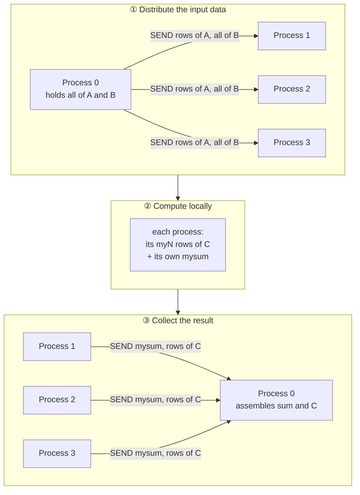

# COE 502 — Lecture 4: Parallel Programming Models

**Parallel Processing Architectures** · KFUPM · Dr. Abdulaziz Tabbakh

> These notes follow deck `04 - Parallel Programing Models.pdf`. Anything marked **[note]** is
> extra context not on the slides.
>
> This deck is **the map of the course**. Topics 5–9 each take one branch of it and spend weeks
> there. If a term seems to arrive without explanation, that's usually because it is a whole
> topic later on.

---

## Contents

1. [Why parallel computing is difficult](#1-why-parallel-computing-is-difficult)
2. [The four core concepts](#2-the-four-core-concepts)
3. [Programming model abstractions](#3-programming-model-abstractions)
4. [The programmer's two jobs](#4-the-programmers-two-jobs)
5. [Data-level parallelism](#5-data-level-parallelism)
6. [Function-level parallelism](#6-function-level-parallelism)
7. [How threads exchange information](#7-how-threads-exchange-information)
8. [The example: matrix multiplication](#8-the-example-matrix-multiplication)
9. [Shared-memory version](#9-shared-memory-version)
10. [Message-passing version](#10-message-passing-version)
11. [Parallelism overhead](#11-parallelism-overhead)
12. [Summary sheet](#12-summary-sheet)
13. [Self-test](#13-self-test)

---

## 1. Why parallel computing is difficult

The deck opens by naming the difficulty directly. Five reasons:

> - Underlying **machine model is more complex than (and different from)** the familiar "von Neumann" model.
> - There are **different machine models** (as we'll see), with their own challenges and opportunities.
> - **Most systems are a mix of more than one model.**
> - **Existing tools not advanced (smart) enough** to shield programmer from these difficulties.
> - More often than not, parallel programming is about **high performance** — and getting high performance requires **detailed knowledge of underlying hardware**.

Unpacking each:

**The von Neumann model** is the mental picture every programmer carries without noticing: one processor, one memory, instructions in order, one thing happening at a time (Lecture 2 §2). Every language you have learned assumes it. Parallel machines violate it, so your intuitions stop applying — *silently*, which is the dangerous part.

**Different models, not one replacement.** Shared memory and message passing need genuinely different code.

**Most systems are a mix.** A real cluster is shared memory *inside* a node and message passing *between* nodes. You end up writing both styles in the same program — which is exactly why topic 8 (OpenMP) and topic 5 (MPI) are both on the syllabus.

**Tools aren't smart enough** — this is the honest admission. Compilers automated away assembly, register allocation, instruction scheduling. They have **not** automated parallelism. You still do it by hand.

**High performance requires hardware knowledge** — the sting in the tail. The only reason to parallelise is speed, and speed requires knowing cache sizes, communication costs, topology. **The abstraction leaks by design.**

---

## 2. The four core concepts

> **Two aspects of every parallel computing system:**
>
> **Control**
> - **Work distribution:** How is parallelism created and expressed?
> - **Synchronization:** How are the dependencies between parallel computations enforced?
>
> **Data**
> - **Naming:** How is common data referenced by parallel computations?
> - **Communication:** How is data passed between parallel computations?

These four questions organise the entire field. Memorise the frame — "what are the two aspects related to control?" is an obvious exam question, and the answer is **work distribution and synchronization**.

### Model vs hardware

> - **Parallel programming model** answers these questions **at an abstract level, as seen by the programmer**.
> - **Parallel hardware design** answers these questions **as implemented by the hardware**.
> - **Programming model and hardware design can be different**
>   - i.e. what programmer sees may be far from the hardware implementation.
>   - **However, to achieve high performance, they should match each other.**

**[note] What a mismatch looks like.** You can program a message-passing cluster *as though* it had shared memory, using software (distributed shared memory) that quietly turns loads and stores into network messages. It works. It works **slowly**, because every innocent-looking variable access becomes a network round trip you did not know you were paying for.

That mismatch is the most common cause of parallel code that is **correct and useless**.

---

## 3. Programming model abstractions

> **Defines how parallel computations can be expressed in a high-level programming language.**
>
> - **Simple extensions through an API** (application-programming interface) of common programming languages such as **C/C++ or Fortran**
> - **Shared-memory:** OpenMP or pthreads
> - **Message-passing:** MPI (message-passing interface)
> - **Parallelizing compilers** translate a sequential program into parallel threads
> - Threads or processes must **communicate and coordinate their activity** (synchronization)

Note what this is *not*: new languages. Libraries and pragmas bolted onto languages you already know.

**[note] On parallelizing compilers.** He lists them as an option; in practice they handle only simple, regular loops and nobody relies on them for real performance. This is the "tools aren't smart enough" bullet from slide 2, concretely.

| | Shared memory | Message passing |
|---|---|---|
| **API** | OpenMP, pthreads | MPI |
| **Unit of work** | **threads** | **processes** |
| **Address space** | shared | private per process |

---

## 4. The programmer's two jobs

> Programmers/compilers must be able to exploit parallelism. This task consists of two parts: **work partitioning** and **coordination**.

> **Partitioning:** Work that can be parallelized must be partitioned to **threads (shared memory)** / **processes (message-passing)**.

> **Coordination:** Work done by threads must be coordinated **as if the work was done by a single processor**.
>
> Coordination involves two actions:
> - **Synchronize** parallel threads with each other
> - **Communicate** partial results between threads

> 📌 **"As if the work was done by a single processor"** is the entire correctness requirement of
> parallel programming. The parallel version must produce exactly what the serial version would
> have. *"The answer varies depending on thread scheduling"* is never acceptable.

> ⚠️ **The vocabulary is not casual.** **Threads** for shared memory, **processes** for message
> passing. Threads share one address space; processes each have their own. The word he uses tells
> you which model he's in.

---

## 5. Data-level parallelism

> Means that **computations of different data elements in a data structure (e.g. array) are independent of each other.**
>
> - Partition the data set.
> - Apply the same processing functions to each partition.
> - **SPMD** (single program multiple data) **(Not SIMD).**
> - Massive parallelism.
> - Expressed in **loops with no loop-carried dependency**.
> - One of the main targets for parallelization.
> - Has the attractive property that **as the problem size is scaled up, more parallelism can often be found**.

### SPMD is not SIMD

That bracketed "(Not SIMD)" is doing real work, because the acronyms look identical and mean different things.

| | **SIMD** | **SPMD** |
|---|---|---|
| What kind of thing | A **hardware** arrangement | A **programming** arrangement |
| Granularity of sameness | Same **instruction**, same cycle, lockstep | Same **program text**, executed independently |
| Can workers diverge? | **No** — one instruction unit drives all data paths | **Yes** — own program counter, own branches |
| Example | Vector unit, GPU warp | The matrix-multiply code in §9 |

**Almost all real parallel code is SPMD**, running on MIMD hardware. Every thread runs identical source and diverges because one variable — its thread ID — differs.

### Loop-carried dependency

A **loop-carried dependency** is where one iteration needs a result produced by an earlier iteration.

```c
// NO loop-carried dependency → parallelises
for (i = 0; i < N; i++)
    a[i] = b[i] * 2;          // every iteration self-contained

// HAS a loop-carried dependency → does not
for (i = 1; i < N; i++)
    a[i] = a[i-1] + 1;        // iteration i needs iteration i-1

// HAS one, subtly — this is a REDUCTION
for (i = 0; i < N; i++)
    sum += a[i];              // every iteration reads/writes the same variable
```

**The practical test:** look at a loop, ask whether any iteration **reads something another iteration writes**. If not, it parallelises.

### Why the scaling property matters

> *…as the problem size is scaled up, more parallelism can often be found*

Double the array, double the available parallelism. **This is what makes DLP worth building machines around** — the parallelism grows with the problem, so a bigger machine stays useful. Buy more cores, solve bigger problems, keep them all busy.

Contrast with function-level parallelism, next, which has exactly the opposite property.

---

## 6. Function-level parallelism

> **Independent functions are executed on different processors.**
>
> - Usually used in **streaming applications**
> - Functions can then form a **function pipeline** in which the data stream is processed
> - **More complex, limited parallelism**
>
> **Combine both: function + data parallelism**

Video processing is the standard case: decode → colour-correct → scale → encode. Four processors, one stage each, frames flowing through.

```
         ┌────────┐   ┌────────────┐   ┌───────┐   ┌────────┐
frames → │ decode │ → │ colour fix │ → │ scale │ → │ encode │ → out
         └────────┘   └────────────┘   └───────┘   └────────┘
            P0             P1             P2          P3
```

**[note]** This is the instruction pipeline from Lecture 2 at application scale, and it inherits both of that pipeline's properties:

- **Throughput goes up, latency does not.** Any individual frame still passes through all four stages.
- **The slowest stage sets throughput for everyone.** Balance matters.

**Why "limited parallelism":** the parallelism available equals the **number of distinct functions** — maybe four, maybe ten. And it **does not grow when the problem grows**: double the video length and you still have four stages. That is the exact opposite of DLP's attractive property, which is why DLP gets the attention.

Real systems **combine both**: run four pipeline stages, and parallelise each stage's work across several processors.

---

## 7. How threads exchange information

> Threads/processes need to exchange information.

### Through memory (shared-memory systems)

> - Processors **share some memory**.
> - **Communication is implicit** through loads and stores.
> - Need to **synchronize and coordinate (ordering)**.
> - **Need to know how the hardware interleaves accesses from different processors.**

The diagram: **T1** does a `STORE` into shared memory; **T2** does a `LOAD` from it. Neither thread names the other. T1 writes a variable, T2 reads a variable, and the data passes through memory.

> 🔮 **That last bullet is a seed.** Whether T2 actually sees T1's new value — and *when* — depends
> on how the hardware orders and interleaves memory operations. That is the **memory consistency
> model**, topic 7 and a stated course outcome. The deck plants it here so it doesn't arrive from
> nowhere later.

### By explicit messaging (message-passing systems)

> - Via **send/receive**
> - Need to know the **destination and what to send**
> - **Explicit message-passing statements in the code**
> - Called "message passing"

The contrast is sharp: in shared memory, **T1 doesn't know T2 exists**. In message passing, **T1 must name T2**.

### The red box

In red, boxed, at the bottom of slide 8:

> ## ⛔ NO ASSUMPTIONS ON THE RELATIVE SPEED OF PROCESSORS

You may not assume thread 1 runs faster than thread 2. Or that they progress at comparable rates. Or that a loop of 1000 iterations takes longer than one of 10. Threads get descheduled by the OS, stall on cache misses, contend for memory, get interrupted.

**So any correctness argument shaped like *"by the time T2 reaches this point, T1 will have finished"* is invalid.** Not risky — invalid. It may work on your laptop, every run, for a year, and then fail in production under different load.

**Correctness must come from explicit synchronization. Never from timing.**

**[note]** This is the deepest rule in parallel programming, and the one most often broken by people who believe their code works because they tested it. **Testing cannot prove the absence of a race**; it can only fail to find one.

---

## 8. The example: matrix multiplication

One problem, written three ways. This is the heart of the deck — the same data-level split, with the coordination mechanism varied, so you can see exactly what changes.

> Multiply matrices `a[n,n]` by `b[n,n]` and store result in `c[n,n]`. **Add all elements of c.**

```c
1.  sum = 0;
2.  for (i=0; i<N; i++)
3.    for (j=0; j<N; j++){
4.      C[i,j] = 0;
5.      for (k=0; k<N; k++)
6.        C[i,j] = C[i,j] + A[i,k]*B[k,j];      // ← boxed on the slide
7.      sum += C[i,j];                           // ← boxed on the slide
8.    }
```

**The arithmetic:** each element `C[i,j]` is the **dot product** of row *i* of A with column *j* of B — walk along the row and down the column together, multiply each pair, accumulate. That's the innermost k-loop. Three nested loops over N, so **N³ multiply-adds**.

### Why two lines are boxed

He has drawn red boxes around lines 6 and 7, and they behave in **opposite** ways:

| Line | What it does | Dependency? |
|---|---|---|
| **6** | Computes `C[i,j]` from A and B only — never reads another element of C | ❌ None. All **N² elements of C are mutually independent** → pure DLP |
| **7** | Accumulates into `sum` — every iteration reads and writes the *same* variable | ✅ **Loop-carried.** Iteration 2 needs iteration 1's result |

> 📌 **That split is the shape of almost every real parallel problem:** a large body of independent
> work, plus one small accumulation that resists. It is Amdahl's Law in miniature — the N³ work
> divides freely, the summation is the stubborn part.

### The fix: a reduction

Both parallel versions use the same trick: **each worker keeps its own private running total (`mysum`), and the private totals are combined once at the end.**

N² serial additions become N² parallel additions plus a handful of serial ones. The pattern is called a **reduction**, and you will meet it constantly (it's a first-class construct in OpenMP and MPI).

---

## 9. Shared-memory version

```c
/* A, B, C, BAR, LV and sum are shared
/* All other variables are private
1a  low   = pid*N/nproc;      /* pid = 0...nproc-1
1b  hi    = low + N/nproc;    /* identifies rows of A
1c  mysum = 0; sum = 0;
2   for (i=low; i<hi; i++)
3     for (j=0; j<N; j++){
4       C[i,j] = 0;
5       for (k=0; k<N; k++)
6         C[i,j] = C[i,j] + A[i,k]*B[k,j];
7       mysum += C[i,j];
8     }
9   BARRIER(BAR);
10  LOCK(LV);
11    sum += mysum;
12  UNLOCK(LV);
```

> 🎯 **Put it beside the sequential version: lines 3–8 are completely unchanged.** That is the headline.

### Lines 1a–1b: partitioning

Each thread has a `pid` from 0 to nproc−1 and computes which rows of C it owns. With N = 100 and nproc = 4:

```
matrix C                low  hi
┌──────────────────┐
│     pid = 0      │     0   25
├──────────────────┤
│     pid = 1      │    25   50
├──────────────────┤
│     pid = 2      │    50   75
├──────────────────┤
│     pid = 3      │    75  100
└──────────────────┘
```

**Every thread runs this same code.** There is no master handing out assignments — each computes its own range from its own `pid`, and they come out disjoint automatically. **That is SPMD.**

### Lines 3–8: nothing changes

> - Arrays **A, B,** and **C,** along with the scalar variables **BAR, LV**, and **sum**, are **globally shared variables**.
> - The matrices can be accessed by all threads.
>   - **No modifications are needed to the loop nest** that calculates the matrix product.
>   - Arrays A, B and C can be accessed using **regular loads and stores**.

This is shared memory's whole appeal. Thread 2 needs row 50 of A and *every* column of B — and it just **reads them**. Nothing was distributed, requested, or sent.

Everything else — `i`, `j`, `k`, `low`, `hi`, `mysum` — is **private**, one copy per thread.

### Lines 9–12: coordination

> **Coordination is still required.**
> - Each thread calculates its partial sum and must add it to the global sum.
> - There is a risk that **multiple threads could update the global sum at the same time**, hence some partial sums could be **overwritten** by others.
> - The partial sums must be added to the global sum **in a serial fashion using critical section**.
> - **The critical section ensures that at most one thread can execute the code inside of the section at a time.**
>
> **Coordination is needed to determine when it is safe** to add partial sums to the global sum (threads asynchronous).
> - A method is needed to guarantee that **no thread can enter the critical section until all threads are done with their matrix multiplication part**.
> - A **barrier synchronization** forces every thread to **stall until all threads have reached the barrier**.

#### The lock — mutual exclusion

`sum += mysum` **looks** like one operation but is really three:

```
  read  sum        →  register
  add   mysum      →  register
  write register   →  sum
```

Interleave two threads' three steps and an update vanishes:

| | Thread 1 | Thread 2 | `sum` |
|---|---|---|---|
| | reads 100 | | 100 |
| | | reads 100 | 100 |
| | writes 150 | | 150 |
| | | writes 180 | **180** ⚠️ |

Thread 1's contribution is gone. The lock forces the three steps to complete uninterrupted.

#### The barrier — ordering

Without it, thread 0 might finish its rows early and add its `mysum` while thread 3 is **still multiplying** — so `sum` would be read as final before it was.

> ⚠️ **They are not interchangeable.** The **lock** answers *who may go in* — one at a time. The
> **barrier** answers *when anyone may go in* — not until everyone has finished. You need both.
> A lock alone gives you a correct-looking program with a wrong answer.

And notice this is the **red box from slide 8 in action**. You cannot argue "thread 3 will still be busy by then." The barrier is what *makes* it true.

### Where the danger actually is

| Lines | Share of the work | Protection needed |
|---|---|---|
| 2–8 | ~99.9% (N³ operations) | **None** — threads touch disjoint rows |
| 11 | one addition | **Lock + barrier** |

> 📌 **Shared data is not dangerous. Shared data that someone *writes* is.**

### Granularity

> The amount of work that is carried out by a thread in parallel with other threads is called **parallelism granularity**.
>
> **For a fixed problem size, the granularity decreases with the number of processors.**

| N = 1000 | Threads | Rows per thread | Coordination cost |
|---|---|---|---|
| | 4 | 250 | negligible against the work |
| | 100 | 10 | noticeable |
| | 1000 | 1 | **rivals the work itself** |

That is the mechanism behind the **Mortar curve** from Lecture 3 §8 — the one that rose, peaked, and came back down. Granularity shrinking until overhead dominates. Section 11 turns it into arithmetic.

---

## 10. Message-passing version

Same problem. Look at how much more there is.

The **computation** is nearly identical:

```c
1k mysum = 0;
2  for (i=0; i<myN; i++)
3    for (j=0; j<N; j++){
4      C[i,j] = 0;
5      for (k=0; k<N; k++)
6        C[i,j] = C[i,j] + A[i,k]*B[k,j];
7      mysum += C[i,j];
8    }
```

Everything else on the slide is new, wrapped around that core in two red boxes labelled **"Distribute the input data"** and **"Collect the result"**.

> 🎯 **That layout is the whole story of message passing in one picture.** The computation didn't
> change. The data movement had to be written by hand.



### Distributing the input

```c
1a myN = N/nproc;
1b if (pid == 0){
1c   for (i=1; i<nproc; i++){
1d     k = i*N/nproc;
1g     SEND(&A[k][0], myN*N*sizeof(float), i, IN1);
1h     SEND(&B[0][0], N*N*sizeof(float), i, IN2);
1i   } else {
1j   RECV(&A[0][0], myN*N*sizeof(float), 0, IN1);
1k   RECV(&B[0][0], N*N*sizeof(float), 0, IN2);
1l }
```

> *(The deck's line labels skip 1e–1f, and the `} else {` placement on line 1i is loose — read it
> as `if (pid==0) { …loop of SENDs… } else { …RECVs… }`.)*

**The signature:** `SEND(address, size in bytes, destination pid, tag)` and `RECV(address, size in bytes, source pid, tag)`. The **tag** (IN1, IN2, SUM, RES) labels the message kind, so a receiver waiting for matrix A doesn't accidentally consume matrix B.

**Process 0 holds the data.** Nobody else has any. So it loops over every other process and ships each its share, while every other process sits in a `RECV` waiting.

Still **SPMD** — same program text — but the `if/else` on `pid` makes the two branches do opposite things.

#### The asymmetry: A is split, B is not

Process *i* receives `myN` rows of A — just its slice. But it receives **all of B**, the entire N×N matrix.

That is forced by the mathematics: to compute any element in your rows of C, you need one row of A and **every column of B**. So B cannot be partitioned; every process needs a complete copy.

| | Data received per process |
|---|---|
| A | N²/P elements |
| B | **N² elements** — the whole thing |

**[note]** With many processes you ship the whole of B, **P times over**. That is a cost the shared-memory version pays precisely **nothing** for — there, B just sits in memory and everyone reads it. This single asymmetry is often what decides which model wins for a given problem.

#### The index shift

This is the subtle line. Process 0 sends from `&A[k][0]` — **global** row *k*. The receiver stores it at `&A[0][0]` — **its own row zero**.

```
global view (process 0)          local view (process 2)
┌──────────────────┐
│ rows   0 –  24   │  → p1       ┌──────────────────┐
│ rows  25 –  49   │  → p2  ⟹   │ rows 0 – 24      │   same data,
│ rows  50 –  74   │  → p3       └──────────────────┘   renumbered
│ rows  75 –  99   │  → p0
└──────────────────┘
```

That is why the compute loop reads `for (i=0; i<myN; i++)` rather than `low` to `hi`. In shared memory the thread walks **its range of the one global array**; here each process walks **its own array from the start**, because it doesn't have the rest and has no way to refer to it.

> ⚠️ Translating between global and local indices by hand is a **permanent feature** of
> message-passing code, and a permanent source of bugs.

### Collecting the result

```c
9  if (pid == 0){
10   sum = mysum;
11   for (i=1; i<nproc; i++){
12     RECV(&mysum, sizeof(float), i, SUM);
13     sum += mysum;
14   }
15   for (i=1; i<nproc; i++){
       k = i*N/nproc;
16     RECV(&C[k][0], myN*N*sizeof(float), i, RES);
20   }
21 } else {
22   SEND(&mysum, sizeof(float), 0, SUM);
23   SEND(&C[0][0], myN*N*sizeof(float), 0, RES);
24 }
```

Two things come back: the **partial sums** (tag `SUM`) and the **computed slices of C** (tag `RES`). And the index shift runs in reverse — each process sends from its local `&C[0][0]`, and process 0 files it at global `&C[k][0]`.

### What's missing, and why

> ### ⛔ No LOCK. No UNLOCK. No BARRIER.

| Mechanism | Why it isn't needed |
|---|---|
| **Lock** | `sum` lives in **process 0's private memory** and only process 0 ever touches it. No shared variable → nothing to race for. The partial sums arrive **one at a time** through a serial loop, which is exactly the serialisation the lock was manufacturing |
| **Barrier** | A `RECV` **cannot complete until the data arrives**. Process 0 physically cannot finish its collection loop before every other process has sent. The ordering the barrier enforced comes free with the communication |

> 📌 **The trade, in one sentence:**
> **Message passing makes you write all the data movement and gives you the synchronisation for free.
> Shared memory gives you the data movement for free and makes you write all the synchronisation.**

**[note] And it explains the failure modes.** In shared memory, forgetting the barrier yields a program that compiles, runs, and quietly produces a **wrong number**. In message passing, forgetting a SEND yields a program that **hangs** — obvious, and arguably better.

### Slide 14's mechanics

> - **Each node needs to have its processor and memory.**
> - **No shared address space.**
>   - Each thread/process can access **its own address space**.
>   - **Data structures must be explicitly distributed** to the private address spaces.
>   - **Results from the partial computations** performed by the threads **must be collected at the end**.
>   - **SEND** instruction copies the data from sender local memory **to a buffer at the receiver side**.
>   - **RECV** instruction copies the data **from the buffer to the local memory**.
> - **Coordination is carried out by sending messages.**
>   - **Synchronous SEND/RECV block** until both parties have notified each other that the message has been exchanged, while **asynchronous** one does not.
>   - The SEND and RECV primitives are implemented by a **combination of hardware and software** functions.

Note the **two copies** per transfer (sender's memory → receiver's buffer → receiver's memory). Part of why communication costs what it does.

**Synchronous is where deadlock comes from:** two processes that both SEND before either RECVs will each block waiting for the other, forever. (Lecture 1 §17 has the worked deadlock example.)

---

## 11. Parallelism overhead

The deck's closing argument — the granularity point from slide 11, turned into arithmetic.

> Suppose that it takes time **T_MM/P** to multiply two matrices on **P** cores, and that it takes a time **T_init** to start a new thread. **Thread initiation is sequential.** How many cores should be used to maximize the speedup?

> The execution time for matrix multiplication on **P** cores taking thread initiation into account is:

$$T = P \times T_{init} + \frac{T_{MM}}{P}$$

Two terms pulling **opposite ways**:

| Term | Behaviour as P grows |
|---|---|
| $T_{MM}/P$ — the work, divided | **shrinks** |
| $P \times T_{init}$ — thread startup, paid sequentially | **grows** |

So total time falls, **bottoms out**, and climbs again.

> The maximum speedup is obtained by finding the **minimum of T with respect to P**:

$$\frac{dT}{dP} = 0 \quad\text{or}\quad T_{init} - \frac{T_{MM}}{P^2} = 0$$

> The optimum value of **P** is given by:

$$\boxed{P = \sqrt{\frac{T_{MM}}{T_{init}}}}$$

> If the time to carry out matrix multiplication on a single processor (**T_MM**) is **100 times longer** than thread initiation, the maximum speedup is reached for **ten cores**.

√100 = 10. ✓

> 📌 **Ten.** Not a thousand, not as many as you can afford. Past that, thread creation costs more
> than the work you're saving.

### The general result

Whenever cost has a term in **1/P** and a term in **P**, the optimum is at the square root of their ratio:

$$P_{opt} = \sqrt{\frac{\text{work}}{\text{per-processor overhead}}}$$

**[note] Worked variant.** Suppose 80% of a program is parallel, there's a 2% parallelization overhead every processor pays, and thread initialization costs 1% of total time **per thread, sequentially**:

$$T = 0.2 + \frac{0.8}{P} + 0.02 + 0.01P$$

$$\frac{dT}{dP} = -\frac{0.8}{P^2} + 0.01 = 0 \;\Rightarrow\; P = \sqrt{80} = 8.94$$

Check both integers: P = 8 → T = 0.40, S = 2.50. P = 9 → T = 0.3989, S = **2.51**. So **P = 9**.

And watch it collapse past the peak:

| P | 4 | **9** | 16 | 32 | 64 | 100 |
|---|---|---|---|---|---|---|
| Speedup | 2.17 | **2.51** | 2.33 | 1.77 | 1.15 | **0.81** |

At 100 processors you are running **slower than on one**.

```python
import numpy as np, matplotlib.pyplot as plt
P = np.arange(1, 101)
S = 1 / (0.2 + 0.8/P + 0.02 + 0.01*P)
plt.plot(P, S); plt.xlabel("Processors"); plt.ylabel("Speedup")
plt.grid(True); plt.show()
print(P[S.argmax()], S.max())      # → 9  2.5078
```

> This is the **Mortar curve** from Lecture 3 slide 18, derived from first principles. A *fixed*
> overhead lowers the asymptote; an overhead that **grows with P** turns the curve over.

---

## 12. Summary sheet

### The two axes

Every parallel program answers **both** — they are independent, so all four combinations exist.

| Axis | Question | Options |
|---|---|---|
| **Partitioning** | How do I split the work? | **Data-level** (same code, different data) · **Function-level** (different code, different stages) |
| **Coordination** | How do workers exchange information? | **Shared memory** (implicit, loads/stores) · **Message passing** (explicit, send/recv) |

The matrix-multiply example holds axis 1 constant and varies axis 2, so you can see exactly what changes.

### The four core concepts

| Aspect | Questions |
|---|---|
| **Control** | **Work distribution** — how is parallelism created and expressed? · **Synchronization** — how are dependencies enforced? |
| **Data** | **Naming** — how is common data referenced? · **Communication** — how is data passed? |

### Shared memory vs message passing

| | Shared memory | Message passing |
|---|---|---|
| Unit of work | **threads** | **processes** |
| Address space | one global | private per process |
| Communication | **implicit** — loads and stores | **explicit** — SEND / RECV |
| Synchronisation | **programmer's job** — locks, barriers | **free** — comes with the message |
| Data distribution | **free** — it's all visible | **programmer's job** — explicit SENDs |
| API | OpenMP, pthreads | MPI |
| Typical bug | silent **wrong answer** (race) | **hang** (deadlock) |
| Course topics | 6, 7, 8 | 5 |

### DLP vs FLP

| | Data-level | Function-level |
|---|---|---|
| Split by | data | functions |
| Parallelism available | = number of data elements (**massive**) | = number of functions (**limited**) |
| Scales with problem size? | ✅ **Yes** | ❌ No |
| Expressed in | loops with no loop-carried dependency | streaming / function pipelines |
| Exploited by | SIMD hardware, **or SPMD threads on MIMD** | pipelined stages |

### Key formulas

$$T = P \times T_{init} + \frac{T_{MM}}{P} \qquad\Rightarrow\qquad P_{opt} = \sqrt{\frac{T_{MM}}{T_{init}}}$$

### The non-negotiables

- ⛔ **No assumptions on the relative speed of processors.** Correctness comes from explicit synchronization, never timing.
- 📌 **Lock ≠ barrier.** Lock = mutual exclusion (who may enter). Barrier = ordering (when anyone may enter). The matrix multiply needs both.
- 📌 **Shared data is not dangerous; shared data that someone writes is.**
- 📌 **Programming model and hardware should match**, or you get code that is correct and useless.

---

## 13. Self-test

<details>
<summary><b>1.</b> Name the two aspects of every parallel computing system and the two questions under each.</summary>

**Control:**
- **Work distribution** — how is parallelism created and expressed?
- **Synchronization** — how are the dependencies between parallel computations enforced?

**Data:**
- **Naming** — how is common data referenced by parallel computations?
- **Communication** — how is data passed between parallel computations?
</details>

<details>
<summary><b>2.</b> Can the programming model differ from the hardware design? Should it?</summary>

**Can** — yes. The programming model answers the four questions as the *programmer* sees them; the hardware design answers them as *implemented*. What the programmer sees may be far from the implementation.

**Should** — no. *"To achieve high performance, they should match each other."* Programming a message-passing machine in shared-memory style works and runs slowly, because every variable access becomes a network round trip.
</details>

<details>
<summary><b>3.</b> SPMD vs SIMD — what's the difference?</summary>

**SIMD** is **hardware**: one instruction unit drives many data paths in lockstep; every unit executes the same instruction in the same cycle, and they cannot diverge.

**SPMD** is a **programming arrangement**: every processor runs the same *program text* but **independently** — own program counter, own branches. Thread 3 can be in a different part of the code from thread 7.

Almost all real parallel code is SPMD, on MIMD hardware.
</details>

<details>
<summary><b>4.</b> Which of these loops parallelise?</summary>

```c
(a) for (i=0;i<N;i++) a[i] = b[i] + c[i];
(b) for (i=1;i<N;i++) a[i] = a[i-1] * 2;
(c) for (i=0;i<N;i++) total += a[i];
(d) for (i=0;i<N;i++) a[i] = a[i] * 2;
```

- **(a) Yes** — no loop-carried dependency.
- **(b) No** — iteration *i* needs iteration *i−1*.
- **(c) Not directly** — every iteration reads/writes `total`. But it's a **reduction**: private partial sums combined at the end.
- **(d) Yes** — each iteration reads and writes only its own element.
</details>

<details>
<summary><b>5.</b> In the shared-memory matrix multiply, why are BOTH a barrier and a lock required?</summary>

They do **different jobs**.

- The **lock** provides mutual exclusion. `sum += mysum` is really read-add-write; without the lock two threads can interleave those steps and one partial sum is silently lost.
- The **barrier** provides ordering. Threads are asynchronous, so without it a fast thread could add its partial sum and read the "final" total before a slower thread has finished multiplying.

Lock only → correct-looking program, wrong answer. Barrier only → lost updates.
</details>

<details>
<summary><b>6.</b> In the message-passing version, why does each process receive only part of A but ALL of B?</summary>

To compute any element of its rows of C, a process needs **one row of A** and **every column of B**. So A can be partitioned by rows, but B cannot be partitioned at all — every process needs a complete copy.

Consequence: with P processes you ship the whole of B **P times over** — a cost shared memory pays nothing for.
</details>

<details>
<summary><b>7.</b> Why does the message-passing version need no locks and no barriers?</summary>

**No lock:** `sum` lives in process 0's **private** memory and only process 0 touches it. No shared variable means nothing to race for, and the partial sums arrive one at a time through a serial loop.

**No barrier:** a `RECV` cannot complete until data arrives, so process 0 physically cannot finish collecting before every process has sent. The ordering comes free with the communication.
</details>

<details>
<summary><b>8.</b> What is parallelism granularity, and what happens to it as P increases?</summary>

**Granularity** = the amount of work carried out by a thread in parallel with other threads.

**For a fixed problem size, granularity decreases as the number of processors increases.** Eventually the per-thread work shrinks until coordination overhead rivals it — which is the Mortar curve turning over.
</details>

<details>
<summary><b>9.</b> T_MM = 400 ms on one core; T_init = 4 ms per thread, sequential. Optimal P? And T at that P?</summary>

$$P = \sqrt{\frac{400}{4}} = \sqrt{100} = \mathbf{10}$$

$$T = 10 \times 4 + \frac{400}{10} = 40 + 40 = \mathbf{80 \text{ ms}}$$

(Speedup 400/80 = 5×.) Note the two terms are **equal at the optimum** — that's always true for this shape.
</details>

<details>
<summary><b>10.</b> What does the red box on slide 8 forbid, and why does it matter?</summary>

**NO ASSUMPTIONS ON THE RELATIVE SPEED OF PROCESSORS.**

You may not assume one thread runs faster than another, or that they progress at comparable rates. Threads get descheduled, stall on cache misses, contend for memory.

Any argument of the form *"by the time T2 gets there, T1 will have finished"* is **invalid** — it may work for a year and then fail under different load. Correctness must come from **explicit synchronization**, never from timing. Testing cannot prove the absence of a race.
</details>

---

*Previous: [Lecture 3 — Performance](./03-performance.md)*
*Next: [Lecture 5 — Instruction-Level Parallelism](./05-ilp.md)*
