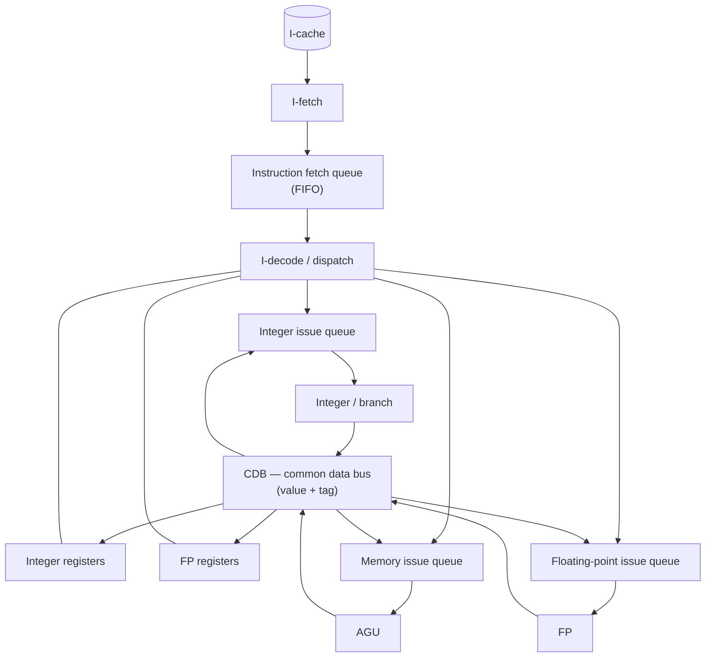

# COE 502 — Lecture 5: Instruction-Level Parallelism

**Parallel Processing Architectures** · KFUPM · Dr. Abdulaziz Tabbakh

> These notes follow deck `05-ILP.pdf`. Anything marked **[note]** is extra context not on the slides.
>
> **This is the parallelism you never write.** The programmer hands over ordinary serial code and
> the hardware (or the compiler) finds the independent instructions inside it. Everything in this
> deck is machinery for doing that better.

---

## Contents

**Part I — Statically scheduled pipelines**
1. [What this deck is trying to fix](#1-what-this-deck-is-trying-to-fix)
2. [The baseline: a pipeline with a floating-point lane](#2-the-baseline-a-pipeline-with-a-floating-point-lane)
3. [Latency and initiation interval](#3-latency-and-initiation-interval)
4. [The new hazards](#4-the-new-hazards)
5. [Super-pipelined CPU](#5-super-pipelined-cpu)
6. [Superscalar CPU](#6-superscalar-cpu)
7. [In-order (static) instruction scheduling](#7-in-order-static-instruction-scheduling)
8. [Loop unrolling](#8-loop-unrolling)
9. [Software pipelining](#9-software-pipelining)
10. [Strengths and weaknesses of static pipelines](#10-strengths-and-weaknesses-of-static-pipelines)

**Part II — Dynamically scheduled pipelines**

11. [Is superscalar good enough?](#11-is-superscalar-good-enough)
12. [Out-of-order execution and dynamic scheduling](#12-out-of-order-execution-and-dynamic-scheduling)
13. [Tomasulo's algorithm](#13-tomasulos-algorithm)
14. [Hardware-based speculation](#14-hardware-based-speculation)
15. [Multiple issue](#15-multiple-issue)

**Part III — VLIW and vector**

16. [VLIW processors](#16-vliw-processors)
17. [Vector processors](#17-vector-processors)
18. [Summary sheet](#18-summary-sheet)
19. [Self-test](#19-self-test)

---

## 1. What this deck is trying to fix

Go back to the one equation from Lecture 2:

$$\text{CPI} = 1 + \text{stalls per instruction}$$

A perfect pipeline has CPI = 1. The deck has **two ambitions**, and they are different sizes:

| Ambition | Means | Covered by |
|---|---|---|
| Get CPI **down to 1** | Remove the stalls | Static scheduling, loop unrolling, software pipelining, dynamic scheduling |
| Get CPI **below 1** | **Finish more than one instruction per cycle** | Superscalar, VLIW, vector |

> **To achieve CPI < 1, need to complete multiple instructions per clock.** (slide 31)

### Where the opportunity comes from

```
I1:  a = b + c      // independent
I2:  d = e + f      // independent  → I1 and I2 could run simultaneously
I3:  g = a + d      // needs BOTH   → must wait
```

Nobody put that independence there. You wrote three sequential lines; the independence is a property of what you happened to write. **Instruction-level parallelism** is the hardware's or compiler's job to find.

### Who does the finding?

| | **Static scheduling** | **Dynamic scheduling** |
|---|---|---|
| Who | the **compiler**, before the program runs | the **hardware**, at run time |
| Sees | the whole program, unlimited thinking time | a small window, nanoseconds |
| Knows | nothing about cache misses or actual addresses | exactly what just happened |

### The deck's roadmap (slide 2)

> **Statically Scheduled Pipelines**
> - 5-stage pipeline
> - Pipelines with out-of-order completion
> - Superpipelined and Superscalar CPU
> - Static Instruction Scheduling
> - Loop Unrolling
> - Software Pipelining
>
> **Dynamically Scheduled Pipelines**
>
> **VLIW Microarchitectures**
>
> **Vector Microarchitectures**

It is a progression in **who does the thinking**: compiler → hardware → compiler again, more aggressively → neither, because the data is uniform.

---

## 2. The baseline: a pipeline with a floating-point lane

### Slide 3 — the starting point

The 5-stage pipeline, with his naming: **IF** (fetch) · **ID** (decode & register read) · **EX** (execute) · **MEM** (memory) · **WB** (writeback).

Two remarks:

> **Instructions go through every stage in process order, even if they don't use the stage.**

An integer add has nothing to do in MEM, but passes through anyway. It cannot skip, because skipping would put two instructions in WB at once.

> **Control implementation: instruction carries control — "instruction carries its baggage".**

Control signals are generated at decode and travel **with** the instruction in the pipeline registers. They have to: five instructions are in the machine at once, each needing different settings, so a single central controller couldn't serve them.

> 📌 **Keep that first remark.** Because every instruction took the *same path*, every instruction
> took the *same time* — so they finished in the order they started, automatically. The next slide
> destroys that.

### Slide 4 — the second lane

**The problem:** floating-point arithmetic is far slower than integer arithmetic. An FP number is a sign, exponent and fraction, so multiplying two means multiplying fractions, adding exponents, and renormalising.

If you forced that into one EX stage, the clock period would stretch to accommodate it and **every integer instruction would pay**. (That is the single-cycle mistake from Lecture 2, at a smaller scale.)

**The fix:** give FP its own lane.

```
                      ┌──────┐
                 ┌───▶│  EX  │──────────────────────────────┐
  ┌────┐  ┌────┐ │    └──────┘   integer lane — 1 cycle      ▼
  │ IF │─▶│ ID │─┤                                      ┌──────┐   ┌──────┐
  └────┘  └────┘ │   ┌─────┬─────┬─────┬─────┬─────┐    │  ME  │──▶│  WB  │
                 └──▶│ FP1 │ FP2 │ FP3 │ FP4 │ FP5 │───▶└──────┘   └──────┘
                     └─────┴─────┴─────┴─────┴─────┘
                        floating-point lane — 5 cycles
```

The slide's bullets:

> - **FP instructions take 5 clocks and are pipelined**
> - **Integer unit:** handles integer instructions, branches, loads/stores (EX)
> - **Two separate register files:** integer and FP
> - **Forwarding paths into EX and FP1**
> - **FP values forwarded from FP/ME and ME/WB to ID/EX** because of stores
> - Instructions **wait in ID until they can proceed data-hazard free**
> - **Static scheduling** of instructions
> - **Still in-order execution, but out-of-order completion**

**Decoding the opaque ones:**

- **Two register files.** `R0–R31` hold integers, `F0–F31` hold floating-point values. Separate hardware, separate names — which is why the code says `ADD.S f1,f2,f1`. **An instruction's register names tell you which lane it takes.**
- **"FP/ME and ME/WB to ID/EX"** — these are names of *pipeline registers* (the storage between FP5 and ME, between ME and WB, and between ID and EX). A store like `S.S F2,0(R1)` writes an FP value to memory but travels down the **integer** lane, so the FP result must be routed across. Those two bypass wires are that handover.
- **"Wait in ID"** — ID is the gate. An instruction that isn't safe to release sits there and **blocks everything behind it**, because this machine releases strictly in order.

### In-order execution vs out-of-order completion

Two genuinely different things, and this deck turns on the distinction.

```
I1:  MUL.D  F0, F2, F4     ← floating-point, long lane
I2:  ADD    R1, R2, R3     ← integer, short lane
```

| | C1 | C2 | C3 | C4 | C5 | C6 | C7 | C8 | C9 |
|---|---|---|---|---|---|---|---|---|---|
| **I1** MUL.D | IF | ID | FP1 | FP2 | FP3 | FP4 | FP5 | ME | **WB** |
| **I2** ADD | | IF | ID | EX | ME | **WB** | | | |

**I2 writes at cycle 6; I1 writes at cycle 9.** The instruction written *second* finished *three cycles earlier*.

Nothing was rearranged — both passed through ID in program order. They simply took lanes of different lengths.

| Term | Meaning | Still guaranteed? |
|---|---|---|
| **In-order execution** | instructions *start* in program order | ✅ Yes |
| **Out-of-order completion** | they *finish* in whatever order their lane allows | ❌ No |

> Until this slide those were the same event. Now they have come apart — and §4 is the damage.

---

## 3. Latency and initiation interval

Two timing numbers, easy to confuse, both needed for every pipeline-timing question.

> **Latency of operation:** minimum number of cycles between an instruction producing a result and the instruction consuming it. The dependent instruction must **stall in ID** until its operand is forwarded.
> **If functional units are linear pipelines then instruction latency is execution time − 1.**

> **Repeat (initiation) interval:** number of cycles that must elapse between consecutive issues of instructions **to the same unit**. If a functional unit is not a linear pipeline, two consecutive instructions may not be issued in consecutive cycles because of **structural hazards**.

| | Question it answers |
|---|---|
| **Latency** | How many cycles must a **dependent** instruction wait? |
| **Initiation interval** | How often can I **start a new operation** on this unit? |

The table for the baseline machine (slide 5):

| Functional unit | Latency | Initiation interval |
|---|---|---|
| **Integer ALU** | 0 | 1 |
| **Load** | 1 | 1 |
| **FP OP** | 4 | **1 (5 if not pipelined)** |

Walking the rows:

- **Integer ALU, latency 0** — executes in one cycle (EX), forwarded immediately, so a dependent instruction follows with no stall. Execution time 1, minus 1 = 0.
- **Load, latency 1** — the value isn't available until the end of MEM, but the consumer wants it at the start of its EX, the **same cycle**. One unavoidable bubble. This is the load-use hazard from Lecture 2, as a number.
- **FP OP, latency 4** — five stages, result at the end of FP5. A dependent instruction waits 4 cycles. Execution time 5, minus 1 = 4.

**Every initiation interval is 1** because every unit here is **pipelined** — you can start a new operation each cycle while earlier ones are still inside. The bracketed "(5 if not pipelined)" is the counterexample: an unpipelined unit is *occupied*, so you must wait for it to empty.

> 📌 **Latency is about dependent instructions; initiation interval is about the unit's throughput,
> dependent or not.** Latency 4 with interval 1 means a consumer waits four cycles but **four
> independent FP ops can start back to back.**

**That gap between 4 and 1 is the entire opportunity.** Fill those four cycles with independent work and the latency costs nothing. Finding such work is what static scheduling, loop unrolling and software pipelining are all for.

---

## 4. The new hazards

### Structural hazards (slide 6)

Out-of-order completion means two instructions can arrive at the same stage in the same cycle.

| | C1 | C2 | C3 | C4 | C5 | C6 | C7 | **C8** | **C9** | C10 |
|---|---|---|---|---|---|---|---|---|---|---|
| **I1** `Add.S f1,f2,f1` | IF | ID | FP1 | FP2 | FP3 | FP4 | FP5 | **ME** | **WB** | |
| **I2** `Add.S f4,f2,f3` | | IF | ID | FP1 | FP2 | FP3 | FP4 | FP5 | ME | WB |
| **I3** `L.S f10` | | | IF | ID | EX | ME | WB | | | |
| **I4** `L.S f12` | | | | IF | ID | EX | ME | **WB** | | |
| **I5** `L.S f14` | | | | | IF | ID | EX | **ME** | **WB** | |

> - **Conflict at cycle C8:** I1 and I5 are both in the ME stage *(does not matter since I1 does not access memory)*
> - **Conflict at cycle C9:** I1 and I5 are both in the WB stage **and both store in FP registers**
>   - **Structural hazard on FP register file write port**
>   - Could add one write port to register file (**way too complex!!**)
> - Also: **structural hazards on execution units**
>
> **Two general techniques to remove structural hazards:**
> - **Add hardware resources**
> - **Deal with it by stalling instructions to serialize conflicts**

**[note]** Note the C8 conflict is **harmless** — I1 passes through ME without using it. The C9 conflict is **real**, because both genuinely write an FP register. Extra write ports are expensive (the register file's area grows roughly with ports²), so the practical answer is to stall.

### Data hazards (slide 7)

> **WAW hazards on FP registers are possible since instructions now reach WB out of order:**
> ```
> Add.D f2, f4, f6
> L.D   f2, 0(r2)
> ```
> **The LD must stall in ID.**

The `L.D` goes down the **short** lane and would reach WB *before* the `Add.D` on the long lane — so the Add.D's stale value would land last and win. Program order says L.D's value should be final.

> **Still no WAR hazards on registers since reads happen early.**

Registers are read in **ID**, very early in the pipeline. By the time any instruction reaches WB, every earlier instruction has long since read what it needed. WAR cannot occur in this machine.

> **More RAW hazard stalls due to longer latency instructions.**

| | C1 | C2 | C3 | C4 | C5 | C6 | C7 | C8 | C9 | C10 | C11 |
|---|---|---|---|---|---|---|---|---|---|---|---|
| **I1** `L.D F4, 0(R2)` | IF | ID | EX | ME | WB | | | | | | |
| **I2** `MULT.D F0,F4,F6` | | IF | ID | **ID** | FP1 | FP2 | FP3 | FP4 | FP5 | ME | WB |
| **I3** `S.D F0, 0(R2)` | | | IF | **IF** | ID | **ID** | **ID** | **ID** | **ID** | EX | ME |

I2 stalls one cycle in ID waiting for the load. I3 then stalls **five** cycles in ID waiting for the multiply's result — because FP latency is 4 and the stall ripples.

> **No data hazards on memory.** Loads and stores follow the same pipeline path and are **processed in program order in the MEM stage**.

**[note]** That's a design *choice* with a big consequence: memory operations cannot be reordered in this machine, so memory-level parallelism is nil. Dynamic scheduling later adds load/store queues precisely to relax this.

### Summary of what changed

| Hazard | In the simple 5-stage pipeline | With the FP lane |
|---|---|---|
| **RAW** | exists; mostly forwarded | **worse** — long FP latency means long stalls |
| **WAR** | impossible | **still impossible** (reads happen in ID) |
| **WAW** | impossible | ⚠️ **now possible** (out-of-order completion) |
| **Structural** | on memory | ⚠️ **now also on the FP register write port** |

---

## 5. Super-pipelined CPU

```
┌─────┐  ┌─────┐  ┌────┐   ┌─────┐  ┌─────┐   ┌─────┐  ┌─────┐  ┌────┐
│ IF1 │─▶│ IF2 │─▶│ ID │──▶│ EX1 │─▶│ EX2 │──▶│ ME1 │─▶│ ME2 │─▶│ WB │
└─────┘  └─────┘  └────┘ │ └─────┘  └─────┘ ▲ └─────┘  └─────┘  └────┘
                         │   ┌──────────────┤
                         └──▶│ FP PIPELINE(s)│
                             └──────────────┘
```

> Some stages in the 5-stage integer pipeline are **further pipelined**
> - To **increase the clock rate**
> - Here **IF, EX, and ME are now 2 pipeline stages**
> - **Clock is 2× as fast (hopefully)**
> - **Not "free"**:
>   - **Branch penalty when taken is now 3 clocks**
>   - **Latencies in clock are higher**
> - Assuming unchanged 5-stages for FP

| Functional unit | Latency | Initiation interval |
|---|---|---|
| Integer ALU | **1** *(was 0)* | 1 |
| Load | **3** *(was 1)* | 1 |
| FP OP | 4 | 1 (5 if not pipelined) |

> 📌 **The trade in one table.** Cycle time halves, but **measured in cycles everything got
> longer** — the integer ALU's latency went 0 → 1, the load's 1 → 3, and the taken-branch penalty
> grew to 3 clocks. You bought clock rate with stall cycles.

**[note]** This is exactly the Pentium 4's bet (≈20 stages chasing clock rate), and exactly why it lost. Past a point the deeper pipeline's misprediction and latency penalties exceed the clock gain. It is one of the walls that ended the clock race in Lecture 1.

---

## 6. Superscalar CPU

> A superscalar processor **executes more than one instruction during a clock cycle** by simultaneously dispatching multiple instructions to **redundant functional units** on the processor.
>
> Each functional unit is **not a separate CPU core** but an **execution resource within a single CPU** such as an ALU, a bit shifter, or a multiplier.

```
   scalar                          superscalar
┌──────────────┐          ┌──────────────────────────────┐
│ fetch/decode │          │        fetch / decode        │
├──────────────┤          ├──────────────────────────────┤
│  scheduler   │          │          scheduler           │
├──────────────┤          ├────────┬────────┬────────────┤
│ read register│    ⟹     │  read  │  read  │   read     │
├──────────────┤          ├────────┼────────┼────────────┤
│   execute    │          │  ALU   │   FP   │   data     │
├──────────────┤          ├────────┼────────┼────────────┤
│  write back  │          │ write  │ write  │  write     │
├──────────────┤          ├────────┴────────┴────────────┤
│    retire    │          │           retire             │
└──────────────┘          └──────────────────────────────┘
```

### The 2-way machine (slide 10)

> **Fetch, decode and execute up to 2 instructions per clock**
> - **Same clock rate** as basic pipeline
> - **Easy because of the 2 (int and fp) register files**
> - **Issue a pair of instructions**
> - **Pair must be integer/branch/memory and fp pair (compiler)**
> - Instructions in pair must be **independent and have no hazard with prior instructions**
> - Same latencies as basic pipeline; **branches execute in EX**
> - **Branches and latencies waste more instruction slots**
> - **Exceptions are more complex**
>
> **Hard to build more than 2-way**
>
> **IPC (instructions per clock) instead of CPI (IPC = 1/CPI)**

**[note] Why the pair must be one integer and one FP.** Because there are two separate register files, the pair reads from different hardware — no port contention. A general 2-way machine that could issue *any* two instructions would need twice the read ports on one register file, which is the expensive thing. This design gets 2-way issue almost for free by exploiting a structure that already existed.

**Why "branches and latencies waste more slots":** a stall now wastes **two** issue slots per cycle instead of one. Superscalar makes every stall twice as expensive, which is why it pairs so naturally with better scheduling.

**Superpipelining and superscalar combine** — the slide's red note adds superpipelining to the superscalar diagram. They are orthogonal: one shortens the cycle, the other widens the issue.

---

## 7. In-order (static) instruction scheduling

> To maximize instruction throughput (IPC) of static pipelines, **Compiler moves code up or down**:
> - **Local** (basic block)
> - **Global** (across basic blocks)
>   - **Cyclic** (loops)
>   - **Non-cyclic** (traces)

**[note] A basic block** is a straight run of instructions with no branch in and no branch out — execution enters at the top and leaves at the bottom. It is the unit within which a compiler can reorder freely, because control flow can't jump into the middle.

### The running example

```c
for (i = 0; i < 100; i++)
    A[i] := a[i] + b[i];
```

Unoptimized, on the basic pipeline (numbers in brackets are **clocks**, including stalls):

| | Instruction | Clocks |
|---|---|---|
| `Loop:` | `L.S F0,#4(R1)` | (1) |
| | `L.S F1,#4(R2)` | (1) |
| | `ADD.S F2,F1,F0` | **(2)** |
| | `S.S F2,#4(R1)` | **(5)** |
| | `ADDI R1,R1,#8` | (1) |
| | `ADDI R2,R2,#8` | (1) |
| | `SUBI R3,R3,#2` | (1) |
| | `BNEZ R3,Loop` | **(3)** |

> **Total Execution Time: 15 Clocks; CPI = 15/8 = 1.88**

The costs: `ADD.S` waits for the second load (load latency 1 → 2 clocks), `S.S` waits for the FP add (FP latency 4 → 5 clocks), and the branch costs 3.

### Local code scheduling (slide 12)

> **Compiler moves instructions inside the loop body:**
> - **Move SUBI up**
> - **Move S.S down**

| | Instruction | Clocks |
|---|---|---|
| `Loop:` | `L.S F0,#4(R1)` | (1) |
| | `L.S F1,#4(R2)` | (1) |
| | `SUBI R3,R3,#2` | (1) ← moved up |
| | `ADD.S F2,F1,F0` | **(1)** ← stall gone |
| | `ADDI R1,R1,#8` | (1) |
| | `ADDI R2,R2,#8` | (1) |
| | `S.S F2,#-4(R1)` | **(3)** ← moved down |
| | `BNEZ R3,Loop` | (3) |

> **Must change the displacement of the store (WAR hazard on R1)**
>
> **Execution time is 12 clocks, a speed up of 15/12 = 1.25**
>
> The penalty of the branch cannot be improved:
> - Change the code and use a branch at the top of the loop body
> - **Delayed branches**
>
> **Easy but limited because basic blocks are small.**
> **Use global scheduling: loop unrolling and software pipelining.**

> ⚠️ **The displacement change is the exam-relevant detail.** Moving `S.S` *after* `ADDI R1,R1,#8`
> means R1 has already advanced by 8 — so the store's offset must change from `#4(R1)` to
> `#-4(R1)` to still address the same location. **Reordering changed the meaning, and the compiler
> had to repair it.** That repair is what "WAR hazard on R1" refers to.

---

## 8. Loop unrolling

Three transformations applied in sequence (slide 13):

### Step 1 — unroll twice

> **Copy loop twice, remove instructions, adjust displacements**

```asm
L.S   F0,0(R1)        L.S   F0,#4(R1)
L.S   F1,0(R2)        L.S   F1,#4(R2)
ADD.S F2,F1,F0        ADD.S F2,F1,F0
S.S   F2,0(R1)        S.S   F2,#4(R1)
                      ADDI  R1,R1,#8
                      ADDI  R2,R2,#8
                      SUBI  R3,R3,#2
                      BNEZ  R3,Loop
```

One copy of the loop-control instructions (`ADDI`, `ADDI`, `SUBI`, `BNEZ`) now serves **two** iterations' worth of work. That overhead is immediately halved.

### Step 2 — rename FP registers

> **Remove WAW and WAR hazards by renaming**

Both copies used `F0, F1, F2`. The second copy is renamed to `F3, F4, F5`:

```asm
L.S   F0,0(R1)
L.S   F1,0(R2)
ADD.S F2,F1,F0
S.S   F2,0(R1)
L.S   F3,#4(R1)      ← was F0
L.S   F4,#4(R2)      ← was F1
ADD.S F5,F3,F4       ← was F2,F1,F0
S.S   F5,#4(R1)      ← was F2
...
```

> 📌 **This is register renaming done by the compiler, in software** — the same idea as the
> hardware renaming in Lecture 2, applied to architectural registers at compile time. Without it,
> the two copies collide on names and cannot be interleaved.

### Step 3 — schedule

> **Move loads up, move stores down, adjust displacements**

| Instruction | basic | super |
|---|---|---|
| `L.S F0,0(R1)` | (1) | (1) |
| `L.S F1,0(R2)` | (1) | (1) |
| `L.S F3,#4(R1)` | (1) | (1) |
| `L.S F4,#4(R2)` | (1) | (1) |
| `ADD.S F2,F1,F0` | (1) | (2) |
| `ADD.S F5,F3,F4` | (1) | (2) |
| `SUBI R3,R3,#2` | (1) | (1) |
| `ADDI R1,R1,#8` | (1) | (1) |
| `ADDI R2,R2,#8` | (1) | (1) |
| `S.S F2,#-8(R1)` | **(1)** | (1) |
| `S.S F5,#-4(R1)` | **(1)** | (1) |
| `BNEZ R3,Loop` | (3) | (4) |

> **Total time (basic): 14 clocks or 7 clocks per iteration of original loop.**
> **Speedup: 15/7 = 2.14**

All four loads are hoisted to the top, so by the time the adds run their operands are ready; the stores are pushed to the bottom, so by then the adds have finished. **Every stall is filled with useful work from the other iteration.**

### Name dependence (slide 14)

> **Two instructions use the same name but no flow of information**
> - **Not a true data dependence, but is a problem when reordering instructions**
> - **Anti-dependence:** instruction *j* writes a register or memory location that instruction *i* reads
>   - Initial ordering (*i* before *j*) must be preserved
> - **Output dependence:** instruction *i* and instruction *j* write the same register or memory location
>   - Ordering must be preserved
>
> **To resolve, use register renaming techniques**

| Deck 02's name | This deck's name | Pattern |
|---|---|---|
| **WAR** | **anti-dependence** | j writes what i reads |
| **WAW** | **output dependence** | i and j write the same place |
| **RAW** | *(true data dependence)* | j reads what i wrote — **not removable** |

> ⚠️ Note he says *"a register **or memory location**"*. Name dependences exist on memory too, not
> just registers — which is why dynamic scheduling needs load/store queues.

### Limitations (slide 15)

> - **Works well if loop iterations are independent**
> - **Problem with loop-carried RAW dependency**
>   ```c
>   for (i = 5; i < 100; i++)
>       A[i] := a[i-5] + b[i];
>   ```
>   - **Recurrence with distance 5 iterations**
>   - **Unroll up to 4 times**
>   - **5 times ⟹ loop-carried dependency limits code motion**
> - **Consumes architectural registers due to renaming**
> - **Code expansion** — affects instruction-cache and memory
> - **Problem when the number of iterations is unknown at compile time**

**[note] The recurrence distance.** `a[i]` depends on `a[i-5]`, so iterations *i* and *i−5* are dependent but iterations *i* … *i+4* are mutually independent. You may unroll **up to 4** copies freely; the 5th copy collides with the 1st.

**Why unknown trip count is a problem:** unrolling by 4 needs the iteration count to be a multiple of 4. If it isn't known at compile time, the compiler must emit an extra "remainder" loop — more code, more branches.

---

## 9. Software pipelining

> **Original loop is translated into pipelined loop** — pipeline dependent instructions in **different iterations**.
>
> Since the `ADD.S` is the **long latency** operation, we can pipeline the two loads and the `ADD.S` **with the store**.

The idea: instead of unrolling (which copies the body), **re-stage** the loop so that each new iteration of the transformed loop does the *store* of iteration *k*, the *loads* of iteration *k+1*, and the *add* of iteration *k+1* — all of which are independent.

| | O_ITE1 | O_ITE2 | O_ITE3 | O_IT4 |
|---|---|---|---|---|
| **Prologue** | L.S F0 · L.S F1 · ADD.S F2 | — | — | — |
| **P_ITE1** | S.S F2 | L.S F0 · L.S F1 · ADD.S F2 | — | — |
| **P_ITE2** | — | S.S F2 | L.S F0 · L.S F1 · ADD.S F2 | — |
| **P_ITE3** | — | — | S.S F2 | L.S F0 · L.S F1 · ADD.S F2 |
| **Epilogue** | | | | S.S F2 |

> **Note that exactly the same operations are executed in exactly the same order in both the original loop and the pipelined loop. The code is simply reorganized.**

Read the table **by row** and you see the new loop body; read it **by column** and you see the original iterations, intact and in order. Each diagonal is one original iteration, spread across time.

### The resulting code (slide 17)

| | Instruction | Clocks |
|---|---|---|
| **Prologue:** | `L.S F0,0(R1)` · `L.S F1,0(R2)` · `SUBI R3,R3,#1` · `ADD.S F2,F1,F0` · `ADDI R1,R1,#4` · `ADDI R2,R2,#4` | |
| **Loop** | `S.S F2,#-4(R1)` | (1) |
| | `L.S F0,0(R1)` | (1) |
| | `L.S F1,0(R2)` | (1) |
| | `SUBI R3,R3,#1` | (1) |
| | `ADD.S F2,F1,F0` | (1) |
| | `ADDI R1,R1,#4` | (1) |
| | `ADDI R2,R2,#4` | (1) |
| | `BNEZ R3,Loop` | (3) |
| **Epilogue** | `S.S F2,#-4(R1)` | |

> **No stall, no code expansion, no register renaming**
> **Use both: first loop unrolling then software pipelining**

**[note] The arithmetic.** The loop body is 7 instructions at 1 clock plus a 3-clock branch = **10 clocks per iteration**, against the original 15 → speedup **1.5**. Less than unrolling's 2.14 *on its own*, but it costs **no code expansion and no extra registers** — which is why the slide says to use both together.

### Unrolling vs software pipelining

| | Loop unrolling | Software pipelining |
|---|---|---|
| Mechanism | **copy** the body N times | **re-stage** the body across iterations |
| Code size | **grows** | unchanged |
| Register pressure | **grows** (renaming) | unchanged |
| Loop overhead | **amortised** over N iterations | unchanged |
| Needs trip count known? | effectively yes | no |
| Extra code | — | **prologue + epilogue** |

---

## 10. Strengths and weaknesses of static pipelines

> **Strengths**
> - **Hardware simplicity:** clock rate advantage over more complex designs
> - **Very predictable:** static performance predictions are reliable
> - **Compiler has a global view of the code:** e.g. optimize loops
> - **Power/energy advantage**
>
> **Weaknesses**
> - **Dynamic events** (e.g. cache misses, conditional branches)
> - **No mechanism to deal with cache misses**
>   - Freeze the processor on a miss
>   - **Only one access at a time → no tolerance for miss latency**
> - **Lack of dynamic information**
>   - **Memory addresses → this limits code motion**
> - **Compilers are complex**
>   - Optimize performance vs. enforce execution correctness

> 📌 **"Memory addresses → limits code motion"** is the killer. The compiler usually cannot prove
> that `A[i]` and `B[j]` are different locations, so it must **conservatively** keep the load after
> the store. The hardware, at run time, knows both addresses exactly — and can reorder freely.
> **That information asymmetry is the whole case for dynamic scheduling.**

---

## 11. Is superscalar good enough?

> A superscalar processor can fetch, decode, execute and retire instructions in parallel.
> - **Can execute only independent instructions in parallel**
>
> **But … adjacent instructions are usually dependent**
> - **The utilization of the second pipe is usually low**
> - There are algorithms in which both pipes are highly utilized
>
> **Solution: out-of-order execution**
> - **Execute instructions based on "data flow" rather than program order**
> - **Still need to keep the semantics of the original program**

The problem with **in-order** superscalar: the pair must be adjacent *and* independent. Real code rarely obliges — so the second slot sits empty most cycles, and you paid for hardware you aren't using.

> 📌 **"Data flow rather than program order"** is the core idea of the rest of the deck. Program
> order is an *accident of how you wrote it*; data flow is the **true** constraint. Execute as soon
> as your inputs exist.

---

## 12. Out-of-order execution and dynamic scheduling

> **Make use of cycles that would otherwise be wasted** by a certain type of costly delay. Most modern CPU designs include support for out of order execution.
>
> The key concept of OoO processing is to allow the processor to **avoid a class of stalls that occur when the data needed to perform an operation are unavailable**.

> **Execution steps** *(instructions are dynamically scheduled based on the availability of resources / operands readiness)*:
> 1. Instruction **fetch**
> 2. Instruction **dispatch to an instruction queue** (also called instruction buffer or **reservation stations**)
> 3. The instruction **waits in the queue until its input operands are available**. The instruction is allowed to **leave the queue before earlier, older instructions**
> 4. The instruction is **issued** to the appropriate functional unit and **executed**
> 5. The **results are queued**
> 6. **Only after all older instructions have their results written back to the register file**, then this result is **written back** to the register file. This is called the **graduation** or **retire** stage

> 🔑 **Step 6 is the one that makes the whole thing legal.** Instructions *execute* out of order but
> *retire* in order. The architectural state only ever advances in program order, so from outside
> the machine nothing has been reordered at all. (Lecture 2 §2: architectural state vs physical state.)

### Dynamic scheduling (slide 21)

> **Rearrange order of instructions to reduce stalls while maintaining data flow**
>
> **Dynamic scheduling implies:** out-of-order execution · out-of-order completion
>
> **Advantages:**
> - **Compiler doesn't need to have knowledge of microarchitecture**
> - **Handles cases where dependencies are unknown at compile time**
>
> **Disadvantage:**
> - **Substantial increase in hardware complexity**
> - **Complicates exceptions**

### Dynamic instruction scheduling (slide 22)

> Static pipelines can only exploit **the parallelism exposed to it by the compiler**
> - Instructions are **stalled in ID** until they are hazard-free and then scheduled for execution
> - The compiler strives to limit the number of stalls in ID
> - **However compiler is limited in what it can do**
>
> **Potentially there is a large amount of ILP to exploit (across 100s of instructions)**
> - **Must cross basic block boundaries** (10s of branches)
> - **Data-flow order (dependencies) — not thread order**
>
> **Dynamic instruction scheduling:**
> - **Separate decoding from scheduling**
> - Decode instruction then **dispatch them in queues** where they wait to be scheduled until input operands are available
>
> **No stall at decode for data hazard — only structural hazards**
> - All data hazards — **RAW, WAW, and WAR** — are now possible **both on memory and registers** and must be solved
> - **Execute beyond conditional branches — speculative execution**

> ⚠️ **WAR is back.** In the static pipeline, reads happened in ID so WAR was impossible. Once
> instructions can sit in a queue and read their operands late, a later instruction's write can
> overtake an earlier instruction's read. **All three hazards are live again** — and on memory too.

---

## 13. Tomasulo's algorithm

Robert Tomasulo's scheme, from the IBM 360/91 (1967), is the canonical dynamic-scheduling design.



The deck splits it into **FRONT-END** and **BACK-END**, and notes the issue queues are **"aka reservation stations in original Tomasulo."**

> **Front-end**
> - Instructions are **fetched**
> - Stored in a FIFO queue called **"instruction fetch queue" (IFQ)**
> - When an instruction reaches the top of the IFQ it is:
>   - **Decoded and dispatched to an issue queue** (integer/branch, memory, or floating-point)
>   - **Even if some of its input operands are not ready** (being computed)
>
> **Back-end**
> - Instructions in issue queues **wait for their input (register) operands**
> - Once register operands are ready instructions **can be scheduled for execution, provided they will not conflict for the CDB (common data bus) or their functional unit**
> - Instructions execute in their functional unit and their **result is put on the CDB**
> - **All instructions in queues and all registers in both register files "watch" the CDB and grab the value they are waiting for**

> 🔑 **The CDB is the heart of it.** A result is **broadcast once**, tagged, and everyone who was
> waiting for that tag grabs it simultaneously. That broadcast-and-match is what replaces the
> register file as the communication mechanism — and it is also **implicit register renaming**,
> because instructions wait on *tags*, not on register names.

### The three steps (slide 25)

> **Issue**
> - Get next instruction from FIFO queue
> - **If available RS, issue the instruction to the RS with operand values if available**
> - If operand values not available, stall the instruction
>
> **Execute**
> - When operand becomes available, **store it in any reservation stations waiting for it**
> - When **all operands are ready, issue the instruction**
> - **Loads and stores maintained in program order through effective address**
> - **No instruction allowed to initiate execution until all branches that precede it in program order have completed**
>
> **Write result**
> - **Write result on CDB into reservation stations and store buffers**
> - (Stores must wait until **address and value** are received)

**[note]** Note the Issue step stalls on **structural** grounds (no free reservation station), not on data. And the last Execute bullet — no execution past an unresolved branch — is the restriction that **hardware speculation removes next.**

---

## 14. Hardware-based speculation

> **Execute instructions along predicted execution paths but only commit the results if prediction was correct.**
>
> **Instruction commit:** allowing an instruction to update the register file **when instruction is no longer speculative**.
>
> **Need an additional piece of hardware to prevent any irrevocable action until an instruction commits** — i.e. updating state or taking an exception.

### The three ideas combined (slide 27)

> **Combination of 3 main ideas:**
> 1. **Dynamic OoO instruction scheduling** (Tomasulo)
> 2. **Dynamic branch prediction**, allowing instruction scheduling across branches
> 3. **Speculative execution:** execute instructions **before all control/data dependencies are resolved**

> Hardware-based speculation uses a **data-flow approach**: instructions execute when their operands are available/predicted, **across predicted branches**.
>
> **Key ideas:**
> - **Separate the completion of instruction execution and the commit of its result**
> - **Between completion and commit results are speculative**
> - **Commit results to registers and storage in process order**
>
> **We need to add the following to Tomasulo:**
> - **Branch prediction**
> - **Temporary storage for speculative results**
> - **Mechanism to roll-back execution when speculation fails**

**[note]** That "temporary storage" is the **reorder buffer (ROB)** in standard terminology — a FIFO holding completed-but-not-committed results in program order. Commit pops from its head; a misprediction flushes everything behind the bad branch. It is also what makes **precise exceptions** possible, which is why deck 02's outline listed them.

> 📌 **Complete ≠ commit.** An instruction *completes* when its functional unit produces a value;
> it *commits* when that value is allowed into the architectural state. The gap between the two is
> where all the speculation lives.

---

## 15. Multiple issue

> **To achieve CPI < 1, need to complete multiple instructions per clock.**
>
> **Solutions:**
> - **Statically scheduled superscalar processors**
> - **VLIW (very long instruction word) processors**
> - **Dynamically scheduled superscalar processors**

### Combining it all (slide 28)

> **Modern microarchitectures: dynamic scheduling + multiple issue + speculation**
>
> **Two approaches:**
> - **Assign reservation stations and update pipeline control table in half clock cycles**
>   - Only supports **2 instructions/clock**
> - **Design logic to handle any possible dependencies between the instructions**
>
> **Issue logic is the bottleneck in dynamically scheduled superscalars.**

### What multiple issue requires (slide 30)

> - **Examine all the dependencies among the instructions in the bundle**
> - If dependencies exist in bundle, **encode them in reservation stations**
> - Also need **multiple completion/commit**
> - To simplify RS allocation: **limit the number of instructions of a given class that can be issued in a "bundle"** — i.e. one FP, one integer, one load, one store

> 📌 **Why issue logic is the bottleneck.** To issue *n* instructions in one cycle you must check
> every pair among them for dependences — that is **O(n²)** comparisons, all inside one clock
> period. This is the hard scaling wall on issue width, and a direct reason the industry stopped
> widening cores and started adding them. **This slide is the bridge back to the whole premise of
> COE 502.**

---

## 16. VLIW processors

> - **Package multiple independent operations into one instruction**
> - **Independent functional units with no hazard detection**
> - May have some forwarding to reduce latencies of operation
> - **Compiler is responsible for dispatching/scheduling instructions**
>
> **Example VLIW processor:**
> - One integer instruction (or branch)
> - Two independent floating-point operations
> - Two independent memory references
> - Each takes **16–24 bits**
> - **Instruction size 112 – 168 bits**
>
> **Must be enough parallelism in code to fill the available slots.**

> 🔑 **VLIW is the opposite bet from dynamic scheduling.** Dynamic scheduling spends transistors on
> hardware that finds parallelism at run time. VLIW spends *nothing* — **no hazard detection at
> all** — and makes the compiler guarantee that the operations in each bundle are independent. If
> the compiler is wrong, the machine computes garbage; there is no interlock to save it.

### VLIW code (slide 33)

Loop unrolled **7 times**:

| Clock | MemOp1 | MemOp2 | FPOp1 | FPOp2 | Int/BROp |
|---|---|---|---|---|---|
| 1 | L.D F0,0(R1) | L.D F6,-8(R1) | | | |
| 2 | L.D F10,-16(R1) | L.D F14,-24(R1) | | | |
| 3 | L.D F18,-32(R1) | L.D F22,-40(R1) | ADD.D F4,F0,F2 | ADD.D F8,F6,F2 | |
| 4 | L.D F26,-48(R1) | | ADD.D F12,F10,F2 | ADD.D F16,F14,F2 | |
| 5 | | | ADD.D F20,F18,F2 | ADD.D F24,F22,F2 | |
| 6 | S.D 0(R1),F4 | S.D -8(R1),F8 | ADD.D F28,F26,F2 | | SUBI R1,R1,#56 |
| 7 | S.D 40(R1),F12 | S.D 32(R1),F16 | | | |
| 8 | S.D 24(R1),F20 | S.D 16(R1),F24 | | | |
| 9 | S.D 8(R1),F28 | | | | BNE R1,R2,Clock1 |

> **Problems:** Code size · Empty slots · Register pressure · Lockstep · Cost of branches

Count the blanks in that table — roughly **40% of the slots are empty**, and each empty slot is still encoded in the instruction word. That's the **code size** problem and the **empty slots** problem in one picture. The register pressure is visible too: F0 through F28, 15 registers live at once, to unroll a loop seven times.

**"Lockstep"** means all operations in a bundle must proceed together — if any one stalls (say a cache miss), **the whole bundle stalls**, because there is no hardware to let the others continue.

**[note]** VLIW succeeded in DSPs and embedded media processors, where workloads are regular and the compiler really can see everything. It failed in general-purpose computing (Intel's Itanium being the famous case), for exactly the reason slide 18 gave: the compiler cannot know memory addresses or cache behaviour in advance.

---

## 17. Vector processors

> Vector processors are able to **execute instructions on entire vectors and not just on scalars.**
>
> Instructions are of the type `addv v1, v2, v3`
> - v1, v2, v3 are **vectors of scalars of same type and same length**
> - They are specified by a **base address, a vector length and a stride** (memory operand), or they can be **vector registers**
>
> The above instruction adds the corresponding scalar elements of v2 and v3 and puts the results in corresponding elements of v1: `V1[i] ← v2[i] + v3[i]`, for all i's
>
> Vector length and stride may be held in **special control registers**.

> **Vector machines existed well before superscalar processors.**
> **They are still built for supercomputers for engineering/scientific computation.**
> **Because of multimedia (streaming) applications they are reappearing in commodity markets (DSP).**

> 📌 **Strictly this is DLP, not ILP** — it's Flynn's SIMD from Lecture 1. It is in this deck
> because it is another route to **more work per instruction**, which is the deck's actual subject.

### Vector timing (slide 35)

With 64-element vectors and an ADD unit of 10 stages:

$$T_{ex} = 10 + 63 = 9 + 64$$

$$\boxed{T_{vector} = \text{VECTOR\_LENGTH} + \text{STARTUP TIME}}$$

> After vector startup time (the time to get the first result), **results are computed one per clock**.

**[note]** This is exactly the pipeline fill-and-drain formula `k + (n−1)` from Lecture 2, with *n* = vector length. **One instruction** now drives 64 operations, so instruction fetch, decode and hazard checking are paid **once** instead of 64 times. That amortisation is the whole advantage.

### Load/store vector architecture (slide 36)

> - **Vector registers + scalar registers**
>   - Each vector register can hold consecutive components of vectors fetched from memory
>   - E.g. **8 vector registers of 64 components each**
>   - 1 read and 1 write port per vector register connected to functional units through **crossbars**
> - **Vector functional units are deeply pipelined and specialized** — act on operands in vector registers

Example: **Y = a · X + Y** (the classic SAXPY):

```asm
L.V    V1,0(R1),R6     /load vector X with base 0(R1) and stride (R6)
Mul.V  V2,V1,F0        /multiply X by scalar in F0
L.V    V3,0(R2),R6     /load vector Y
Add.V  V4,V2,V3        /add the vectors
S.V    0(R2),V4,R6     /store vector Y
```

With **loop strip-mining** for vectors longer than 64:

```asm
Loop:  L.V   V1,0(R1),R6
       Mul.V V2,V1,F0
       L.V   V3,0(R2),R6
       Add.V V4,V2,V3
       S.V   0(R2),V4,R6
       Subi  R1,R1,#512    /assume that machine is byte addressable
       Subi  R2,R2,#512    /64 reg. x 8 bytes/reg = 512 bytes
       Bnez  R1,loop
```

**[note] Strip-mining** is chopping a long vector into fixed-size chunks the vector registers can hold — 64 elements at a time here. The 512 is 64 × 8 bytes.

### Memory system (slide 37)

> **Access pattern to memory is known at decode time for the entire vectors**
> - **Memory is interleaved, no need for caches**
> - Vector load/store units from memory to registers
>
> **Load store units can be seen as pipelines**
> - The startup time is the time to get the first component
> - **Banks are started one after the other**
> - **If the number of banks is greater than the memory cycle time, we have no conflicts**, and results come out one per clock
> - **Startup time is much longer than for functional units**
> - Vectors accessed with a stride are stored in consecutive locations of vector register

> 🔑 **"No need for caches"** is a startling claim worth understanding. Caches exist because access
> patterns are *unpredictable* — you keep data nearby in case you need it again. A vector machine
> **knows the entire access pattern at decode time**, so it can start the right memory banks in the
> right order and stream data at one element per clock. Prediction is unnecessary when you have
> certainty.

### Memory organization (slide 38)

> **Heavily interleaved (hundreds of memory modules)**
>
> **INTERLEAVING: Xi is in bank (i MOD 4)**

```
bank0: x0  x4      ─┐
bank1: x1  x5      ─┤
bank2: x2  x6      ─┼──▶ V1[0..63]
bank3: x3  x7      ─┘
```

With 4 banks each taking 4 cycles, bank0 is free again exactly when x4 is wanted. The banks are started staggered, so after the initial latency one element emerges per clock.

$$T_{load} = \text{vector\_length} + \text{startup time (time to get } x_0 - 1)$$

### Chaining and parallel execution (slide 39)

> **Independent vector instructions can be executed in parallel and also can be chained.**

For `Y = a·X + Y`:

**One operation at a time:**

$$T = \text{startup(load)} + N + \text{startup(mulv)} + N + \text{startup(load)} + N + \text{startup(addv)} + N + \text{startup(store)} + N$$

$$= \text{startup} + \text{vector\_length} \times 5$$

**With chaining + parallelism:**

$$T = \text{startup(load)} + \text{startup(mulv)} + \text{startup(addv)} + \text{startup(store)} + \text{vector\_length}$$

*(the two loads execute in parallel)*

> 🔑 **Chaining is forwarding, at vector scale.** Instead of waiting for the multiply to finish all
> 64 elements before the add starts, element *i*'s product is fed **straight into the adder** as
> soon as it emerges. The functional units form a pipeline of their own.
>
> The saving is dramatic: **5 × N collapses to N**, with only the startup costs remaining. For
> N = 64 that is roughly 320 cycles down to about 64 plus startups.

---

## 18. Summary sheet

### The four approaches

| Approach | Who finds the parallelism | Key mechanism | Main weakness |
|---|---|---|---|
| **Static (in-order)** | **compiler** | code scheduling, loop unrolling, software pipelining | no dynamic info — can't see cache misses or memory addresses |
| **Dynamic (OoO)** | **hardware** | reservation stations, CDB, reorder buffer | substantial hardware complexity; issue logic is O(n²) |
| **VLIW** | **compiler**, aggressively | wide instruction word, **no hazard detection** | empty slots, code size, lockstep, register pressure |
| **Vector** | **neither** — the data is uniform | one instruction per whole vector | needs regular, uniform data |

### Formulas

$$\text{latency} = \text{execution time} - 1 \quad\text{(linear pipelines)}$$

$$T_{vector} = \text{vector length} + \text{startup time}$$

$$\text{IPC} = \frac{1}{\text{CPI}}$$

Chaining: $\;\text{startup}_{total} + N\;$ instead of $\;\text{startup} + 5N$

### The baseline latency table

| Functional unit | Latency | Initiation interval |
|---|---|---|
| Integer ALU | 0 | 1 |
| Load | 1 | 1 |
| FP OP | 4 | 1 (5 if not pipelined) |

*(Super-pipelined: integer ALU 1, load 3, FP 4.)*

### Hazards, before and after the FP lane

| | Simple 5-stage | With FP lane | With dynamic scheduling |
|---|---|---|---|
| **RAW** | yes | yes, worse | yes, on registers **and memory** |
| **WAR** | impossible | **impossible** (reads in ID) | ⚠️ **possible again** |
| **WAW** | impossible | ⚠️ **possible** | ⚠️ possible |
| **Structural** | memory | + **FP register write port** | CDB, functional units, RS availability |

### Running example — all the speedups

| Version | Clocks per original iteration | Speedup |
|---|---|---|
| Unoptimized | 15 (CPI 1.88) | 1.00 |
| Local scheduling | 12 | **1.25** |
| Loop unrolling (×2) + rename + schedule | 7 | **2.14** |
| Software pipelining | 10 | **1.50** *(no code expansion, no renaming)* |

### Things worth memorising

- **In-order execution ≠ in-order completion.** The FP lane breaks them apart.
- **Latency** = how long a *dependent* instruction waits. **Initiation interval** = how often you can *start* a new op. Latency 4 + interval 1 ⟹ four independent FP ops back to back.
- **WAR is impossible in the static FP pipeline** (reads happen in ID) but **comes back** with dynamic scheduling.
- **Anti-dependence = WAR. Output dependence = WAW.** Both removable by renaming; **RAW never is**.
- **Loop unrolling** grows code and registers; **software pipelining** doesn't. Use both.
- **Execute ≠ commit.** Speculation lives in the gap.
- **Issue logic is the bottleneck** in dynamically scheduled superscalars — O(n²) dependence checks.
- **Chaining** turns 5N into N.

---

## 19. Self-test

<details>
<summary><b>1.</b> Why does the pipeline need a separate floating-point lane, and what does it break?</summary>

FP arithmetic is far slower than integer. Forcing it into one EX stage would stretch the clock period for **every** instruction. The separate 5-stage FP lane keeps the clock short.

What it breaks: **out-of-order completion.** Two lanes of different lengths means an instruction issued later can finish earlier — which makes **WAW hazards possible** and creates a **structural hazard on the FP register write port**.
</details>

<details>
<summary><b>2.</b> Distinguish latency from initiation interval. Give the values for the baseline machine.</summary>

**Latency** = minimum cycles between an instruction producing a result and a dependent instruction consuming it (= execution time − 1 for linear pipelines).
**Initiation interval** = cycles that must elapse between consecutive issues **to the same unit**.

| Unit | Latency | Initiation interval |
|---|---|---|
| Integer ALU | 0 | 1 |
| Load | 1 | 1 |
| FP OP | 4 | 1 (5 if not pipelined) |
</details>

<details>
<summary><b>3.</b> Why are WAR hazards impossible in the static FP pipeline but possible with dynamic scheduling?</summary>

In the static pipeline, **registers are read in ID**, very early. By the time any instruction reaches WB, every earlier instruction has already read its operands — so a later write can never overtake an earlier read.

With dynamic scheduling, instructions **sit in queues and read operands late**, so a later instruction's write can overtake an earlier instruction's read. Slide 22: *"All data hazards — RAW, WAW, and WAR — are now possible both on memory and registers."*
</details>

<details>
<summary><b>4.</b> In the local-scheduling example, why did the store's displacement change from #4(R1) to #-4(R1)?</summary>

The store was moved **after** `ADDI R1,R1,#8`, so R1 has already advanced by 8. The displacement must shift by −8 (from +4 to −4) to still address the same memory location.

The deck calls this *"WAR hazard on R1"* — reordering changed the instruction's meaning and the compiler had to repair it.
</details>

<details>
<summary><b>5.</b> Name the three steps of loop unrolling and what each accomplishes.</summary>

1. **Unroll twice** — copy the loop body, remove redundant loop-control instructions, adjust displacements. *Amortises loop overhead.*
2. **Rename FP registers** — give the second copy its own registers. *Removes the WAW and WAR hazards that would otherwise prevent interleaving.*
3. **Schedule** — move loads up, stores down, adjust displacements. *Fills the stalls with independent work from the other iteration.*

Result: 14 clocks for 2 iterations = 7 per iteration, speedup **15/7 = 2.14**.
</details>

<details>
<summary><b>6.</b> `for (i=5;i<100;i++) A[i] = a[i-5] + b[i];` — how many times can this be unrolled, and why?</summary>

**Up to 4 times.** The recurrence distance is **5 iterations**, so iterations *i* … *i+4* are mutually independent, but the 5th copy would collide with the 1st.

Unrolling 5 times ⟹ *"loop-carried dependency limits code motion."*
</details>

<details>
<summary><b>7.</b> Compare loop unrolling with software pipelining.</summary>

| | Loop unrolling | Software pipelining |
|---|---|---|
| Mechanism | copies the body | re-stages the body across iterations |
| Code size | grows | unchanged |
| Register pressure | grows (renaming) | unchanged |
| Extra code | — | prologue + epilogue |

The deck's verdict on software pipelining: **"No stall, no code expansion, no register renaming"** — and **"Use both: first loop unrolling then software pipelining."**
</details>

<details>
<summary><b>8.</b> Why does "lack of dynamic information — memory addresses" limit static scheduling?</summary>

The compiler usually **cannot prove** that two memory references touch different locations, so it must conservatively preserve their order — even when they are in fact independent.

The hardware, at run time, **knows both addresses exactly** and can reorder freely. That information asymmetry is the main case for dynamic scheduling.
</details>

<details>
<summary><b>9.</b> What is the CDB in Tomasulo's algorithm, and why does it matter?</summary>

The **common data bus**. A functional unit's result is **broadcast once on the CDB with a tag**, and *all instructions in queues and all registers in both register files "watch" the CDB and grab the value they are waiting for.*

Why it matters: instructions wait on **tags**, not register names — so it is **implicit register renaming**, and it replaces the register file as the communication mechanism.
</details>

<details>
<summary><b>10.</b> What are the three ideas combined in hardware-based speculation, and the three things added to Tomasulo?</summary>

**Three ideas:** dynamic OoO scheduling (Tomasulo) · dynamic branch prediction · speculative execution.

**Added to Tomasulo:** branch prediction · temporary storage for speculative results · a mechanism to roll back when speculation fails.

Key principle: **separate completion from commit.** Between the two, results are speculative; commit happens **in program order**.
</details>

<details>
<summary><b>11.</b> What is the bottleneck in dynamically scheduled superscalars, and why does it scale badly?</summary>

**Issue logic.** To issue *n* instructions in one cycle you must check every pair among them for dependences — **O(n²)** comparisons inside one clock period.

That is the hard wall on issue width, and a direct reason the industry stopped widening cores and started adding them.
</details>

<details>
<summary><b>12.</b> List the five problems with VLIW shown on slide 33.</summary>

**Code size · Empty slots · Register pressure · Lockstep · Cost of branches.**

Empty slots are still encoded in the instruction word (hence code size); lockstep means one stalled operation stalls the whole bundle, since there is no hazard-detection hardware to let the others continue.
</details>

<details>
<summary><b>13.</b> A vector ADD unit has 8 stages and vectors are 64 elements. Execution time?</summary>

$$T_{ex} = \text{startup} + \text{vector length} - 1 = 8 + 63 = \mathbf{71 \text{ cycles}}$$

Or in the deck's form: $T_{vector}$ = vector_length + startup time = 64 + 7 = 71.

After the startup time, **results emerge one per clock**.
</details>

<details>
<summary><b>14.</b> Why do vector processors claim "no need for caches"?</summary>

Because the **access pattern to memory is known at decode time for the entire vector** — base address, length, stride. Caches exist to cope with *unpredictable* access; a vector machine has certainty instead, so it uses **heavily interleaved memory banks** started one after the other and streams one element per clock.
</details>

<details>
<summary><b>15.</b> What is chaining, and what does it save?</summary>

Feeding element *i*'s result from one vector functional unit **straight into the next** as it emerges, instead of waiting for the whole vector to finish. It is forwarding at vector scale.

For `Y = a·X + Y`: without chaining, `startup + 5 × vector_length`. With chaining and parallel execution (the two loads run together), `startup(load) + startup(mulv) + startup(addv) + startup(store) + vector_length`.

**5N collapses to N.**
</details>

---

## References (slide 40)

- Michel Dubois, Murali Annavaram, and Per Stenström. 2012. *Parallel Computer Organization and Design.* Cambridge University Press, USA.
- David A. Patterson and John L. Hennessy. *Computer Architecture: A Quantitative Approach.* Morgan Kaufmann, 6th edition.

---

*Previous: [Lecture 4 — Parallel Programming Models](./04-parallel-programming-models.md)*
