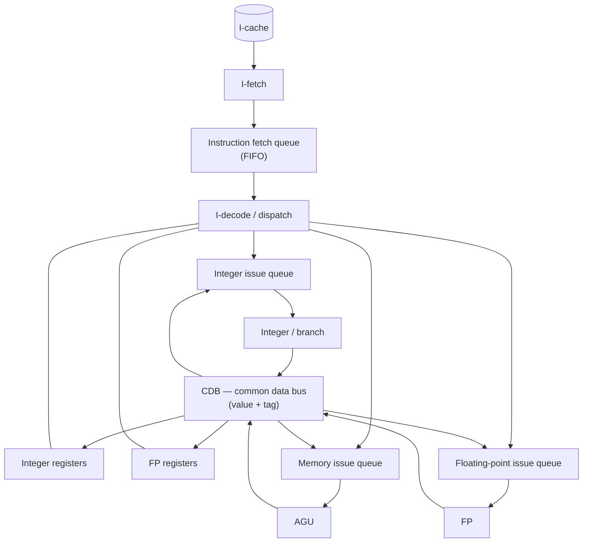

# COE 502 — Lecture 5: Instruction-Level Parallelism

**Parallel Processing Architectures** · KFUPM · Dr. Abdulaziz Tabbakh · slides: `05-ILP.pdf`

---

## The whole lecture in 30 seconds

You write ordinary one-line-after-another code. Some of those instructions don't depend on each other, so they *could* overlap. That hidden overlap is **instruction-level parallelism (ILP)**. You never write it yourself: the compiler or the hardware has to find it.

| Part | Who finds the independent work | Sections |
|---|---|---|
| **Static scheduling** | The **compiler**, before the program runs | 2–10 |
| **Dynamic scheduling** | The **hardware**, while the program runs | 11–15 |
| **VLIW** | The **compiler**, packing several operations into one long instruction | 16 |
| **Vector** | Nobody: **one instruction works on a whole list** of numbers | 17 |

One rule sits behind almost everything in this lecture:

> **Some results take several cycles to be ready. Put independent work in that gap instead of waiting.**

---

## Contents

- [Key words](#key-words)

**Part I — Statically scheduled pipelines**
1. [What this deck is trying to fix](#1-what-this-deck-is-trying-to-fix)
2. [The baseline: a pipeline with a floating-point lane](#2-the-baseline-a-pipeline-with-a-floating-point-lane)
3. [Latency and initiation interval](#3-latency-and-initiation-interval)
4. [The new hazards](#4-the-new-hazards)
5. [Super-pipelined CPU](#5-super-pipelined-cpu)
6. [Superscalar CPU](#6-superscalar-cpu)
7. [In-order (static) instruction scheduling](#7-in-order-static-instruction-scheduling)
8. [Loop unrolling](#8-loop-unrolling)
9. [Software pipelining](#9-software-pipelining)
10. [Strengths and weaknesses of static pipelines](#10-strengths-and-weaknesses-of-static-pipelines)

**Part II — Dynamically scheduled pipelines**

11. [Is superscalar good enough?](#11-is-superscalar-good-enough)
12. [Out-of-order execution and dynamic scheduling](#12-out-of-order-execution-and-dynamic-scheduling)
13. [Tomasulo's algorithm](#13-tomasulos-algorithm)
14. [Hardware-based speculation](#14-hardware-based-speculation)
15. [Multiple issue](#15-multiple-issue)

**Part III — VLIW and vector**

16. [VLIW processors](#16-vliw-processors)
17. [Vector processors](#17-vector-processors)
18. [Summary sheet](#18-summary-sheet)
19. [Self-test](#19-self-test)

---

## Key words

| Word | Meaning |
|---|---|
| **IF · ID · EX · ME · WB** | The 5 pipeline stages: fetch · decode and read registers · execute · memory · write the result to a register |
| **Stall** | A wasted cycle: an instruction waits because an input isn't ready |
| **Forwarding** | Passing a result straight to the next instruction, without waiting for WB |
| **Functional unit** | Hardware that does one kind of work: integer ALU, FP adder, load/store unit |
| **Issue** | Sending an instruction to its functional unit to start executing |
| **Latency** | How many cycles a *dependent* instruction must wait (§3) |
| **Hazard** | A case where overlapping instructions could give a wrong answer or fight over hardware (§4) |
| **Basic block** | Straight-line code with no branch into or out of the middle (§7) |
| **CPI / IPC** | Cycles per instruction / instructions per cycle. IPC = 1 / CPI |

---

## 1. What this deck is trying to fix

**The idea:** a pipeline finishes at most one instruction per cycle (CPI = 1), and every stall pushes CPI above 1. The deck tries to (a) remove stalls and (b) finish *more* than one instruction per cycle.

$$\text{CPI} = 1 + \text{stalls per instruction}$$

| Goal | Means | Covered by |
|---|---|---|
| CPI **down to 1** | Remove stalls by filling waits with independent work | static scheduling, loop unrolling, software pipelining, dynamic scheduling |
| CPI **below 1** | Finish more than one instruction per cycle | superscalar, VLIW, vector |

Where the opportunity comes from:

```
I1:  a = b + c      // independent
I2:  d = e + f      // independent  → I1 and I2 could run at the same time
I3:  g = a + d      // needs both   → must wait for them
```

| | Static scheduling | Dynamic scheduling |
|---|---|---|
| Who | the compiler, before the program runs | the hardware, at run time |
| Sees | the whole program, with unlimited time to think | a small window of instructions, in nanoseconds |
| Knows | nothing about cache misses or actual memory addresses | exactly what is happening right now |

---

## 2. The baseline: a pipeline with a floating-point lane

**The idea:** FP math is slow, so it gets its own 5-stage lane. Instructions still **start** in program order but can now **finish** out of order. That causes the new problems in §4.

**Slide 3 — the plain 5-stage pipeline:**
- Every instruction goes through every stage in order, even stages it doesn't use. So every instruction took the same time, and they automatically finished in the order they started.
- Control signals are created at decode and travel with the instruction ("the instruction carries its baggage"), because 5 different instructions are in the pipeline at once.

**Slide 4 — adding the FP lane:** if FP math were squeezed into one EX stage, the clock would have to slow down for *every* instruction. So FP gets its own lane:

```
                      ┌──────┐
                 ┌───▶│  EX  │──────────────────────────────┐
  ┌────┐  ┌────┐ │    └──────┘   integer lane — 1 cycle      ▼
  │ IF │─▶│ ID │─┤                                      ┌──────┐   ┌──────┐
  └────┘  └────┘ │   ┌─────┬─────┬─────┬─────┬─────┐    │  ME  │──▶│  WB  │
                 └──▶│ FP1 │ FP2 │ FP3 │ FP4 │ FP5 │───▶└──────┘   └──────┘
                     └─────┴─────┴─────┴─────┴─────┘
                        floating-point lane — 5 cycles
```

What the slide's bullets mean:
- **FP instructions take 5 cycles (FP1–FP5) and are pipelined:** a new FP operation can start every cycle.
- **The integer lane (EX)** handles integer operations, branches, loads and stores.
- **Two register files:** `R0–R31` for integers, `F0–F31` for FP. The register names tell you which lane an instruction takes.
- **Forwarding** into EX and FP1. FP results are also forwarded across to the integer lane, because a store like `S.S F2,0(R1)` saves an FP value but travels down the integer lane.
- **Instructions wait in ID** until they're safe to go, and block everything behind them.
- **Static scheduling:** the compiler decides the order.
- **In-order execution, out-of-order completion:**

```
I1:  MUL.D  F0, F2, F4     ← FP, long lane
I2:  ADD    R1, R2, R3     ← integer, short lane
```

| | C1 | C2 | C3 | C4 | C5 | C6 | C7 | C8 | C9 |
|---|---|---|---|---|---|---|---|---|---|
| **I1** MUL.D | IF | ID | FP1 | FP2 | FP3 | FP4 | FP5 | ME | **WB** |
| **I2** ADD | | IF | ID | EX | ME | **WB** | | | |

I2 started second but finished three cycles earlier. Nothing was reordered: both passed through ID in order. They just took lanes of different lengths.

| Term | Meaning | Still guaranteed? |
|---|---|---|
| **In-order execution** | instructions *start* in program order | ✅ yes |
| **Out-of-order completion** | they *finish* whenever their lane allows | ❌ no |

> 💡 One door leading to a short corridor and a long corridor. People walk in one at a time, in order, but whoever takes the short corridor comes out first.

---

## 3. Latency and initiation interval

**The idea:** two different timing numbers. **Latency** = how long a *dependent* instruction must wait for a result. **Initiation interval** = how often a unit can *start* a new operation, dependent or not.

| | Question it answers |
|---|---|
| **Latency** | How many cycles must a dependent instruction stall? |
| **Initiation interval** | How often can this unit start a new operation? |

> 💡 A car wash with 5 stations, 1 minute each. A car takes 5 minutes to get through, but a new car can enter every minute (interval 1). A one-bay car wash that takes 5 minutes per car only takes a new car every 5 minutes (interval 5).

Baseline machine (slide 5):

| Functional unit | Latency | Initiation interval |
|---|---|---|
| Integer ALU | 0 | 1 |
| Load | 1 | 1 |
| FP OP | 4 | 1 (5 if not pipelined) |

$$\text{latency} = \text{execution time} - 1$$

Why minus 1? The next instruction is always one cycle behind anyway, so that one cycle of waiting is free.

**Where each latency comes from.** A result is ready at the end of: **EX** (integer), **ME** (load, because the value comes from memory), **FP5** (FP). The consumer needs it at the start of its own EX (or FP1).

Integer ALU — latency 0:
```
Cycle:            1   2   3   4   5   6
ADD  R1,R2,R3     IF  ID  EX  ME  WB     ← result at end of EX (cycle 3)
SUB  R4,R1,R5         IF  ID  EX  ME  WB ← needs it at start of EX (cycle 4): forwarded, no stall
```
Load — latency 1:
```
Cycle:            1   2   3   4   5   6   7
LD   R1,0(R2)     IF  ID  EX  ME  WB         ← value ready at end of ME (cycle 4)
ADD  R3,R1,R4         IF  ID  ID* EX  ME  WB ← wanted it in cycle 4 → 1 stall
```
FP — latency 4:
```
Cycle:            1   2   3   4   5   6   7   8   9   10
MUL.D F0,F2,F4    IF  ID  FP1 FP2 FP3 FP4 FP5 ME  WB      ← result at end of FP5 (cycle 7)
ADD.D F6,F0,F8        IF  ID  ID* ID* ID* ID* FP1 FP2 FP3 ← 4 stalls
```

**Initiation interval is 1** for every unit because they are all pipelined. An unpipelined FP unit would be busy for all 5 cycles, so even *independent* FP operations would have to start 5 cycles apart (interval 5). That waiting is a structural hazard (hardware busy), not a data one.

### The rule you'll use everywhere

$$\text{stalls} = \text{latency} - (\text{independent instructions placed in between}) \qquad (\text{never below } 0)$$

Latency 4 with interval 1 means a dependent instruction waits 4 cycles, but 4 independent FP operations can start back to back. **Fill those 4 cycles with independent work and the latency costs nothing.** Sections 7–9 are all about finding that work.

```
Naive order                         Reordered
MUL.D  F0,F2,F4                     MUL.D  F0,F2,F4
ADD.D  F6,F0,F8     ← 4 stalls      MUL.D  F10,F12,F14  ┐
MUL.D  F10,F12,F14                  MUL.D  F16,F18,F20  │ 4 independent
MUL.D  F16,F18,F20                  MUL.D  F22,F24,F26  │ instructions
MUL.D  F22,F24,F26                  DADDUI R1,R1,#8     ┘
DADDUI R1,R1,#8                     ADD.D  F6,F0,F8     ← 4 − 4 = 0 stalls
```

---

## 4. The new hazards

**The idea:** because instructions can now finish out of order, **WAW** becomes possible and two instructions can try to **write registers in the same cycle**. **WAR** is still impossible. **RAW** stalls get longer.

### The three data hazard names

| Name | The program says… | The danger |
|---|---|---|
| **RAW** (read after write) | I1 writes a register, then I2 reads it | I2 reads too early and gets the old value |
| **WAR** (write after read) | I1 reads a register, then I2 writes it | I2 writes too early, so I1 reads the new value by mistake |
| **WAW** (write after write) | I1 writes, then I2 writes the same register | the writes land in the wrong order, so the older value survives |

> 💡 A shared whiteboard. **RAW:** you copy a number before your colleague has written it. **WAR:** your colleague erases it before you've finished copying. **WAW:** the person meant to write first writes last, so their outdated number stays on the board.

### Structural hazards (slide 6)

Two instructions can reach the same stage in the same cycle:

| | C1 | C2 | C3 | C4 | C5 | C6 | C7 | **C8** | **C9** | C10 |
|---|---|---|---|---|---|---|---|---|---|---|
| **I1** `Add.S f1,f2,f1` | IF | ID | FP1 | FP2 | FP3 | FP4 | FP5 | **ME** | **WB** | |
| **I2** `Add.S f4,f2,f3` | | IF | ID | FP1 | FP2 | FP3 | FP4 | FP5 | ME | WB |
| **I3** `L.S f10` | | | IF | ID | EX | ME | WB | | | |
| **I4** `L.S f12` | | | | IF | ID | EX | ME | **WB** | | |
| **I5** `L.S f14` | | | | | IF | ID | EX | **ME** | **WB** | |

- **C8:** I1 and I5 are both in ME. **Harmless:** I1 is an FP add and doesn't actually use memory.
- **C9:** I1 and I5 are both in WB, both writing FP registers. **Real conflict** on the FP register file's write port.
- Two general fixes: **add hardware** (an extra write port, "way too complex") or **stall** one instruction. In practice: stall.

### Data hazards (slide 7)

**WAW is now possible:**
```
Cycle:            1   2   3   4   5   6   7   8   9
ADD.D F2,F4,F6    IF  ID  FP1 FP2 FP3 FP4 FP5 ME  WB ← writes F2 in cycle 9
L.D   F2,0(R2)        IF  ID  EX  ME  WB             ← writes F2 in cycle 6 (too early!)
```
Without protection, the slow `ADD.D` writes F2 last, so its stale value wins. Program order says the `L.D` value must be final. **Fix: the `L.D` stalls in ID** until its WB will come after the `ADD.D`'s.

**WAR is still impossible:** every instruction reads its registers in **ID** (stage 2) and writes in **WB** (the last stage). A later instruction can never write before an earlier one has already read.

**RAW stalls get longer** (FP latency is 4):

| | C1 | C2 | C3 | C4 | C5 | C6 | C7 | C8 | C9 | C10 | C11 |
|---|---|---|---|---|---|---|---|---|---|---|---|
| **I1** `L.D F4, 0(R2)` | IF | ID | EX | ME | WB | | | | | | |
| **I2** `MULT.D F0,F4,F6` | | IF | ID | **ID** | FP1 | FP2 | FP3 | FP4 | FP5 | ME | WB |
| **I3** `S.D F0, 0(R2)` | | | IF | **IF** | ID | **ID** | **ID** | **ID** | **ID** | EX | ME |

- I2 waits 1 cycle in ID for the load (load latency 1).
- That stall **ripples**: I2 is still in ID during C4, so I3 can't enter ID and waits in IF.
- I3 then waits in ID until the multiply finishes FP5 (C9), and executes in C10.

> ⚠️ I3 loses **5 cycles in total = 1 in IF (the ripple) + 4 in ID (FP latency)**. It sits in ID for 5 cycles, but one of those is its normal ID cycle.

**No data hazards on memory:** loads and stores all go through the single ME stage, in program order. The price: memory operations can never overlap or be reordered. Dynamic scheduling later adds load/store queues to relax this.

### Summary

| Hazard | Simple 5-stage pipeline | With the FP lane | Why |
|---|---|---|---|
| **RAW** | exists, mostly forwarded | **worse** | FP results take 4 extra cycles |
| **WAR** | impossible | **still impossible** | reads happen in ID, long before any write |
| **WAW** | impossible | ⚠️ **possible** | out-of-order completion |
| **Structural** | on memory | ⚠️ **+ FP register write port** | two instructions can reach WB together |

---

## 5. Super-pipelined CPU

**The idea:** cut the slow stages in two so the clock can tick about twice as fast. Each instruction now takes more cycles, so every stall costs more cycles. **You buy clock speed with stall cycles.**

```
┌─────┐  ┌─────┐  ┌────┐   ┌─────┐  ┌─────┐   ┌─────┐  ┌─────┐  ┌────┐
│ IF1 │─▶│ IF2 │─▶│ ID │──▶│ EX1 │─▶│ EX2 │──▶│ ME1 │─▶│ ME2 │─▶│ WB │
└─────┘  └─────┘  └────┘ │ └─────┘  └─────┘ ▲ └─────┘  └─────┘  └────┘
                         │   ┌──────────────┤
                         └──▶│ FP PIPELINE(s)│
                             └──────────────┘
```

IF, EX and ME are each split in two (8 stages). The FP lane is assumed unchanged.

| Unit | Latency | Why it changed |
|---|---|---|
| Integer ALU | **1** (was 0) | the work now spans EX1 + EX2 = 2 stages → 2 − 1 |
| Load | **3** (was 1) | the value is ready only after ME2: EX1, EX2, ME1, ME2 = 4 stages → 4 − 1 |
| FP OP | 4 | FP lane assumed unchanged |
| Taken branch | **3-cycle penalty** | more stages before the branch is decided, so more wrong instructions get fetched |

Integer ALU — now 1 stall:
```
Cycle:            1   2   3   4   5   6   7   8
ADD  R1,R2,R3     IF1 IF2 ID  EX1 EX2 ME1 ME2 WB ← result at end of EX2 (cycle 5)
SUB  R4,R1,R5         IF1 IF2 ID  ID* EX1 EX2    ← 1 stall
```
Load — now 3 stalls:
```
Cycle:            1   2   3   4   5   6   7   8   9
LD   R1,0(R2)     IF1 IF2 ID  EX1 EX2 ME1 ME2 WB     ← value ready at end of ME2 (cycle 7)
ADD  R3,R1,R4         IF1 IF2 ID  ID* ID* ID* EX1 EX2← 3 stalls
```
Taken branch — 3 wasted fetches (a penalty of 3 matches the branch being decided at the end of EX1; the slide doesn't say which stage):
```
Cycle:            1   2   3   4   5
BEQ (taken)       IF1 IF2 ID  EX1    ← outcome known at end of cycle 4
next (wrong)          IF1 IF2 ID  ✗
next (wrong)              IF1 IF2 ✗
next (wrong)                  IF1 ✗
branch target                     IF1  ← right instruction starts in cycle 5
```

### Is it actually faster?

$$\text{time} = \text{instructions} \times \text{CPI} \times \text{cycle time}$$

A faster clock (smaller cycle time), but a higher CPI (more stalls). Example, 10⁹ instructions:

| | Cycle time | CPI | Time |
|---|---|---|---|
| Old 5-stage | 1.0 ns | 1.3 | 1.30 s |
| 8-stage, moderate stalls | 0.5 ns | 1.8 | **0.90 s** ✅ |
| 8-stage, stall-heavy code | 0.5 ns | 2.8 | **1.40 s** ❌ |

**Why "2× (hopefully)":** every stage ends in a pipeline register, which adds a fixed delay. A 1.0 ns stage = 0.9 ns of work + 0.1 ns for the register. Split it in half: 0.45 + 0.1 = 0.55 ns, not 0.5. So about 1.8×, and less with every extra split.

> 💡 The **Pentium 4** pushed this to ~20+ stages to chase clock speed. Branch mispredictions threw away more work, latencies in cycles grew, and power and heat exploded (the power wall from Lecture 1). Past a point, deeper pipelines get slower, which helped end the clock-speed race.

---

## 6. Superscalar CPU

**The idea:** start **2 instructions per cycle**, side by side, at the same clock speed. Still one CPU running one program; it just has extra functional units inside. It is **not** multiple cores.

> 💡 Two cooks working side by side on the same order list: one does mains on the grill, one does desserts in the oven. Two dishes can start every minute, but only if they don't depend on each other.

```
   scalar                          superscalar
┌──────────────┐          ┌──────────────────────────────┐
│ fetch/decode │          │        fetch / decode        │
├──────────────┤          ├──────────────────────────────┤
│  scheduler   │          │          scheduler           │
├──────────────┤          ├────────┬────────┬────────────┤
│ read register│    ⟹     │  read  │  read  │   read     │
├──────────────┤          ├────────┼────────┼────────────┤
│   execute    │          │  ALU   │   FP   │   data     │
├──────────────┤          ├────────┼────────┼────────────┤
│  write back  │          │ write  │ write  │  write     │
├──────────────┤          ├────────┴────────┴────────────┤
│    retire    │          │           retire             │
└──────────────┘          └──────────────────────────────┘
```

### The 2-way machine (slide 10)

1. **Up to 2 instructions per cycle**, same clock rate as the basic pipeline.
2. **The pair must be one integer/branch/memory instruction + one FP instruction.** They read different register files, so no extra read ports are needed. Allowing *any* two would mean doubling the ports on one register file, which is expensive.
3. **The compiler** places valid pairs next to each other.
4. **The two must be independent** of each other and of earlier unfinished instructions. If not, the first goes alone and the second waits a cycle.
5. Same latencies as the basic pipeline; branches are resolved in EX.

**Example:**
```
I1  L.D    F0, 0(R1)      ; int/memory
I2  ADD.D  F4, F2, F6     ; FP, independent of I1
I3  DADDUI R1, R1, #8     ; int
I4  MUL.D  F8, F0, F10    ; FP, needs F0 from I1
I5  DSUB   R5, R6, R7     ; int, independent
```
```
Cycle:            1   2   3   4   5   6   7   8   9   10  11
I1 L.D    F0      IF  ID  EX  ME  WB
I2 ADD.D  F4      IF  ID  FP1 FP2 FP3 FP4 FP5 ME  WB
I3 DADDUI R1          IF  ID  EX  ME  WB
I4 MUL.D  F8          IF  ID  ID* FP1 FP2 FP3 FP4 FP5 ME  WB
I5 DSUB   R5              IF  ID  EX  ME  WB
```
- I1 + I2 enter together (int + FP, independent).
- I3 + I4 enter together, but I4 needs F0 from the load, so it waits one cycle in ID.
- I5 enters behind them.

> ⚠️ **"2 per cycle" does not mean an instruction finishes in less than a cycle.** Every instruction still goes through every stage. The gain is that **twice as many instructions are in flight at once**: the staircase of start points steps by 2 here instead of 1. Over millions of instructions, the rate they enter = the rate they finish = IPC.

> 💡 Compared with the FP-lane machine (§2): same lanes, but the FP-lane machine has **one door** (one instruction enters per cycle) and the superscalar has a **double door** (two enter per cycle).

**IPC = 1 / CPI.** Here, 5 instructions start executing over 3 cycles (EX/FP1 in C3, C4, C5): 6 slots, 1 empty → IPC ≈ 1.67 in the long run. The maximum for 2-way is 2.0.

### Handling hazards in the pair

Same tools as before (forward, stall in ID), plus one new move: **split the pair**. Every cycle the hardware checks:
1. Can the first instruction go (no hazard with earlier instructions)? **No** → both wait.
2. Can the two go together (int + FP, second independent of first)? **No** → first goes alone.
3. Can the second go (no hazard with earlier instructions)? **No** → first goes alone.

Instructions always issue **in program order**: the second can never overtake the first.

### The costs

- **Stalls cost twice as much:** a stall cycle now wastes **2** slots. A load with latency 1 can cost up to **3** slots: its partner in the same cycle can't use the value, and neither can either slot in the next cycle.
- **Exceptions are harder:** two instructions start together but finish at different times.
- **Hard to go beyond 2-way:** issuing n instructions together means checking every pair among them, n(n−1)/2 checks: 1 for 2-way, 6 for 4-way, 28 for 8-way (more in §15).

**Superpipelining + superscalar combine:** one shortens the cycle, the other widens it. Ideal: 2× clock × 2-way = up to 4× more instructions per second. Less in practice, because both make stalls more expensive.

---

## 7. In-order (static) instruction scheduling

**The idea:** the hardware runs instructions in exactly the written order and won't skip past a stuck one. So the **compiler rewrites the order** so that independent instructions fill the waits.

> **Compiler moves code up or down:**
> - **Local:** inside one basic block
> - **Global:** across basic blocks
>   - **Cyclic:** loops (→ loop unrolling, software pipelining)
>   - **Non-cyclic:** traces (the most likely path through several blocks, scheduled as if it were one long block)

**Basic block** = straight-line code with no branch into or out of the middle: you enter at the top and leave at the bottom. Inside one, the compiler can reorder freely, as long as it respects the dependencies.

### The running example

```c
for (i = 0; i < 100; i++)
    A[i] := a[i] + b[i];
```
> ⚠️ `:=` is Pascal notation, and Pascal ignores case, so **A and a are the same array**. That's why the store uses R1, the same pointer as the first load.

| Instruction | Plain words |
|---|---|
| `L.S F0,#4(R1)` | load a number from list a (address R1 + 4) |
| `L.S F1,#4(R2)` | load a number from list b |
| `ADD.S F2,F1,F0` | add them |
| `S.S F2,#4(R1)` | save the answer |
| `ADDI R1,R1,#8` | move the list-a pointer forward |
| `ADDI R2,R2,#8` | move the list-b pointer forward |
| `SUBI R3,R3,#2` | count down |
| `BNEZ R3,Loop` | if not finished, go back to the top |

**Unscheduled: 15 clocks per iteration.** The clock count for each instruction includes the stalls before it.

| Instruction | Clocks | Why |
|---|---|---|
| `L.S F0` | 1 | |
| `L.S F1` | 1 | |
| `ADD.S` | **2** | needs F1 from the load right before it → 1 stall |
| `S.S` | **5** | needs F2 from the add right before it → 4 stalls |
| `ADDI`, `ADDI`, `SUBI` | 1 each | |
| `BNEZ` | **3** | branch penalty: 2 wasted fetches |
| **Total** | **15** | CPI = 15/8 ≈ 1.88 |

```
Cycle:            1   2   3   4   5   6   7   8   9   10  11  12  13  14  15  16  17  18
L.S   F0,#4(R1)   IF  ID  EX  ME  WB
L.S   F1,#4(R2)       IF  ID  EX  ME  WB
ADD.S F2,F1,F0            IF  ID  ID* FP1 FP2 FP3 FP4 FP5 ME  WB
S.S   F2,#4(R1)               IF  IF* ID  ID* ID* ID* ID* EX  ME  WB
ADDI  R1,R1,#8                        IF  IF* IF* IF* IF* ID  EX  ME  WB
ADDI  R2,R2,#8                                            IF  ID  EX  ME  WB
SUBI  R3,R3,#2                                                IF  ID  EX  ME  WB
BNEZ  R3,Loop                                                     IF  ID  EX
(wrong)                                                               IF  ID  ✗
(wrong)                                                                   IF  ✗
L.S F0 next iter                                                              IF  ID  EX
```
- **C5:** the add wants to start, but b only arrives at the end of C5 (ME of the second load), so it waits.
- **C7–C10:** the store waits for the sum, which is ready at the end of FP5 (C10).
- **C7–C10:** `ADDI R1` doesn't need the sum, but it's stuck behind the store (in-order).
- **15** = `L.S F0` reaches EX in C3, and the next iteration's `L.S F0` reaches EX in C18.

### Local code scheduling (slide 12)

**Move SUBI up, move S.S down:**

```asm
Loop:  L.S   F0,#4(R1)
       L.S   F1,#4(R2)
       SUBI  R3,R3,#2      ← moved up: fills the load gap
       ADD.S F2,F1,F0      ← no stall now
       ADDI  R1,R1,#8
       ADDI  R2,R2,#8
       S.S   F2,#-4(R1)    ← moved down: 2 instructions between it and the add
       BNEZ  R3,Loop
```

| Producer → consumer | Latency | Independent instructions between | Stalls |
|---|---|---|---|
| `L.S F1` → `ADD.S` | 1 | 1 (`SUBI`) | 0 |
| `ADD.S` → `S.S` | 4 | 2 (`ADDI`, `ADDI`) | 2 |

**12 clocks** → speedup 15/12 = **1.25**.

```
Cycle:            1   2   3   4   5   6   7   8   9   10  11  12  13  14  15
L.S   F0,#4(R1)   IF  ID  EX  ME  WB
L.S   F1,#4(R2)       IF  ID  EX  ME  WB
SUBI  R3,R3,#2            IF  ID  EX  ME  WB
ADD.S F2,F1,F0                IF  ID  FP1 FP2 FP3 FP4 FP5 ME  WB
ADDI  R1,R1,#8                    IF  ID  EX  ME  WB
ADDI  R2,R2,#8                        IF  ID  EX  ME  WB
S.S   F2,#-4(R1)                          IF  ID  ID* ID* EX  ME  WB
BNEZ  R3,Loop                                 IF  IF* IF* ID  EX
(wrong)                                                   IF  ID  ✗
(wrong)                                                       IF  ✗
L.S F0 next iter                                                  IF  ID  EX
```

### ⚠️ The displacement fix (exam favourite)

`S.S` builds its address from R1. It now runs **after** `ADDI R1,R1,#8`, so R1 has already moved. Example: R1 = 1000, and the answer belongs at 1004.

| Order | R1 when the store runs | Address |
|---|---|---|
| Original: `S.S F2,#4(R1)`, then `ADDI` | 1000 | 1000 + 4 = **1004** ✅ |
| Moved, not fixed: `ADDI`, then `S.S F2,#4(R1)` | 1008 | 1008 + 4 = 1012 ❌ |
| Moved and fixed: `ADDI`, then `S.S F2,#-4(R1)` | 1008 | 1008 − 4 = **1004** ✅ |

**New displacement = old displacement − how far the register moved** = 4 − 8 = −4.

The slide calls this a **"WAR hazard on R1"**: the store *reads* R1, then `ADDI` *writes* it. Moving the store below `ADDI` flips that order, so the compiler must repair it.

> ⚠️ "WAR is impossible" (§4) is about the **pipeline**, which never reorders. Here the **compiler** is reordering, so the compiler has to watch for WAR itself.

### Limits

- **The branch penalty can't be fixed locally:** the branch is the last instruction, so there's nothing left in the block to put after it. Options: move the branch to the top of the loop, or use a **delayed branch** (the instruction right after a branch always runs, so the compiler puts something useful there).
- **Basic blocks are small** (here, 8 instructions). Even after reordering, the store still stalls 2 cycles. → We need **global scheduling: loop unrolling and software pipelining.**

---

## 8. Loop unrolling

**The idea:** do **two iterations per trip** through the loop. That gives the compiler more independent instructions to fill waits with, and the loop bookkeeping (pointer moves, count down, branch) runs once per two numbers instead of once per number.

### Step 1: unroll (copy the body)

```asm
L.S   F0,0(R1)      ┐
L.S   F1,0(R2)      │ number 1 (at pointer + 0)
ADD.S F2,F1,F0      │
S.S   F2,0(R1)      ┘
L.S   F0,#4(R1)     ┐
L.S   F1,#4(R2)     │ number 2 (at pointer + 4, the next number)
ADD.S F2,F1,F0      │
S.S   F2,#4(R1)     ┘
ADDI  R1,R1,#8      ┐
ADDI  R2,R2,#8      │ bookkeeping, now once per 2 numbers
SUBI  R3,R3,#2      │
BNEZ  R3,Loop       ┘
```

### Step 2: rename the registers of the second copy

Both copies use F0, F1, F2. To mix the copies in Step 3, they need **separate registers**. Otherwise, with a[0] = 10, b[0] = 20, a[1] = 1, b[1] = 2, moving all four loads to the top gives:

```
L.S F0 ← 10,  L.S F1 ← 20,  L.S F0 ← 1 (overwrites!),  L.S F1 ← 2 (overwrites!)
ADD.S F2 = 1 + 2 = 3        ← copy 1 should have got 10 + 20 = 30
```

So the second copy gets **F3, F4, F5**:

```asm
L.S   F3,#4(R1)      ← was F0
L.S   F4,#4(R2)      ← was F1
ADD.S F5,F3,F4       ← was F2,F1,F0
S.S   F5,#4(R1)      ← was F2
```
This is **register renaming done by the compiler**: the same idea as hardware renaming (Lecture 2), done in software.

### Step 3: schedule (loads up, stores down)

```
Cycle:            1   2   3   4   5   6   7   8   9   10  11  12  13  14  15  16  17
L.S   F0,0(R1)    IF  ID  EX  ME  WB
L.S   F1,0(R2)        IF  ID  EX  ME  WB
L.S   F3,#4(R1)           IF  ID  EX  ME  WB
L.S   F4,#4(R2)               IF  ID  EX  ME  WB
ADD.S F2,F1,F0                    IF  ID  FP1 FP2 FP3 FP4 FP5 ME  WB
ADD.S F5,F3,F4                        IF  ID  FP1 FP2 FP3 FP4 FP5 ME  WB
SUBI  R3,R3,#2                            IF  ID  EX  ME  WB
ADDI  R1,R1,#8                                IF  ID  EX  ME  WB
ADDI  R2,R2,#8                                    IF  ID  EX  ME  WB
S.S   F2,#-8(R1)                                      IF  ID  EX  ME  WB
S.S   F5,#-4(R1)                                          IF  ID  EX  ME  WB
BNEZ  R3,Loop                                                 IF  ID  EX
(wrong)                                                           IF  ID  ✗
(wrong)                                                               IF  ✗
L.S F0 next trip                                                          IF  ID  EX
```
**No `ID*` anywhere.** Checking each dependency:

| Who | Needs | Ready at end of | Needed at start of | OK? |
|---|---|---|---|---|
| 1st add | F1 | C5 (ME) | C7 (FP1) | ✅ |
| 2nd add | F4 | C7 (ME) | C8 (FP1) | ✅ just in time |
| 1st store | F2 | C11 (FP5) | C12 (EX) | ✅ just in time |
| 2nd store | F5 | C12 (FP5) | C13 (EX) | ✅ just in time |

**14 clocks per trip = 7 per original iteration** → speedup 15/7 = **2.14**.

**Store displacements:** the stores now run after `ADDI R1,R1,#8`. With R1 = 1000, the two numbers belong at 1000 and 1004. R1 is 1008 by then, so `#-8(R1)` = 1000 and `#-4(R1)` = 1004.

The slide's **"super"** column is the same code on the super-pipelined machine (§5): each add waits 1 cycle and the branch costs 4. Counting the same way gives 17 clocks per trip (8.5 per number). *(The 17 is my count; the slide doesn't give the total.)*

| Version | Clocks per number |
|---|---|
| Original | 15 |
| Local scheduling | 12 |
| Unrolled + renamed, *not* scheduled | 24 / 2 = 12 (only the bookkeeping saving) |
| **Unrolled + renamed + scheduled** | **14 / 2 = 7** |

### Name dependence (slide 14)

- **True dependence (RAW):** a value really **flows** from one instruction to the next (the store needs the sum). It can't be removed, only waited for.
- **Name dependence:** two instructions just **share a register name**, but no value flows between them. It's removed by **renaming**.

| Old name (deck 02) | This deck's name | Pattern | Example from Step 1 |
|---|---|---|---|
| **WAR** | **anti-dependence** | j writes what i reads | copy 1's add reads F0, then copy 2's load writes F0 |
| **WAW** | **output dependence** | i and j write the same place | both copies' adds write F2 |
| **RAW** | true data dependence | j reads what i wrote | not removable |

> ⚠️ The slide says "a register **or memory location**". Name dependences happen on memory too, and memory can't be renamed easily. That's why dynamic scheduling later needs load/store queues.

### Limitations (slide 15)

**1. Loop-carried dependence:**
```c
for (i = 5; i < 100; i++)
    A[i] := a[i-5] + b[i];      // A and a are the same array (Pascal)
```
Iteration i reads a[i−5], which iteration i−5 wrote. Iterations 5–9 only read a[0]–a[4] (already there), so they're independent. Iteration 10 reads a[5], which iteration 5 wrote. **Distance = 5.**

So any 5 consecutive iterations (i … i+4) are independent and can be mixed freely. The **6th** copy (i+5) would depend on the 1st.

> ⚠️ The slide says "**unroll up to 4 times**; 5 times ⟹ dependency limits code motion". That matches if "unroll 4 times" means **4 extra copies + the original = 5 copies**. Saying "4 copies, the 5th collides" is off by one. Check which way the professor counts.

**2. Uses up registers:** each copy needs its own. 2 copies used 6 FP registers; 8 copies would need 24.

**3. Code gets bigger:** it may no longer fit in the instruction cache, which slows down fetching.

**4. Unknown number of iterations:** unrolling by 4 with 103 iterations → 25 trips cover 100, and 3 are left over. If the count isn't known at compile time, the compiler must add a **leftover loop**: more code, more branches.

---

## 9. Software pipelining

**The idea:** each trip through the loop **saves the previous number's answer**, then **loads and adds the next number**. The save never waits, because the sum it saves was started a whole trip earlier. It's the same single pipeline, one instruction entering per cycle; **only the order of the code changes.**

> 💡 A dishwasher: every time you go to it, unload the clean batch from last time, then load and start the new batch, and walk away. You never stand there waiting for it to finish.

### The actual instruction sequence, for 3 numbers

```
   ── prologue (before the loop) ──
 1  load a #1
 2  load b #1
 3  count down
 4  add #1
 5  move pointer a
 6  move pointer b
   ── loop, 1st trip ──
 7  save #1          ← #1's add started back on line 4
 8  load a #2
 9  load b #2
10  count down
11  add #2
12  move pointer a
13  move pointer b
14  go back to top
   ── loop, 2nd trip ──
15  save #2          ← #2's add started back on line 11
16  load a #3
17  load b #3
18  count down
19  add #3
20  move pointer a
21  move pointer b
22  go back? (counter is 0 → no)
   ── epilogue (after the loop) ──
23  save #3
```
- **Prologue:** the first trip has no previous answer to save, so number 1's loads and add go before the loop.
- **Epilogue:** after the last trip, the last answer still needs saving.

### The slide's diagonal table (slide 16)

| | O_ITE1 | O_ITE2 | O_ITE3 | O_IT4 |
|---|---|---|---|---|
| **Prologue** | L.S F0 · L.S F1 · ADD.S F2 | — | — | — |
| **P_ITE1** | S.S F2 | L.S F0 · L.S F1 · ADD.S F2 | — | — |
| **P_ITE2** | — | S.S F2 | L.S F0 · L.S F1 · ADD.S F2 | — |
| **P_ITE3** | — | — | S.S F2 | L.S F0 · L.S F1 · ADD.S F2 |
| **Epilogue** | | | | S.S F2 |

> ⚠️ This is a **plan**, not a timing chart. Nothing in a row runs at the same time: each row is one trip of the new loop, executed one instruction after another. **Read a row** = what one trip does. **Follow a diagonal** = one original iteration, still in order, just split across two trips.

### The code (slide 17)

```asm
Prologue:  L.S   F0,0(R1)
           L.S   F1,0(R2)
           SUBI  R3,R3,#1
           ADD.S F2,F1,F0
           ADDI  R1,R1,#4
           ADDI  R2,R2,#4
Loop:      S.S   F2,#-4(R1)    ; save the PREVIOUS number (pointer already moved, so −4)
           L.S   F0,0(R1)      ; load the NEXT number
           L.S   F1,0(R2)
           SUBI  R3,R3,#1
           ADD.S F2,F1,F0      ; add the NEXT number
           ADDI  R1,R1,#4
           ADDI  R2,R2,#4
           BNEZ  R3,Loop
Epilogue:  S.S   F2,#-4(R1)    ; save the LAST number
```
(Here each trip handles one number of 4 bytes, so the pointers move by 4 and the counter by 1.)

```
Cycle:            1   2   3   4   5   6   7   8   9   10  11  12  13  14  15
S.S   F2,#-4(R1)  IF  ID  EX  ME  WB
L.S   F0,0(R1)        IF  ID  EX  ME  WB
L.S   F1,0(R2)            IF  ID  EX  ME  WB
SUBI  R3,R3,#1                IF  ID  EX  ME  WB
ADD.S F2,F1,F0                    IF  ID  FP1 FP2 FP3 FP4 FP5 ME  WB
ADDI  R1,R1,#4                        IF  ID  EX  ME  WB
ADDI  R2,R2,#4                            IF  ID  EX  ME  WB
BNEZ  R3,Loop                                 IF  ID  EX
(wrong)                                           IF  ID  ✗
(wrong)                                               IF  ✗
S.S next trip                                             IF  ID  EX  ME  WB
```
- The add gets b in time (`SUBI` fills the gap, as in §7).
- The sum is ready at the end of C11, and the **next trip's** save uses it in C13. In between: the two `ADDI`s, the branch, **and the branch's 2 wasted cycles**. The branch penalty now overlaps the add's wait instead of adding to it.
- **10 clocks per number** → speedup 15/10 = **1.5**.

**Check with 100 numbers** (R3 starts at 100): the prologue loads and adds #1; the loop runs 99 times (saves #1–99, loads and adds #2–100); the epilogue saves #100. Every number is handled exactly once. ✅

**No renaming needed:** in each trip, the save *reads* the old F2 before the add *writes* the new F2. One set of registers is enough.

### Unrolling vs software pipelining

| | Loop unrolling | Software pipelining |
|---|---|---|
| How | copy the body N times | split each iteration across two trips |
| Fixes | bookkeeping cost (shared by N numbers) | waiting (no stalls) |
| Code size | grows | same (+ a small prologue/epilogue) |
| Extra registers | yes (renaming) | no |
| Must know the iteration count? | effectively yes | no |
| Running example | 7 clocks/number | 10 clocks/number |

Software pipelining removes all the waiting, but each number still pays for its own bookkeeping (2 moves + count down + 3-clock branch = 6 of the 10 clocks). Unrolling shares that cost. **So use both: unroll first, then software-pipeline the bigger body.**

---

## 10. Strengths and weaknesses of static pipelines

**Strengths**
- **Simple hardware** → faster clock, less power and energy.
- **Predictable:** performance can be worked out in advance.
- **The compiler sees the whole program** (for example, it can optimise a whole loop).

**Weaknesses**
- **Can't react to run-time events** (cache misses, branch outcomes). On a cache miss the whole processor freezes, and only one memory access can happen at a time.
- **No run-time information, especially memory addresses** → limits how far the compiler can move code.
- **Compilers get complex:** they must speed things up without breaking correctness.

> 📌 **Why memory addresses are the killer:**
> ```
> S.S  F2, 0(R1)
> L.S  F6, 0(R5)     ← can this load move above the store?
> ```
> Only if R1 ≠ R5. The compiler usually can't prove that, so it must keep the order "just in case". The hardware sees the actual values at run time and can reorder safely. **That information gap is the main argument for dynamic scheduling.**

---

## 11. Is superscalar good enough?

**The idea:** an in-order superscalar only fills its second slot when the *next* instruction happens to be independent. Neighbouring instructions usually depend on each other, so the second pipe sits idle much of the time.

**The fix is out-of-order execution:** run instructions in **data-flow order** (as soon as their inputs exist), not program order, while still producing the same results as the original program.

> 📌 Program order is just how you happened to write the code. Data flow (who needs whose result) is the real constraint.

---

## 12. Out-of-order execution and dynamic scheduling

**The idea:** the **hardware** lets ready instructions go **past** stuck ones while the program runs. Results are still made official **in program order**, so from the outside it looks like nothing was reordered.

> 💡 A restaurant with a set menu. Orders are pinned on a board as they arrive. Any cook takes any order whose ingredients are ready, even a later one. Finished dishes wait on a counter and are **served in menu order**. The customer never knows the kitchen cooked out of order.

### The 6 steps

| # | Step | In order? | Restaurant |
|---|---|---|---|
| 1 | **Fetch** | ✅ | order arrives |
| 2 | **Dispatch** to a queue (instruction buffer / **reservation stations**) | ✅ | pin it on the board |
| 3 | **Wait** until inputs are ready; **may leave before older instructions** | ❌ | wait for ingredients |
| 4 | **Issue and execute** in a functional unit | ❌ | a cook takes it |
| 5 | **Result queued** (not official yet) | ❌ | dish on the counter |
| 6 | **Retire / graduate:** write to the real registers only after all older instructions have | ✅ | serve in menu order |

> 🔑 **Step 6 makes it legal.** The registers the program sees (the **architectural state**) only ever change in program order. All the out-of-order work happens in temporary storage (the **physical state**, Lecture 2).

### Example

```
1  L.S   F0, 0(R1)     ; load
2  ADD.S F2, F0, F4    ; needs F0
3  S.S   F2, 0(R1)     ; needs F2
4  ADDI  R2, R2, #4    ; needs nothing
5  SUBI  R3, R3, #1    ; needs nothing
```

The cycle in which each one starts its real work (EX / FP1):

| Instruction | In-order pipeline | Out-of-order |
|---|---|---|
| 1 load | 3 | 3 |
| 2 add | 5 | 5 |
| 3 store | 10 | 10 |
| 4 ADDI | **11** (stuck behind the store) | **6** |
| 5 SUBI | **12** (stuck behind the store) | **7** |

*(The out-of-order column assumes one instruction is fetched per cycle and each one starts as soon as its inputs are ready.)*

This is exactly what local scheduling did by hand (moving `SUBI` up), but now **the hardware does it on unmodified code**. There's also no `#-4` displacement fix: the program still says the store comes before `ADDI R1`, and hardware renaming (§13) makes sure the store still sees the old R1.

### Dynamic scheduling (slide 21)

Rearrange the order of instructions to reduce stalls while keeping the data flow. It implies **out-of-order execution** and **out-of-order completion**.

| Advantages | Disadvantages |
|---|---|
| The compiler doesn't need to know the chip's latencies, so the same code runs well on different chips | **Much more hardware** (queues, tracking, buffers) → chip area and power |
| Handles things unknown at compile time: whether a load misses the cache (1 cycle or 100?), whether two addresses are the same | **Exceptions get complicated** |

### Slide 22 in plain words

- A static pipeline can only use the parallelism the **compiler exposed**. A stuck instruction sits in ID and blocks everything.
- There is lots of parallelism available **across hundreds of instructions**, but finding it means looking **past branches** (tens of them).
- **Data-flow order, not program ("thread") order:** an instruction runs when its inputs are ready.
- **Decoding is separated from scheduling:** decode just puts the instruction in a queue and moves on. It only stops if the queue is **full** (structural), never for data.
- **Execute past branches by guessing → speculative execution** (§14).

### ⚠️ WAR and WAW are back

In the static pipeline, reads happened early (in ID), so WAR was impossible. Now an instruction can **sit in the queue and read late** while a later instruction **runs early**:

```
1  ADD.S F2, F0, F4    ; reads F4, but waiting for F0 (slow load)
2  L.S   F4, 0(R3)     ; writes F4, ready now
```
**WAR:** if #2 overwrites F4 first, #1 later reads the wrong F4.

```
1  ADD.S F2, F0, F4    ; writes F2, but waiting
2  L.S   F2, 0(R3)     ; writes F2, runs first
```
**WAW:** #1 finishes last and leaves its older F2 behind.

**Memory too:** a waiting store to `0(R1)` and a ready load from `0(R5)`. If R1 = R5 and the load goes first, it reads the old value.

Fixes: **hardware register renaming** (for WAR/WAW) and **load/store queues** (for memory).

---

## 13. Tomasulo's algorithm

**The idea:** IBM 360/91, 1967, and still the core of modern CPUs. A waiting instruction doesn't wait for a *register*; it waits for a **tag** (the name of the station that will produce the value). Every result is **broadcast once** on the **Common Data Bus (CDB)**, and everyone waiting for that tag grabs it. Waiting on tags instead of register names is **automatic register renaming**, which removes WAR and WAW.

> 💡 A kitchen with tickets and a loudspeaker. A cook who needs sauce that isn't made yet writes "waiting for ticket 7". When ticket 7 is done, the loudspeaker announces "Ticket 7: here's the sauce!", and everyone waiting for ticket 7 grabs it at once. The shelf labels (registers) also say which ticket they're waiting for.



| Term | Meaning |
|---|---|
| **IFQ** | instruction fetch queue: a first-in-first-out line of fetched instructions |
| **Reservation station (RS) / issue queue** | a waiting spot next to a functional unit (named Add1, Load1, …) |
| **Tag** | the name of the RS that will produce a value |
| **CDB** | one shared bus; each result is announced on it as (tag, value) |
| **Register status** | for each register: "ready", or "newest value is coming from tag X" |

**Front-end (in order):** fetch into the IFQ → decode → dispatch to an issue queue (integer/branch, memory or FP), **even if its inputs aren't ready yet**.

**Back-end (out of order):** wait in the RS, listening to the CDB → run when all inputs are in and the unit and CDB are free → announce (tag, value) on the CDB → every RS and register waiting for that tag grabs it.

### Walkthrough

```
1  L.S   F0, 0(R1)     ; memory at R1 holds 5
2  ADD.S F2, F0, F4    ; F4 = 10 at the start
3  L.S   F4, 0(R2)     ; memory at R2 holds 7     ← WAR with #2 (on F4)
4  ADD.S F2, F4, F6    ; F6 = 1                   ← WAW with #2 (on F2)
```
Correct final result (in plain program order): F0 = 5, F4 = 7, **F2 = 7 + 1 = 8**.

**Issue (in order):**

| # | Goes to | Inputs | Register status after |
|---|---|---|---|
| 1 | Load1 | address R1 | F0 ← Load1 |
| 2 | Add1 | F0: **wait for Load1** · F4: ready, **copy 10 now** | F2 ← Add1 |
| 3 | Load2 | address R2 | F4 ← Load2 |
| 4 | Add2 | F4: **wait for Load2** · F6: ready, **copy 1** | F2 ← **Add2** (replaces Add1) |

**Execute (out of order), with Load1 slow:**

| CDB announces | Who grabs it |
|---|---|
| (Load2, 7) | Add2 → now ready · register F4 = 7 |
| (Add2, 8) | register F2 = 8 |
| (Load1, 5) | Add1 → now ready · register F0 = 5 |
| (Add1, 15) | **F2 ignores it**: it's waiting for Add2, not Add1 |

Final: F0 = 5, F4 = 7, F2 = 8 ✅, even though #3 and #4 ran before #1 and #2.
- **WAR solved:** Add1 copied F4 = 10 at issue, so Load2's later write doesn't affect it.
- **WAW solved:** F2 only accepts the newest writer's tag (Add2).

### The three steps (slide 25)

1. **Issue:** take the next instruction from the queue. If there's a **free RS**, put it there, with values where they're ready and tags where they're not. No free RS → issue stops (a **structural** stall, never a data one).
   > ⚠️ The slide's "if operand values not available, stall the instruction" means it **waits inside its RS**. Later instructions keep issuing behind it.
2. **Execute:** grab values from the CDB as they appear; run when all inputs are in. Loads and stores compute their **effective address** (the real address, e.g. R1 + 0) and are kept in program order for the same address. **No instruction may start until every earlier branch is resolved** (speculation removes this limit next).
3. **Write result:** broadcast on the CDB to the RSs and store buffers. A store needs **both** its address and its value before it can write.

> ⚠️ **What original Tomasulo lacks:** in the walkthrough, F2 = 8 was written to the register **before #1 had finished**. Results go into the registers as soon as they're ready, not in program order, so the CPU can't stop cleanly after an exception. The **reorder buffer** (§14) fixes that.

---

## 14. Hardware-based speculation

**The idea:** don't wait at branches. **Guess** the branch, run ahead on the guessed path, and keep every result **unofficial** in a **reorder buffer (ROB)**. Make results official (**commit**) in program order once the guess is confirmed; if the guess was wrong, **throw them away**.

> 💡 A regular customer usually orders dessert, so the kitchen starts it early. It waits on the counter. If they order it, it's already ready: time saved. If not, throw it away. Nothing reaches the table until it's confirmed.

**Three ideas combined (slide 27):** (1) dynamic out-of-order scheduling (Tomasulo) · (2) **dynamic branch prediction** (guessing from what this branch did recently) · (3) **speculative execution** (running before control/data dependencies are resolved).

**Added to Tomasulo:** branch prediction · temporary storage for speculative results (**the ROB**, a queue kept in program order) · a way to **roll back** (flush) after a wrong guess.

| Step | What happens | Order |
|---|---|---|
| 1. Issue | into an RS **and** a slot at the back of the ROB | in order |
| 2. Execute | when inputs are ready | out of order |
| 3. Write result (**complete**) | onto the CDB (others can use it right away) and into its ROB slot | out of order |
| 4. **Commit** | at the front of the ROB: write to the real registers/memory | **in order** |

This is the "retire" step 6 from §12, which original Tomasulo was missing.

### Walkthrough

```
1  LD    R4, 0(R1)      ; slow load
2  BEQZ  R4, Skip       ; needs R4 → can't decide yet
3  ADDI  R5, R5, #1     ; R5 = 5 → 6
4  ADD.S F2, F4, F6     ; F2 = 0 → 5
Skip:
5  SUBI  R3, R3, #1
```
The predictor guesses **not taken**, so 3, 4 and 5 run while the load is still going. They **complete**, but their results sit in the ROB: the real registers still show **R5 = 5, F2 = 0**.

- **Guess right** (R4 ≠ 0): commit 1, 2, 3, 4, 5 in order → R5 = 6, F2 = 5. Instructions 3–5 were already done: time saved.
- **Guess wrong** (R4 = 0): commit 1 and 2, then **flush everything behind the branch** and refetch from `Skip`. R5 = 5 and F2 = 0, as if 3 and 4 never ran. Some time wasted, but **never a wrong answer**.

### Nothing irreversible before commit

- **Register writes** wait for commit (the old value would otherwise be lost).
- **Stores** to memory wait for commit (other parts of the system could see the value).
- **Exceptions** are only noted in the ROB slot and raised only if that instruction commits. A divide-by-zero on a wrongly guessed path simply disappears with the flush.

**Precise exceptions for free:** if an instruction fails, everything before it has committed and everything after it is still in the ROB. Flush it, and the CPU stops in a clean state.

> 📌 **Complete ≠ commit.** *Complete* = the unit produced the value (any order, still undoable). *Commit* = the value enters the official state (program order, final). All speculation lives in the gap between the two.

---

## 15. Multiple issue

**The idea:** to get **CPI < 1** (IPC > 1), you must issue **several instructions per cycle**. The hard part is checking, inside one cycle, that the instructions in the same group don't depend on each other. That checking grows roughly with n², which caps how wide a core can go.

| Design | Who finds independent instructions | Who checks hazards | Order |
|---|---|---|---|
| **Statically scheduled superscalar** (the 2-way machine, §6) | compiler | hardware (splits unsafe groups) | in order |
| **VLIW** (§16) | compiler | nobody at run time | in order |
| **Dynamically scheduled superscalar** | hardware | hardware | out of order |

**Modern CPUs = dynamic scheduling + multiple issue + speculation.**

### The problem inside a group

```
ADD.S F2, F0, F4     ; writes F2
MUL.S F6, F2, F8     ; reads F2  ← issued in the same cycle
```
One at a time, MUL.S would look up F2 and see "coming from Add1". In the same cycle, the register status **hasn't been updated yet**, so MUL.S would grab the **old** F2. The issue logic must compare the two instructions directly and hand MUL.S the tag Add1 ("**encode the dependence in the RS**"). It must also handle WAW inside the group, so the register status ends up pointing to the later writer.

**Two approaches (slide 28):**
1. **Half-cycle trick:** issue instruction 1 in the first half of the clock and instruction 2 in the second half, so instruction 2 sees the updated status. Only works for **2** per cycle.
2. **Logic that checks every dependency in the group at once.** Works for any width, but grows fast:

| Issue width n | Pairs to check: n(n−1)/2 |
|---|---|
| 2 | 1 |
| 4 | 6 |
| 8 | 28 |

All of it inside one clock cycle → **issue logic is the bottleneck**.

**What multiple issue needs (slide 30):**
- check all dependencies inside the group, and encode them in the RSs;
- **multiple completion and commit** per cycle (otherwise the ROB fills up), which also means several CDBs;
- **limit each group to one of each type** (one FP, one integer, one load, one store), so each instruction goes to a different set of RSs and they never compete.

> 📌 **The bridge to this course:** wider cores hit the n² issue wall, and real code rarely has 8+ independent instructions ready anyway. Add the clock-speed wall from §5, and the industry switched from bigger single cores to **more cores**: parallel processing.

---

## 16. VLIW processors

**The idea:** the **compiler** packs several independent operations into one **very long instruction**, one slot per functional unit. The hardware runs all the slots together with **no hazard checking at all**. It's **static scheduling** for a multiple-issue machine. (It appears after dynamic scheduling only because the deck groups these slides by multiple issue, §15.)

> 💡 A head chef writes a minute-by-minute plan for 5 cooks, who follow it blindly. An empty spot in the plan = an idle cook. If the plan is wrong, the dish comes out wrong: nobody checks. If one cook is held up, **all 5 stop** (lockstep).

```
┌──────────┬──────────┬──────────┬──────────┬────────────────┐
│ Memory 1 │ Memory 2 │ FP op 1  │ FP op 2  │ Integer/branch │   ← one VLIW instruction
└──────────┴──────────┴──────────┴──────────┴────────────────┘
```
- No hazard detection; maybe some forwarding.
- The compiler is fully responsible for scheduling.
- **The code must have enough parallelism to fill the slots.**

> ⚠️ **Instruction size:** 5 slots × 16–24 bits = **80–120 bits**. The slide's 112–168 bits = 7 × (16–24), i.e. 7 slots, which doesn't match the 5-slot machine it describes. Check which the professor expects.

### VLIW code (slide 33)

`x[i] = x[i] + s` (s is in F2), unrolled 7 times. **Each row = one long instruction = one clock.**

| Clock | MemOp1 | MemOp2 | FPOp1 | FPOp2 | Int/BROp |
|---|---|---|---|---|---|
| 1 | L.D F0,0(R1) | L.D F6,-8(R1) | | | |
| 2 | L.D F10,-16(R1) | L.D F14,-24(R1) | | | |
| 3 | L.D F18,-32(R1) | L.D F22,-40(R1) | ADD.D F4,F0,F2 | ADD.D F8,F6,F2 | |
| 4 | L.D F26,-48(R1) | | ADD.D F12,F10,F2 | ADD.D F16,F14,F2 | |
| 5 | | | ADD.D F20,F18,F2 | ADD.D F24,F22,F2 | |
| 6 | S.D 0(R1),F4 | S.D -8(R1),F8 | ADD.D F28,F26,F2 | | SUBI R1,R1,#56 |
| 7 | S.D 40(R1),F12 | S.D 32(R1),F16 | | | |
| 8 | S.D 24(R1),F20 | S.D 16(R1),F24 | | | |
| 9 | S.D 8(R1),F28 | | | | BNE R1,R2,Clock1 |

The same table, simplified:

| Clock | Mem 1 | Mem 2 | FP 1 | FP 2 | Int/branch |
|---|---|---|---|---|---|
| 1 | load #1 | load #2 | | | |
| 2 | load #3 | load #4 | | | |
| 3 | load #5 | load #6 | add #1 | add #2 | |
| 4 | load #7 | | add #3 | add #4 | |
| 5 | | | add #5 | add #6 | |
| 6 | store #1 | store #2 | add #7 | | move pointer |
| 7 | store #3 | store #4 | | | |
| 8 | store #5 | store #6 | | | |
| 9 | store #7 | | | | branch |

**Follow number #1:** load at clock 1 → add at clock 3 → store at clock 6. The gaps are this example's latencies (load → add 2 clocks apart, add → store 3 clocks apart, shorter than the FP latency of 4 used earlier). Nothing checks them; the compiler simply leaves enough space.

**Pointer fix again:** `SUBI R1,R1,#56` (7 numbers × 8 bytes) runs in clock 6. The stores in that same instruction still see the old R1 (all slots read their inputs together), so their offsets are 0 and −8. The stores in clocks 7–9 see the new R1, so +56 is added to their offsets. E.g. number #3 lives at 1000 − 16 = 984; after the SUBI, R1 = 944, and `40(R1)` = 984 ✅.

**Speed:** 7 numbers in 9 clocks ≈ **1.29 clocks per number**.

### Problems: code size · empty slots · register pressure · lockstep · cost of branches

- **Empty slots:** 45 slots, 23 used (7 loads + 7 adds + 7 stores + SUBI + BNE) → **22 empty, about half**. ⚠️ (Older versions of these notes said ~40%; the count is ~49%.)
- **Code size:** empty slots still take up bits, on top of the 7× unrolling.
- **Register pressure:** F0–F28 → 15 FP registers live at once.
- **Lockstep:** one cache miss stalls the whole instruction and everything after it.
- **Cost of branches:** one wasted clock now wastes 5 slots.

> 💡 It looks like unrolling + software pipelining, but it's only unrolling + scheduling. Each trip starts with only loads (clocks 1–2) and ends with only stores (clocks 7–9). Software pipelining would fill those slots with the next/previous trip's work. Best possible: 14 memory operations ÷ 2 memory slots = **7 clocks** per trip instead of 9.

| | VLIW | Dynamic (Tomasulo + ROB) |
|---|---|---|
| Finds parallelism | compiler, in advance | hardware, at run time |
| Hazard hardware | none | lots |
| Cost / power | low | high |
| If the compiler is wrong | **wrong answers** | the hardware copes |
| Cache misses, unknown addresses | everything stalls | other instructions continue |
| New chip | often needs recompiling | the same code runs fine |

**Worked:** DSPs and media chips (regular loops, predictable memory access). **Failed:** general-purpose CPUs (Intel **Itanium**), because the compiler can't know memory addresses or cache behaviour in advance (§10).

---

## 17. Vector processors

**The idea:** **one instruction does the same operation on a whole list** of numbers. `ADDV V1,V2,V3` = 64 additions. Fetch, decode and hazard checking happen **once** instead of 64 times, and the 64 operations are guaranteed independent.

> 💡 A spreadsheet: instead of typing the formula into 64 rows, type it once and drag it down the column.

> 📌 Strictly this is **DLP** (data-level parallelism: the same operation on lots of data), not ILP. It's Flynn's **SIMD** from Lecture 1. It's in this deck because it's another way to get more work done per instruction.

`addv v1, v2, v3` → **V1[i] = V2[i] + V3[i] for every i**. Vectors live in **vector registers** or in memory, described by a **base address**, a **length** and a **stride** (the gap in memory between consecutive elements). Length and stride can be held in special control registers.

History: vector machines came **before** superscalar CPUs, in supercomputers. Today the idea is everywhere: SIMD instructions in every CPU (AVX, NEON) and in GPUs.

### Vector timing (slide 35)

64 elements through a 10-stage adder: element 0 needs 10 cycles, then one result comes out per cycle.

```
Cycle:       1    2    3   ...   10   11   12   ...   73
Element 0    S1   S2   S3  ...   S10  ✓
Element 1         S1   S2  ...   S9   S10  ✓
Element 2              S1  ...   S8   S9   S10  ✓
   ...
Element 63                                      ...  S10 ✓
```

$$T = 10 + 63 = 9 + 64 = 73 \text{ cycles}$$

$$T_{vector} = \text{vector length} + \text{startup time}$$

> ⚠️ **Off-by-one trap:** for this formula to give 73, **startup time = (time to the first result) − 1 = 9**, not 10. It's the pipeline formula k + (n − 1) from Lecture 2.

### Load/store vector architecture (slide 36)

- **Vector registers** (e.g. 8 registers × 64 numbers each) alongside the normal registers.
- Vector math only works on vector registers: **load** data into them, **store** it out afterwards (like L.S/S.S, but for whole lists).
- Each vector register has 1 read port and 1 write port, connected to the units through a **crossbar** (a switch that connects any register to any unit).
- Vector units are **deeply pipelined**.

**SAXPY: Y = a·X + Y**
```asm
L.V    V1,0(R1),R6     ; load 64 numbers of X (base R1, stride R6)
MUL.V  V2,V1,F0        ; × a (a single number in F0, used for every element)
L.V    V3,0(R2),R6     ; load 64 numbers of Y
ADD.V  V4,V2,V3        ; add
S.V    0(R2),V4,R6     ; store back into Y
```
5 instructions do 64 multiplies, 64 adds, and all the loads and stores.

**Strip-mining** (lists longer than 64): process 64 elements at a time in a loop.
```asm
Loop:  L.V    V1,0(R1),R6
       MUL.V  V2,V1,F0
       L.V    V3,0(R2),R6
       ADD.V  V4,V2,V3
       S.V    0(R2),V4,R6
       SUBI   R1,R1,#512    ; 64 numbers × 8 bytes = 512 bytes (byte-addressable memory)
       SUBI   R2,R2,#512
       BNEZ   R1,Loop
```
The loop bookkeeping now runs once per 64 numbers. (If the length isn't a multiple of 64, the vector-length register is set smaller for the last chunk.)

### Memory system (slides 37–38)

A single memory chip is slow (say, 4 cycles per access). **Interleaving:** spread the elements across several **banks** that work independently, with element xᵢ in bank (i mod 4), and start the banks one cycle apart:

```
bank0: x0  x4  x8  ...
bank1: x1  x5  x9  ...
bank2: x2  x6  x10 ...
bank3: x3  x7  x11 ...
```

| Cycle | Bank 0 | Bank 1 | Bank 2 | Bank 3 | Delivered (end of cycle) |
|---|---|---|---|---|---|
| 1 | start x0 | | | | |
| 2 | busy | start x1 | | | |
| 3 | busy | busy | start x2 | | |
| 4 | busy | busy | busy | start x3 | **x0** |
| 5 | **start x4** | busy | busy | busy | **x1** |
| 6 | busy | **start x5** | busy | busy | **x2** |

Bank 0 is free again exactly when x4 is next → **one element per cycle** after the first.

$$T_{load} = \text{vector length} + \text{startup}, \qquad \text{startup} = (\text{time to get } x_0) - 1$$

Here: x0 arrives at cycle 4 → startup = 3 → T = 64 + 3 = 67.

- **No conflicts when the number of banks ≥ the bank's cycle time.** ⚠️ The slide says "greater than", but its own example (4 banks, 4 cycles) works, so the rule is **at least**.
- ⚠️ **Stride trap (not on the slide):** with 4 banks and a stride of 4 elements, x0, x4, x8, … are all in bank 0 → one element every 4 cycles (a **bank conflict**).
- **Startup is longer** for memory than for arithmetic units.
- Strided elements are packed **side by side** in the vector register.
- **"No need for caches":** caches exist because the hardware doesn't know what will be needed next. A vector load says exactly which addresses it needs, up front, so the banks can stream them in order. There's nothing to guess.

### Chaining and parallel execution (slide 39)

**One operation at a time:** each instruction waits for the previous one to finish all N elements.
```
load X  |startup|████ N ████|
mul                         |startup|████ N ████|
load Y                                          |startup|████ N ████|
add                                                                 |startup|████ N ████|
store                                                                                   |startup|████ N ████|
```
$$T = \text{all 5 startups} + 5N$$

**Parallel + chaining:** the two loads run at the same time, and each element is passed straight to the next unit as soon as it comes out (forwarding, at vector scale):
```
load X  |startup|████ N ████|
load Y  |startup|████ N ████|
mul       |startup|████ N ████|
add         |startup|████ N ████|
store         |startup|████ N ████|
```
$$T = \text{startup(load)} + \text{startup(mul)} + \text{startup(add)} + \text{startup(store)} + N$$

Example (startups: load 10, mul 7, add 6, store 10; N = 64): 43 + 320 = **363** cycles → 33 + 64 = **97** cycles. **5N collapses to N.**

---

## 18. Summary sheet

### The four approaches

| Approach | Who finds the parallelism | Key mechanism | Main weakness |
|---|---|---|---|
| **Static (in-order)** | compiler | code scheduling, loop unrolling, software pipelining | no run-time info: can't see cache misses or memory addresses |
| **Dynamic (OoO)** | hardware | reservation stations, CDB, reorder buffer | lots of hardware; issue logic grows with n² |
| **VLIW** | compiler, aggressively | wide instruction, **no hazard detection** | empty slots, code size, lockstep, register pressure |
| **Vector** | nobody: the data is uniform | one instruction per whole vector | needs regular, uniform data |

### Formulas

$$\text{latency} = \text{execution time} - 1$$

$$\text{stalls} = \text{latency} - \text{independent instructions in between} \quad (\ge 0)$$

$$\text{time} = \text{instructions} \times \text{CPI} \times \text{cycle time}, \qquad \text{IPC} = 1 / \text{CPI}$$

$$\text{pairs to check when issuing } n = n(n-1)/2$$

$$T_{vector} = \text{vector length} + \text{startup} \quad (\text{startup} = \text{time to first result} - 1)$$

Chaining: startups + N, instead of startups + 5N.

### Latencies

| | Basic | Super-pipelined |
|---|---|---|
| Integer ALU | 0 | 1 |
| Load | 1 | 3 |
| FP OP | 4 | 4 |
| Taken branch (clocks, including itself) | 3 | 4 |
| Initiation interval | 1 for all pipelined units (FP: 5 if not pipelined) | same |

### Hazards

| | Simple 5-stage | With FP lane | With dynamic scheduling |
|---|---|---|---|
| **RAW** | yes | yes, worse | yes, on registers **and memory** |
| **WAR** | impossible | **impossible** (reads in ID) | ⚠️ **possible again** |
| **WAW** | impossible | ⚠️ **possible** | ⚠️ possible |
| **Structural** | memory | + **FP register write port** | CDB, functional units, free RSs |

### Running example — all the speedups

| Version | Clocks per number | Speedup |
|---|---|---|
| Unoptimised | 15 (CPI 1.88) | 1.00 |
| Local scheduling | 12 | 1.25 |
| Software pipelining | 10 | 1.50 |
| Loop unrolling ×2 + rename + schedule | 7 | 2.14 |

### Things worth memorising

- **In-order execution ≠ in-order completion.** The FP lane breaks them apart.
- **Latency** = how long a *dependent* instruction waits. **Initiation interval** = how often you can *start* a new operation.
- **Fill the wait with independent work**: that's what every static technique does.
- **WAR is impossible in the static FP pipeline** (reads happen in ID) but **comes back** with dynamic scheduling.
- **Anti-dependence = WAR, output dependence = WAW.** Both are removed by renaming; **RAW never is.**
- **Loop unrolling** cuts bookkeeping but grows code and registers; **software pipelining** removes waits for free. Use both.
- **Tomasulo:** wait on tags, not register names → automatic renaming.
- **Complete ≠ commit.** Speculation lives in the gap; the ROB commits in order.
- **Issue logic is the bottleneck** of wide out-of-order cores (n² checks).
- **VLIW** = static scheduling with no safety net. **Vector** = one instruction, many data. **Chaining** turns 5N into N.

### ⚠️ Corrections to remember

| Topic | What to remember |
|---|---|
| RAW example, slide 7 | I3 loses 5 cycles = 1 in IF + 4 in ID |
| Running example | `A` and `a` are the same array (Pascal ignores case) |
| Recurrence distance 5 | 5 copies are independent; the 6th collides. "Unroll 4 times" = 4 extra copies |
| VLIW instruction size | 5 slots × 16–24 bits = 80–120 bits (112–168 would be 7 slots) |
| VLIW empty slots | 22 of 45 ≈ 49%, not 40% |
| Vector startup | startup = time to first result − 1 |
| Memory banks | need banks **≥** cycle time (not strictly greater); watch out for stride conflicts |

---

## 19. Self-test

<details>
<summary><b>1.</b> Why does the pipeline need a separate floating-point lane, and what does it break?</summary>

FP arithmetic is much slower than integer. Forcing it into one EX stage would stretch the clock period for **every** instruction. The separate 5-stage FP lane keeps the clock short.

What it breaks: instructions can now **finish out of order** (a later, short instruction overtakes an earlier, long one). That makes **WAW possible** and creates a **structural hazard on the FP register write port**.
</details>

<details>
<summary><b>2.</b> Distinguish latency from initiation interval. Give the values for the baseline machine.</summary>

**Latency** = cycles a dependent instruction must wait for a result (= execution time − 1).
**Initiation interval** = cycles between starting two operations on the same unit.

| Unit | Latency | Initiation interval |
|---|---|---|
| Integer ALU | 0 | 1 |
| Load | 1 | 1 |
| FP OP | 4 | 1 (5 if not pipelined) |
</details>

<details>
<summary><b>3.</b> An unpipelined unit takes 3 cycles. What are its latency and initiation interval?</summary>

Latency = 3 − 1 = **2**. Initiation interval = **3**: the unit is busy for all 3 cycles, so the next operation must wait until it's empty.
</details>

<details>
<summary><b>4.</b> <code>ADD.D F2,F4,F6</code> is followed by <code>L.D F2,0(R2)</code>. What goes wrong without protection, and what does the pipeline do?</summary>

**WAW.** The load takes the short lane and writes F2 in cycle 6; the add takes the long lane and writes F2 in cycle 9, so the add's stale value would win. The pipeline **stalls the L.D in ID** until its write will land after the add's.
</details>

<details>
<summary><b>5.</b> Why is WAR impossible in the static FP pipeline but possible with dynamic scheduling?</summary>

In the static pipeline, registers are **read in ID**, very early, and written in WB, at the end. A later instruction can never write before an earlier one has read.

With dynamic scheduling, instructions **sit in queues and may read late**, while later instructions run early. So a later write can overtake an earlier read.
</details>

<details>
<summary><b>6.</b> Super-pipelined machine: a load is followed immediately by an instruction that uses its value. How many stalls? What if 2 independent instructions are placed in between?</summary>

Load latency is 3, so **3 stalls** immediately after. With 2 independent instructions in between: 3 − 2 = **1 stall**.
</details>

<details>
<summary><b>7.</b> On the 2-way (int + FP) machine, how many cycles to issue <code>DADD</code>, <code>DSUB</code>, <code>ADD.D</code>, <code>MUL.D</code> (all independent, in that order)?</summary>

**3 cycles.** DADD and DSUB are both integer, so DADD goes alone. Then DSUB (int) pairs with ADD.D (FP). Then MUL.D goes alone. IPC = 4/3 ≈ 1.33.
</details>

<details>
<summary><b>8.</b> In local scheduling, why did the store change from <code>#4(R1)</code> to <code>#-4(R1)</code>?</summary>

The store was moved **after** `ADDI R1,R1,#8`, so R1 has already moved forward by 8. To hit the same address: 4 − 8 = −4. Check with R1 = 1000: the original address is 1004; after the ADDI, R1 = 1008, and 1008 − 4 = 1004.

The slide calls this a "WAR hazard on R1": the store reads R1, the ADDI writes it, and moving the store flips that order.
</details>

<details>
<summary><b>9.</b> Name the three steps of loop unrolling and what each one does.</summary>

1. **Unroll:** copy the body, keep one copy of the bookkeeping, adjust displacements. *Halves the bookkeeping cost.*
2. **Rename:** give the second copy its own registers. *Removes the WAR/WAW (name) dependences that would stop the copies being mixed.*
3. **Schedule:** loads up, stores down, fix displacements. *Fills the stalls with work from the other copy.*

Result: 14 clocks per 2 numbers = 7 per number, speedup 15/7 = 2.14.
</details>

<details>
<summary><b>10.</b> <code>for (i=5;i<100;i++) A[i] := a[i-5] + b[i];</code> How far can it be unrolled, and why?</summary>

Iteration i depends on iteration i−5 (**distance 5**). So any 5 consecutive iterations (i … i+4) are independent; a 6th copy (i+5) would need the 1st copy's result. In the slide's wording, **"unroll up to 4 times"** (4 extra copies + the original = 5).
</details>

<details>
<summary><b>11.</b> In the software-pipelined loop, which number does the store save in each trip, and why doesn't it stall?</summary>

It saves the **previous** number's sum. That add was started a whole trip earlier, and the two ADDIs, the branch and the branch's 2 wasted cycles all pass before the store needs the value, which covers the FP latency.
</details>

<details>
<summary><b>12.</b> Compare loop unrolling with software pipelining.</summary>

| | Loop unrolling | Software pipelining |
|---|---|---|
| Fixes | bookkeeping cost | waiting |
| Code size | grows | same (+ prologue/epilogue) |
| Extra registers | yes | no |
| Running example | 7 clocks/number | 10 clocks/number |

Use both: unroll first, then software-pipeline.
</details>

<details>
<summary><b>13.</b> Why does "lack of dynamic information — memory addresses" limit static scheduling?</summary>

The compiler usually **can't prove** that two memory accesses use different addresses (e.g. `0(R1)` vs `0(R5)`), so it must keep their order just in case. The hardware knows the actual addresses at run time and can reorder safely.
</details>

<details>
<summary><b>14.</b> What is the CDB in Tomasulo's algorithm, and why does it matter?</summary>

The **common data bus**. Each result is **broadcast once with a tag**, and every reservation station and register waiting for that tag grabs it at the same time. Because instructions wait on **tags**, not register names, it acts as **automatic register renaming**.
</details>

<details>
<summary><b>15.</b> In the Tomasulo walkthrough, why does register F2 ignore (Add1, 15)?</summary>

The register status for F2 points to **Add2**, the newest instruction that writes F2 in program order. F2 only accepts a value with that tag. That's how WAW is solved: the older write can't overwrite the newer one.
</details>

<details>
<summary><b>16.</b> Speculation: which three ideas are combined, and what three things are added to Tomasulo?</summary>

**Ideas:** dynamic out-of-order scheduling (Tomasulo) · dynamic branch prediction · speculative execution.

**Added:** branch prediction · temporary storage for speculative results (the ROB) · a way to roll back after a wrong guess.

Key principle: separate **completion** from **commit**; commit in program order.
</details>

<details>
<summary><b>17.</b> The branch was mispredicted. What happens to the instructions that ran after it?</summary>

They completed, but their results are only in the ROB. Everything behind the branch is **flushed**, and fetching restarts on the correct path. The official registers and memory were never touched, so the program sees no wrong values.
</details>

<details>
<summary><b>18.</b> What is the bottleneck in dynamically scheduled superscalars, and why does it scale badly?</summary>

**Issue logic.** Issuing n instructions in one cycle means checking every pair among them for dependences: n(n−1)/2 checks (1, 6, 28 for n = 2, 4, 8), all within one clock period.
</details>

<details>
<summary><b>19.</b> List the five VLIW problems from slide 33.</summary>

**Code size · empty slots · register pressure · lockstep · cost of branches.**

In the example, 22 of 45 slots are empty; 15 FP registers are live at once; one cache miss stalls the whole instruction.
</details>

<details>
<summary><b>20.</b> A vector ADD unit has 8 stages and vectors are 64 elements. Execution time?</summary>

First result after 8 cycles, then one per cycle: 8 + 63 = **71 cycles**. In the formula form: 64 + startup, where startup = 8 − 1 = 7 → 71.
</details>

<details>
<summary><b>21.</b> 4 banks, each taking 4 cycles. Why is a stride of 4 elements a problem?</summary>

Element xᵢ is in bank (i mod 4), so x0, x4, x8, … are **all in bank 0**. Each access must wait for the previous one to finish: one element every 4 cycles instead of one per cycle (a bank conflict).
</details>

<details>
<summary><b>22.</b> What is chaining, and what does it save?</summary>

Passing each element's result from one vector unit **straight into the next** as soon as it comes out, instead of waiting for the whole vector. It's forwarding at vector scale.

For Y = a·X + Y: without it, all startups + 5N. With chaining and the two loads in parallel: startup(load) + startup(mul) + startup(add) + startup(store) + N.
</details>


---

*Previous: [Lecture 4 — Parallel Programming Models](./04-parallel-programming-models.md)*
