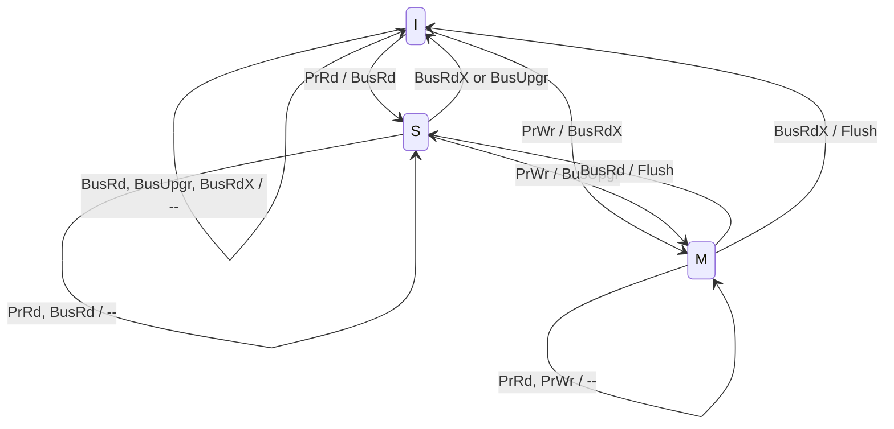

# COE 502 — Lecture 7: Cache Coherence, Consistency and Synchronization

**Parallel Processing Architectures** · KFUPM · Dr. Abdulaziz Tabbakh · slides: `07-CoherenceConsistencySynch.pdf`

> **How to read these notes**
> - Sections follow the slides in order. Each one opens with **The idea**. For a 5-minute refresh, read only those.
> - 💡 = analogy or extra help (not on the slides). ⚠️ = exam trap, or a spot where the slide is wrong or confusing.
> - This is the biggest deck of the course (75 slides). It covers **course outcome 2** (coherence protocols and consistency models) and **course outcome 4** (synchronization).

---

## The whole lecture in 30 seconds

Lecture 6 ended with three problems. This deck solves them:

| Part | Problem | Answer |
|---|---|---|
| **I. Coherence** | Each core has a private cache, so **one variable can have several copies that disagree** | A **protocol** (MSI → MESI → MOESI) keeps the copies in agreement. On a bus it **snoops**; on bigger machines it uses a **directory** |
| **II. Synchronization** | `A = A + 1` is really read, add, write, so **two threads can interleave and lose an update** | **Locks** built from **atomic** instructions (test-and-set, swap, CAS, LL/SC), plus barriers and flags |
| **III. Consistency** | Even with perfect coherence, writes to **different** variables can be **seen in the wrong order** | A **memory consistency model** (SC, TSO, weak ordering, release consistency) says which orders are allowed, and **fences** restore order when you need it |

One rule to carry through Part I:

> **SWMR: at any moment, a block has either ONE writer or MANY readers, never both.**

---

## Contents

- [Key words](#key-words)

**Part I — Cache Coherence**
1. [The problem](#1-the-problem)
2. [Defining coherence](#2-defining-coherence)
3. [Approaches to coherence](#3-approaches-to-coherence)
4. [Elements of a coherence protocol](#4-elements-of-a-coherence-protocol)
5. [Snooping](#5-snooping)
6. [The MSI protocol](#6-the-msi-protocol)
7. [MESI — adding Exclusive](#7-mesi--adding-exclusive)
8. [MOESI — adding Owned](#8-moesi--adding-owned)
9. [Protocol optimizations](#9-protocol-optimizations)
10. [Performance: true and false sharing](#10-performance-true-and-false-sharing)
11. [Directory protocols](#11-directory-protocols)

**Part II — Synchronization**

12. [Why synchronization is needed](#12-why-synchronization-is-needed)
13. [Mutual exclusion, barriers, point-to-point](#13-mutual-exclusion-barriers-point-to-point)
14. [Acquire, release, and waiting](#14-acquire-release-and-waiting)
15. [Implementing locks: RMW instructions](#15-implementing-locks-rmw-instructions)
16. [Load-locked / store-conditional](#16-load-locked--store-conditional)

**Part III — Memory Consistency**

17. [What a memory consistency model is](#17-what-a-memory-consistency-model-is)
18. [Coherence vs consistency: three examples](#18-coherence-vs-consistency-three-examples)
19. [Sequential consistency](#19-sequential-consistency)
20. [Why SC isn't enough](#20-why-sc-isnt-enough)
21. [Relaxed memory models](#21-relaxed-memory-models)
22. [TSO, weak ordering, release consistency](#22-tso-weak-ordering-release-consistency)
23. [Summary sheet](#23-summary-sheet)
24. [Self-test](#24-self-test)

---

## Key words

| Word | Meaning |
|---|---|
| **Block / cache line** | The unit a cache stores and moves (~64 bytes). Coherence works on whole blocks |
| **Write-back cache** | A write updates only the cache; memory is updated later, when the block leaves the cache |
| **Clean / dirty** | Clean = memory has the same value. Dirty = the cache has a newer value than memory |
| **Invalidate** | Mark another cache's copy as unusable, so it must fetch again |
| **Snooping** | Every cache listens to all bus traffic and reacts |
| **Directory** | A table that records which caches hold each block |
| **Critical section** | Code that only one thread may run at a time |
| **Atomic** | Done as one indivisible step: no other processor can see it half-done or get in between |
| **RMW** | Read-modify-write: an instruction that reads, changes and writes memory atomically |
| **Program order** | The order operations appear in one thread's code |
| **Memory order** | The single overall order in which all threads' operations take effect |
| **Store buffer** | A small queue where a core parks its stores so it doesn't have to wait for them |
| **Fence** | An instruction that says "don't move operations across this line" |

---

# Part I — Cache Coherence

## 1. The problem

**The idea:** one memory location can have **several physical copies**: one in memory and up to one in each cache. When someone writes, the copies **disagree**, and a reader can get an old value.

> - A load must return the value of the **latest store** in process order with the same address
> - Problem arises when there are **multiple physical copies of one logical location**: one in main memory, up to one in each cache
> - Copies become inconsistent **when writes happen**
> - Does it happen in a uniprocessor too? **Yes, I/O writes** can make the copies inconsistent

(A device writing straight to memory (DMA) behind the cache's back causes the same problem. Multiprocessors just make it common.)

### The bank account example (slides 3–4)

The account holds 500. Two people withdraw 100 at two ATMs at the same time, as two threads on two processors. Both run: read balance → check → write balance − 100 → give cash.

**Without caches** (every access goes to memory): correct, but slow.

| Step | P0 cache | P1 cache | Memory |
|---|---|---|---|
| start | | | 500 |
| P0 reads, writes 400 | | | **400** |
| P1 reads 400, writes 300 | | | **300** ✅ |

**With write-back caches:** fast, but wrong.

| Step | P0 cache | P1 cache | Memory |
|---|---|---|---|
| start | | | 500 |
| P0 reads | 500 | | 500 |
| P0 writes | **400** | | 500 *(not updated yet)* |
| P1 reads (from memory!) | 400 | **500** ⚠️ | 500 |
| P1 writes | 400 | **400** ⚠️ | 500 |

200 was withdrawn, but the balance ends at 400 instead of 300. **100 disappeared**, because P0's new value was sitting in P0's private cache where P1 couldn't see it.

### What coherence is for (slide 5)

> The behavior of the **physical** system becomes different from the **logical** system. Cache coherence tries to **hide the existence of multiple copies** and make the system behave **as if there is just one copy**.

> 💡 The programmer thinks everyone is editing **one shared document**. In reality everyone has their **own printout**. Coherence is the set of rules that makes the printouts behave like one document.

---

## 2. Defining coherence

**The idea:** two equivalent definitions. The formal one says all writes to a location happen in **one agreed order**, and every read sees the latest. The practical one (**SWMR**) says at any moment there's **one writer or many readers, never both**.

### Definition 1: the universal order (slide 6)

> A memory system is coherent iff it behaves as if, for any memory location M:
> - There is a **universal order of all writes to M** (writes to M are serialized for all processors)
> - If RDj happens **after** WRi, it returns the value of WRi
> - If WRi happens **after** RDj, it does not affect the value returned by RDj
> - i.e. a read returns the **most recent updated value** by any processor
>
> "Happens after" is in **logical time**, not necessarily physical time.
>
> **Coherence is only concerned with reads and writes on a single location.**

**Logical time:** there's no shared clock between cores. What matters is that **everyone agrees** on one order, not what a wall clock would say.

### Definition 2: SWMR epochs (slide 7)

> At any given moment, for location M, there is either:
> - a **single core that may write it** (and read it), or
> - **some number of cores that may read it**
>
> There is never a time when M may be written by one core while being read or written by any other.

The life of a location is split into **epochs**:
```
 epoch:   read-only     read-write    read-write    read-only
 who:     cores 2, 5    core 3        core 1        cores 1, 2, 3
         ├─────────────┼─────────────┼─────────────┼─────────────▶ time
```

> 💡 **SWMR = one marker pen for a whiteboard.** Whoever holds the pen may write; while someone is writing, nobody else reads or writes. When nobody holds the pen, any number of people can read.

> 🔑 Every protocol in Part I (MSI, MESI, MOESI, directories) is just machinery for enforcing SWMR.

---

## 3. Approaches to coherence

**The idea:** coherent caches allow data to **move** between caches and to be **copied** into several. Coherence can be kept by **software** or **hardware**; real machines use **hardware**, by **snooping** or a **directory**.

> Coherent caches provide:
> - **Migration:** movement of data between private caches
> - **Replication:** multiple copies of data in private caches
>
> Protocols:
> - **Directory based:** sharing status of each block kept in **one location** (the directory)
> - **Snooping:** **each core tracks** the sharing status of each block

| Approach | How | Used? |
|---|---|---|
| **Software** | compiler or run-time inserts **Flush** and **Invalidate** instructions | rare: hard to get right |
| **Hardware** | cache controllers run a protocol | **far more common**; the focus of this deck |
| **Hybrid** | e.g. hardware tracks sharers, software decides when to invalidate | some systems |

**Software coherence (slide 10):**
- **Flush:** write my **dirty** lines back to memory.
- **Invalidate:** throw away my **valid** lines.
- The compiler or run-time must know which data is **shared** vs **private**, and use these at the **communication points**.
- **Hard to get perfect:** too many flushes and invalidates → the cache stops being useful.

> **A cache that uses software coherence today?** → **TLBs** (the cache of page-table entries). When the OS changes a page-table entry, it must tell the other cores to invalidate it (a "TLB shootdown"). No hardware does it automatically.

---

## 4. Elements of a coherence protocol

**The idea:** the vocabulary used to describe every protocol.

| Element | Meaning |
|---|---|
| **Actors** | Whoever holds copies and takes part: for now, **caches and main memory** |
| **States** | **Stable:** nothing in progress (M, S, I…). **Transient:** a transaction is in progress ("waiting for data") |
| **State transitions** | Triggered by **local operations** (my core reads/writes) or **remote messages** (another cache's request) |
| **Messages** | What actors send each other to coordinate |
| **Protocol transaction** | A group of messages that takes the system from **one stable state to another** |

The slides only draw **stable** states. Real hardware also has many transient states, and that's where most protocol bugs hide.

---

## 5. Snooping

**The idea:** all caches sit on **one bus** and **listen to everything**. Because only one request can be on the bus at a time, the bus puts all requests in **one order that everyone sees**. That's exactly the "universal order of writes" coherence needs, for free.

> - Each cache controller **snoops on the bus traffic** and does the right thing
> - Assume an **atomic bus**: a request goes out and its reply comes back **without releasing the bus**; the next transaction for the same block waits until the first completes
> - All actors **listen (snoop)**, change their state, and reply if needed
> - **Any write that goes on the bus is seen by everyone at the same time**
> - The bus is the **point of serialization**

> 💡 **A meeting room with one microphone.** Only one person speaks at a time, and everyone hears it. So everyone agrees on what was said and in what order. Remove the room (no bus) and you need a secretary to keep the order: that's the directory (§11).

**System model (slide 13):** each core has a **cache controller** and a **private cache**, all on a **bus**, with the **last-level cache (LLC) / memory controller** and **main memory** below. Each cache line now holds **`state | tag | data`**. The **state** field is what the protocol changes.

---

## 6. The MSI protocol

**The idea:** each cached block is in one of three states. **M** = I have the only copy and I may write it (memory is out of date). **S** = I have a read-only copy (memory is up to date). **I** = I don't have a usable copy. Reads and writes, mine and other cores', move blocks between these states.

### The three states (slide 14)

| State | Meaning | Other copies? | Memory | Can I write? | SWMR role |
|---|---|---|---|---|---|
| **M**odified | only copy, changed | none | **stale** (dirty) | ✅ | the single writer |
| **S**hared | read-only copy | maybe many | up to date (clean) | ❌ | one of the readers |
| **I**nvalid | no usable copy | — | — | ❌ | not involved |

> 💡 **M** = "I took the only copy home and edited it; the master copy is out of date." **S** = "I have a photocopy; read-only." **I** = "I have nothing (or I threw my copy away)."

- Assumes a **write-back** cache.
- **Memory/LLC owns every block, unless some cache has it in M.**

### The messages (slide 16)

| Name | Who sends it | Meaning |
|---|---|---|
| **PrRd / PrWr** | my own processor | "I want to read / write this block" |
| **BusRd** | a cache, on the bus | "give me a copy; I **won't** modify it" |
| **BusRdX** | a cache, on the bus | "give me a copy; I **will** modify it" (everyone else invalidate) |
| **BusUpgr** | a cache in **S**, on the bus | "I already have the data; everyone else **invalidate** so I can write" |
| **Flush** | the cache holding M | "here's the block" (to the requester **and** memory) |

**Why BusUpgr and BusRdX are separate:** a cache in S already has the data, so it only needs permission. BusUpgr skips sending the whole block again.

### The state diagram


Read a label as **event / what I send**. "PrWr / BusUpgr" = my processor wants to write, so I send BusUpgr.

### The transaction table (slide 17)

| Event | My state | What I do |
|---|---|---|
| **PrRd** | I | send **BusRd** → go to **S** |
| **PrWr** | I | send **BusRdX** → go to **M** |
| BusRd / BusUpgr / BusRdX | I | nothing (I have no copy) |
| PrRd / BusRd | S | nothing (reading is fine) |
| **PrWr** | S | send **BusUpgr** → go to **M** |
| BusUpgr / BusRdX | S | **invalidate** my copy → **I**, send an ack |
| PrRd / PrWr | M | nothing (I already own it) |
| **BusRd** | M | send the data to the requester **and memory** → **S** |
| **BusRdX** | M | send the data to the requester **and memory** → **I** |

**How to read it:** rows starting with **Pr** = *my core acting*. Rows starting with **Bus** = *me reacting to another core*. Every cache runs the same table.

> ⚠️ A cache in **M** can never receive a **BusUpgr**. BusUpgr comes from a cache in S, and if anyone is in S, nobody can be in M (SWMR).

### Walkthrough: the bank example under MSI

| Step | Event | P0 | P1 | Bus | Memory |
|---|---|---|---|---|---|
| 0 | start | I | I | | 500 |
| 1 | P0 reads balance | **S** (500) | I | BusRd | 500 |
| 2 | P0 writes 400 | **M** (400) | I | BusUpgr | 500 |
| 3 | P1 reads balance | **S** (400) | **S** (400) | BusRd → P0 **flushes** 400 | **400** |
| 4 | P1 writes 300 | **I** | **M** (300) | BusUpgr → P0 invalidates | 400 |

P1 now reads **400**, not 500, and the account correctly ends at **300**. ✅

---

## 7. MESI — adding Exclusive

**The idea:** most data is **private** (only one core uses it). Under MSI, "read then write" (`x = x + 1`) costs **two** bus transactions even when nobody else has a copy. The new **E** state means "I have the only copy and it's clean", so I can switch to M **silently**, with no bus message.

### The problem with MSI (slide 18)

> - Most blocks are **private**, not shared
> - A **read miss followed by a write** causes **two bus accesses**

**Example:** `x = x + 1` on a variable only this core uses.

| | MSI | MESI |
|---|---|---|
| read x (miss) | BusRd → **S** | BusRd → nobody else has it → **E** |
| write x | BusUpgr → **M** | **E → M silently** (no bus) |
| **Bus transactions** | **2** | **1** |

### The four states

| State | Copies | Memory | Can write? |
|---|---|---|---|
| **M** | only this one | **stale** | ✅ |
| **E** | only this one | **clean** | ✅ **silently** → M |
| **S** | maybe several | clean | ❌ |
| **I** | — | — | ❌ |

**How does a cache know it's the only one?** The bus has a **shared line** (a wire). On a BusRd, every other cache that holds the block pulls that wire. If it's pulled → go to **S**. If not → nobody else has it → go to **E**.

### Pros and cons (slide 19)

> **E is used in almost all commercial coherence protocols.**

| Advantages | Disadvantages |
|---|---|
| **No invalidation traffic on a write-hit in E** (saves the upgrade for "read then write") | Extra **complexity** to work out whether a copy is the only one |
| **A single-threaded program behaves almost like on a uniprocessor**: no coherence overhead | **Memory must wait** until the sharing status is known before replying |
| **Cache-to-cache transfer** can cut latency on some machines | |

---

## 8. MOESI — adding Owned

**The idea:** in MESI, when a dirty (M) block is read by another core, the owner must **write it back to memory** first. If the owner then writes again, that write-back was wasted. The new **O** state means "**shared, but dirty, and I'm in charge of it**": the owner keeps the newest value, gives it to readers, and writes it to memory only later.

### The problem with MESI (slide 21)

> - MESI must **write back to memory on M → S** (a "downgrade")
>   - Because copies in S may be dropped silently, otherwise a dirty block could be lost
> - These write-backs **may waste bandwidth**, e.g. if a store follows (common in **producer-consumer**)

**Walkthrough: P0 produces, P1 consumes, P0 produces again**

| Step | MESI | MOESI |
|---|---|---|
| P0 writes x | P0: **M** | P0: **M** |
| P1 reads x | P0 **writes back to memory**, P0: S, P1: S | P0 sends data to P1 **only**: P0: **O**, P1: S (memory still stale) |
| P0 writes x again | P0 → M, memory stale again: **the write-back was wasted** | P0: O → M, invalidate P1. **No memory write happened** |

### The fix (slides 20–21)

> **Owned:** shared, but **dirty**; **only one owner** (the others are in S)
> - The owner **answers read requests**
> - The owner **writes back on eviction**, or **passes ownership** to another cache
> - MOESI can model MSI and MESI; the owner **eventually** updates memory; allows **cache-to-cache transfers**

> 💡 **O** = "I edited the document and handed out photocopies of my version. The master in the archive is out of date, and it's my job to file the update before I leave."

### The five states

| State | Copies | Memory | Can write? | Answers readers? |
|---|---|---|---|---|
| **M** | only this one | stale | ✅ | ✅ |
| **O** | this + others in S | **stale** | ❌ | ✅ (it's the owner) |
| **E** | only this one | clean | ✅ silently | — |
| **S** | several | clean, *or stale if an O exists* | ❌ | ❌ |
| **I** | — | — | ❌ | — |

> 🔑 **One idea per new state:**
> - **MSI:** the minimum.
> - **+E** separates "I'm the only reader" from "others read too" → saves the **upgrade** on read-then-write.
> - **+O** separates "shared and clean" from "shared and dirty" → saves the **write-back** on a downgrade.
>
> Each new state removes one unnecessary bus transaction, and costs more state and complexity.

---

## 9. Protocol optimizations

**The idea:** three common sharing patterns, each with a trick to save traffic. Then the reason snooping stops working on bigger machines.

| Pattern | What happens | Optimization |
|---|---|---|
| **Producer-consumer**: one core writes, *n* others read | an invalidation, then **n separate read misses** | **Read snarfing / read broadcast**: the other caches see the data go by on the bus and **grab a copy** too, so one miss fills all *n* |
| **Migratory**: cores read **and** modify a block **one at a time** (typical inside a critical section) | a read miss (→ S), then an invalidation (→ M) | **Read-exclusive**: fetch straight into M in one step (combined read + upgrade) |
| **Update-based protocols** | instead of invalidating copies, send them the **new value** | wins **only if every written value is read**; otherwise it sends useless updates |

**Why invalidate wins in practice:** write a variable 10 times before anyone reads it. **Update** sends 10 updates. **Invalidate** sends 1 invalidation and the reader fetches once. That's why almost all real protocols invalidate.

### Why snooping stops working (slide 23)

> - **Every multicore with > 8 processors uses an interconnect other than a bus**
> - That makes it **difficult to serialize events**:
>   - write and upgrade misses are **not atomic**
>   - how does a processor know **all invalidates are complete**?
>   - how are **races** resolved when two processors write at the same time?
> - Solution: **associate each block with a single bus**

> ⚠️ "Associate each block with a single bus" reads oddly. The meaning: give every block **one fixed place that orders its requests**, as the bus used to. That place is the block's **home node** in a directory (§11).

---

## 10. Performance: true and false sharing

**The idea:** coherence adds a new kind of cache miss. **True sharing**: the data really was changed by someone else. **False sharing**: two cores use **different variables that happen to share a cache line**, so the line bounces between them for nothing.

> **Coherence misses:**
> - **True sharing misses:** writing to a shared block (sends an invalidation), or reading an invalidated block
> - **False sharing misses:** **reading an unmodified word in an invalidated block**

### False sharing, step by step

```c
struct { int counter_a;    // core 0 writes this
         int counter_b; }  // core 1 writes this
s;                         // both sit in the same 64-byte line
```

| Step | Core 0 | Core 1 | What happens |
|---|---|---|---|
| core 0 writes `counter_a` | **M** | I | |
| core 1 writes `counter_b` | I | **M** | line moves to core 1, core 0 invalidated |
| core 0 writes `counter_a` | **M** | I | line moves back… |
| … | | | the line **ping-pongs** on every write |

They never touch each other's variable, but coherence works on **whole lines**. **Fix: padding**: put each counter in its own line.

> 💡 Two people writing on different lines of **the same sheet of paper**, which only one can hold at a time. They keep passing it back and forth even though they never touch each other's words.

False sharing is invisible in the source code, which is what makes it hard to find. (It's the "coherence" miss, the fourth C, from Lecture 2.)

### The three performance studies (slides 25–27)

Memory cycles per instruction, split into instruction, capacity/conflict, compulsory, false-sharing and true-sharing misses. (Values read from the slides' charts, so approximate.)

| Changing | Result | Lesson |
|---|---|---|
| **Cache size** 1 → 8 MB | total drops ~3.25 → ~0.95, but **true sharing stays at ~0.65** | 📌 **A bigger cache doesn't fix coherence misses.** The data was invalidated, not pushed out for lack of space |
| **Processors** 1 → 8 | total **rises** ~1.1 → ~2.9; **true sharing grows fastest** (~0.05 → ~1.25) | 📌 **Coherence misses grow with core count**, so they're what limits scaling |
| **Block size** 32 → 256 B | misses per 1000 instructions drop 16 → 10.6, but **false sharing's share grows** | 📌 **Bigger blocks trade compulsory misses for false sharing.** The best size depends on the workload |

---

## 11. Directory protocols

**The idea:** a bus can't handle many cores, and broadcasting every request to every cache wastes effort. A **directory** records, for each block, **which caches have a copy and whether it's dirty**. Requests go to the block's **home**, which contacts **only the caches that matter**.

### Why snooping fails at scale (slide 28)

| Problem | Fix |
|---|---|
| **Bus bandwidth:** bus and ring aren't scalable, about a dozen cores at most | use a **scalable network** (e.g. a mesh) |
| **Snoop bandwidth:** **every** cache must check **every** request, and most checks find nothing | use a **directory**: only contact the caches that **hold** the block ("only spam cores that care") |

⚠️ These are **two separate problems**. A mesh alone fixes bandwidth, but if you still broadcast to everyone, the snoop problem remains. The directory fixes the second one.

> 💡 **Snooping** = shouting every question in a crowded hall. **Directory** = a **librarian with a register** of who borrowed which book. To change a book, you ask the librarian, who phones only the people holding copies.

### Where the directory lives (slides 29–32)

- **In the shared L3:** keep a **bit vector with one bit per core** for each block. Simple, but it only works within one chip (**not scalable beyond the shared L3**).
- **Distributed:** each node gets **its own memory + its own directory** for that memory, connected by the network.

### The presence-flag vector

Each block's directory entry:
```
┌──────────────────────────────┬───────────┐
│ presence bits  p[0] … p[n-1] │ dirty (d) │
└──────────────────────────────┴───────────┘
p[i] = 1  →  processor i has a copy
d    = 1  →  the copy is dirty, so exactly one p[i] is set
```

| Block | Presence bits | d | Meaning |
|---|---|---|---|
| 0 | `0110…1` | 0 | held by processors 1, 2, …, n−1; clean |
| 1 | `0100…0` | **1** | held **only by processor 1**, **dirty** |
| N | `1111…1` | 0 | held by **all** processors; clean |

> ⚠️ Read the bits from left to right as p[0], p[1], p[2]… so `0100…0` means **processor 1**. The slide labels block 1 as "proc. 2", which only works if you count processors from 1. Check which numbering your professor uses.

📌 The entry is SWMR written in bits: **d = 1 with one bit set** = single writer; **d = 0 with several bits set** = many readers.

### cc-NUMA roles (slide 33)

> Same protocol as snooping (e.g. MSI or MESI), but with **messages** instead of a bus.

| Role | Meaning |
|---|---|
| **Home (H)** | the node where the block's **memory and directory entry** live |
| **Requester (R)** | the node asking for the block |
| **Dirty (D)** | the node holding the latest **modified** copy |
| **Shared (S)** | nodes holding read-only copies |

- The **home is fixed by the address** (some address bits pick the node).
- The home can be the same node as R or D.
- **Busy bit per entry:** while home is handling a request for a block, other requests for that block wait. That's how the directory **creates the single order** the bus used to give for free.

### The two basic transactions (slide 34)

**Read miss, block dirty in another node (4 hops):**
```
R ──(1) request──▶ H ──(2) forward──▶ D
R ◀──(4) reply──── H ◀──(3) reply──── D
```

**Write miss, block shared by others:**
```
R ──(1) request──▶ H ──(2) invalidate──▶ S   (each sharer)
R ◀──(4) reply──── H ◀──(3) ack───────── S
```

> ⚠️ The slide adds: "in MSI the transitions are the same except that **updates** are sent instead of invalidations". MSI is an **invalidate** protocol, so this must mean an **update-based** protocol (§9).

### Cutting latency to 3 hops (slide 35)

1. R sends the request to **home**.
2. Home **forwards** it to the dirty node.
3. The dirty node replies **directly to R** (not back through home).
4. R (or D) **tells home afterwards**, off the critical path.

R gets its data after **3 hops instead of 4**; the bookkeeping message to home doesn't make anyone wait.

### Directory memory cost (slide 36)

> N nodes, M memory blocks per node → **directory size = m × n²**. It grows with the **square** of the number of processors.

**Why the square:** the machine has M × N blocks, and each needs N presence bits → M × N × N. **Double the processors → 4× the directory.**

**Alternative: limited pointers.** Store only ***i* pointers** (each **log n** bits, enough to name one processor) instead of *n* bits.

$$\text{overhead} = \frac{\text{size(dir)}}{\text{size(memory)} + \text{size(dir)}} = \frac{M \times n \times i \log n}{M \times n \times b + M \times n \times i \log n} = \frac{i \log n}{b + i \log n}$$

(*b* = block size in bits.)

**Worked example:** 64-byte blocks (b = 512 bits), n = 256 nodes (log n = 8), i = 4 pointers:

$$\frac{4 \times 8}{512 + 4 \times 8} = \frac{32}{544} \approx 5.9\%$$

A full presence vector for n = 256: 256 / (512 + 256) ≈ **33%**.

**The trade-off:** at most *i* sharers can be tracked. If more cores want the block, the protocol must broadcast or drop a sharer. It's a bet that **most blocks have few sharers**, which is usually true.

---

# Part II — Synchronization

## 12. Why synchronization is needed

**The idea:** threads communicate through ordinary loads and stores, and their operations can **interleave in harmful ways**. Synchronization is how you **forbid** the bad interleavings.

> - Communication is **implicit** through loads and stores
> - We need to know how the hardware **interleaves** accesses from different processors
> - Certain interleavings are **not desirable**
>
> 🔑 **Synchronization is the art of preventing interleavings (of memory operations) that we consider incorrect.**

### The basic race (slide 38)

Two threads each run `A ← A + 1`, starting from A = 0. We expect A = 2. But one statement is **three instructions**:

| Step | T1 | T2 | A in memory |
|---|---|---|---|
| 1 | r1 ← A (0) | | 0 |
| 2 | | r1 ← A (0) | 0 |
| 3 | r1 ← r1 + 1 (1) | | 0 |
| 4 | | r1 ← r1 + 1 (1) | 0 |
| 5 | A ← r1 | | 1 |
| 6 | | A ← r1 | **1 ❌** |

> A has been incremented by **1, not 2**.

Same as Lecture 4's `sum += mysum`. Every lock in this course exists to stop this.

---

## 13. Mutual exclusion, barriers, point-to-point

**The idea:** three kinds of synchronization. **Locks**: only one thread at a time in a critical section. **Barriers**: everyone waits until all have arrived. **Flags (point-to-point)**: one thread signals another that something is ready.

### Locks (slide 39)

> A **lock (binary flag)** protects a **critical section**. Changes made inside **become visible to all threads when the lock is released**.

```
T1                  T2
lock(La)            lock(La)        ← acquire
A <- A+1            A <- A+1
unlock(La)          unlock(La)      ← release
```
> 💡 The key to a single bathroom: whoever holds the key goes in; everyone else waits.

### Dekker's algorithm (slide 40): a lock from ordinary loads and stores

```
T1                      T2
A := 1                  B := 1              ← "I want in"
while (B == 1);         while (A == 1);     ← wait while the other wants in
<critical section>      <critical section>
A := 0                  B := 0              ← "I'm done"
```

- **At most one thread in the critical section at a time.**
- ⚠️ **Deadlock:** if both set their flag before either checks, both wait forever. The full algorithm adds a "whose turn" variable, which makes it **complex**, and more so with more threads.
- ⚠️ It **only works under sequential consistency** and breaks on real x86 hardware (§19).

> **Locks are usually implemented with special hardware support** (§15).

### Barriers (slide 41)

> **All threads must reach the barrier before any thread may continue past it.**

> 💡 A tour guide waits at the bus until the whole group is back.

**Wrong:** `BAR := BAR + 1` is a read-modify-write, so two threads can race on it (§12).
```
BAR := BAR+1;        ← race!
while (BAR < 2);
```

**Right:** protect the increment with a lock. Reading BAR doesn't need one.
```
INIT BAR = 0
Lock(bar_lock);
  BAR = BAR + 1;
Unlock(bar_lock);
while (BAR < 2);     ← plain read, no lock needed
```
In practice it's more complex, because **the count must be reset** for the next use. **Barriers can effectively implement critical sections.**

### The Jacobi example (slide 42)

Four threads alternate between two phases, with `barrier(4)` between them:
- **Phase 1:** each thread updates **its own X**; the Y's are **only read**.
- **Phase 2:** each thread updates **its own Y**; the X's are **only read**.

**Why the barrier:** phase 2 reads X's written in phase 1. Without it, a fast thread could read an X that a slow thread hasn't written yet. **No locks are needed inside a phase**, because each thread writes only its own element.

### Point-to-point: flags (slide 43)

```
P1                        P2
                          A = 1;
                          FLAG = 1;          ← release: "A is ready"
while (FLAG == 0);        ← acquire: wait for the signal
print A
```
> No critical section needed: **only one thread writes FLAG**, so there's no read-modify-write race. This is producer/consumer synchronization.

⚠️ This is only correct if `A = 1` becomes visible **before** `FLAG = 1`. Some memory models don't guarantee that, and then P1 can print 0. That's Part III's main example.

---

## 14. Acquire, release, and waiting

**The idea:** **acquire** = get the right to go on (take the lock, pass the event). **Release** = give that right to others. A thread that has to wait can either **sleep** (blocking) or **keep checking** (busy waiting).

> 💡 **Blocking** = go home and wait for a phone call. **Busy waiting** = stand at the door and keep knocking.

| | **Blocking** | **Busy waiting (spinning)** |
|---|---|---|
| Waiting thread | is descheduled (sleeps) | **repeatedly tests a location** until it changes |
| Overhead | **high** (context switch) | **low** |
| Processor | **free** for other work | **held** by the spinning thread |
| Memory/network traffic | none while asleep | **possibly high** |

> **Busy-waiting is better when:**
> - **scheduling overhead > expected wait time**
> - **there's no other task to run**

---

## 15. Implementing locks: RMW instructions

**The idea:** a lock built from a normal load then a store has a **gap between "test" and "set"**, so two threads can both get in. The fix is an **RMW instruction** that reads and writes **in one atomic step**. The simplest is **test-and-set**. **Test-and-test&set** makes it cache-friendly.

### Hardware vs software synchronization (slides 45–46)

- **Dedicated hardware** (special bus lines, registers, a barrier wire): poor scalability, limited flexibility, complex. Rare.
- **Shared memory + RMW instructions** (the normal way). An RMW **reads, modifies and writes back atomically**; the memory/cache controller enforces the atomicity.

| ISA | RMW support |
|---|---|
| IBM 370 | compare-and-swap |
| x86 | any instruction with a **lock** prefix |
| SPARC | SWAP |
| MIPS, PowerPC | a **pair**: load-locked + store-conditional (§16) |

### Why the naïve lock fails (slide 47)

```asm
Lock:    LW   R2, lock      ; read the lock
         BNEZ R2, Lock      ; if 1 (taken), try again
         SW   R1, lock      ; set it to 1 (R1 = 1)
         RET
Unlock:  SW   R0, lock      ; set it to 0
         RET
```

| Step | Thread 1 | Thread 2 | lock |
|---|---|---|---|
| 1 | LW → 0 | | 0 |
| 2 | | LW → 0 | 0 |
| 3 | BNEZ: free! | | 0 |
| 4 | | BNEZ: free! | 0 |
| 5 | SW 1 | | 1 |
| 6 | | SW 1 | 1 |
| | **in the critical section** | **in the critical section ❌** | |

> **The lock is not atomic: two threads can get it at the same time.** The bug is the gap between test and set.

### test_and_set (slide 48)

> `T&S R1, lock`: read `lock` into R1 and **set it to 1, atomically**. R1 = 0 → **got the lock**; R1 = 1 → **failed**.

```asm
Lock:    T&S  R1, lock
         BNEZ R1, Lock      ; was already 1? try again
         RET
Unlock:  SW   R0, lock
         RET
```
> 💡 Flipping the "occupied" sign and seeing what it said before, in one motion. If it already said "occupied", you didn't get in.

### Reducing T&S traffic (slide 49)

**Problem:** T&S **writes** every time, even when it fails. Every write needs the block in **M**, so each attempt invalidates everyone else's copy. With many spinners, the bus is flooded.

**Fix 1: backoff.** After each failure, wait longer before trying again, e.g. **exponential backoff: wait k × cⁱ** before the *i*-th retry.

**Fix 2: test-and-test&set.** Spin with **ordinary loads**; only try T&S when the lock **looks free**.
```asm
Lock:   LW   R1, lock       ; just look (ordinary load)
        BNEZ R1, Lock       ; still taken? keep looking
        T&S  R1, lock       ; looks free: now try to grab it
        BNEZ R1, Lock       ; someone beat me? back to looking
        RET
Unlock: SW   R0, lock
        RET
```

**Why it "works well with caches":**

| Phase | What happens | Bus traffic |
|---|---|---|
| Lock held, 3 threads waiting | each spinner has the lock's block in **S** and keeps reading its **own cache** | **none** |
| Holder releases (writes 0) | invalidation goes out; spinners miss and reload, see 0 | one burst |
| All 3 try T&S | one wins (gets 0), the others get 1 and go back to looking | short burst, then quiet again |

> 💡 Look at the sign from your desk; only walk over and try the door when it says "free".

### Other RMW operations (slide 50)

| Operation | Meaning |
|---|---|
| `SWAP R1, MEM` | exchange R1 and MEM |
| `F&A R1, MEM, CONST` | **fetch-and-add**: R1 ← MEM, then MEM ← MEM + CONST |
| `CAS R1, R2, MEM` | **compare-and-swap**: if MEM == R1, swap R2 and MEM |

- **Fetch-and-add** makes a barrier counter one instruction (no lock / increment / unlock).
- **CAS** is the most general and underpins most lock-free data structures.

---

## 16. Load-locked / store-conditional

**The idea:** instead of one instruction that locks memory during a read *and* a write, use **two ordinary instructions**. **LL** reads and starts **watching** the cache line. **SC** writes **only if nobody else wrote the line since the LL**; otherwise it fails and you retry. Interference is detected by the **coherence protocol's own invalidations**.

> - **Load-locked (LL):** reads `lock` into Rx and **monitors the cache line**
> - **Store-conditional (SC):** tries to store to `lock`
>   - **succeeds if no other thread has written `lock` since the LL** → the LL-SC sequence was atomic
>   - if it **fails**, it **doesn't write**, and sets R1 to 0
> - Advantages: **easier to implement in a pipeline** · **flexibility**

> 💡 Like editing a shared document with version checking: you note the version when you open it (**LL**), and saving only works if nobody saved a newer version in the meantime (**SC**). Otherwise: re-open and try again.

### T&S built from LL/SC

```asm
T&S(Rx,lock):  ADDI R1, R0, 1     ; R1 = 1 (the value to store)
               LL   Rx, lock      ; read lock, start watching
               SC   R1, lock      ; try to store 1
               BEQZ R1, T&S       ; SC failed (R1 = 0)? retry
               RET                ; Rx = old value of lock
```

**Walkthrough: two threads race**

| Step | Thread 1 | Thread 2 | lock |
|---|---|---|---|
| 1 | LL → 0 (watching) | | 0 |
| 2 | | LL → 0 (watching) | 0 |
| 3 | SC 1 → **succeeds** | | 1 |
| 4 | | (the write in step 3 invalidated T2's copy, so its LL-bit is cleared) | 1 |
| 5 | | SC → **fails**, writes nothing → retry | 1 |
| 6 | | LL → 1: lock is taken, so it waits | 1 |

Only one thread wins. ✅

**Why it's easier to pipeline:** a true RMW must hold the memory system during both a read and a write, which happen in different pipeline stages (and an exception could come in between). LL/SC holds nothing; it just **checks afterwards** and retries if needed.

### Building CAS from LL/SC (slide 53)

> More complex atomic operations = **put code between LL and SC**.
> - **Keep it short**, so the SC is likely to succeed
> - **Avoid instructions that can't be undone** (stores, instructions that may cause exceptions)

```asm
CAS(Rx,Ry,X):  ADD  R2, Ry, R0     ; copy Ry (the new value)
               LL   R1, X          ; read X, start watching
               BNE  Rx, R1, return ; X ≠ expected? give up
               SC   R2, X          ; try to write the new value
               BEQZ R2, CAS        ; SC failed? retry
               MOV  Ry, R1         ; return the old X in Ry
return:        RET
```

### How the hardware does it

> - The **LL-bit is set** when LL runs
> - The bus interface **snoops** invalidations/updates to that line and **clears the LL-bit**
> - **SC checks the LL-bit** and fails if it's cleared
> - There can be **several LL-bits** for different addresses

> 🔑 **This is where Part I and Part II meet.** The coherence protocol's invalidation messages are exactly what detect the interference, so atomicity is built on top of coherence.

⚠️ If the code between LL and SC is long, other writes keep clearing the LL-bit, and the SC can **fail forever** under contention (**livelock**). That's why the slide says to keep it simple.

---

# Part III — Memory Consistency

## 17. What a memory consistency model is

**The idea:** a **contract** that says which orders of memory operations, across **different** locations, a program is allowed to observe. It decides what values a read may return. A stricter contract is easier to program; a looser one lets the hardware go faster.

> A **memory consistency model** is a **specification of the allowed behavior of multithreaded programs** with shared memory:
> - the **order** in which memory operations appear to execute
> - **what values a read can return**
> - usually **several correct behaviors are allowed**
>
> It affects **ease of programming** and **performance**.

### Coherence vs consistency (slide 59)

| | **Coherence** | **Consistency** |
|---|---|---|
| About | **one** location | **different** locations |
| Promise | all reads return the latest write; writes to the same location are **seen in the same order by everyone** | writes to different locations are seen in **an order that makes sense given the source code** |
| Question | "Which value?" | "**When** will a written value be returned by a read?" |

> 🔴 **Coherence: writes to a *single location* are seen in order.**
> 🔴 **Consistency: writes to *different locations* are seen in an order that makes sense.**

> 💡 You send two texts: "dinner is ready", then "come downstairs". **Coherence** = each text arrives intact and unchanged. **Consistency** = they arrive **in the right order**.

---

## 18. Coherence vs consistency: three examples

**The idea:** three small programs where the caches are **perfectly coherent**, yet a surprising result can still happen. Coherence says nothing, because each example involves **two different locations**. Only a consistency model decides.

All three assume coherent caches and initial values of 0.

### Example 1: store buffering (slide 55)

```
Processor 1          Processor 2
Store A ← 1          Store B ← 1
Load  R1 ← B         Load  R2 ← A
```
**Can we get R1 = 0 and R2 = 0?** Coherence: **no comment** (different locations).

- **SC: no.** Whichever store comes first in the single order, the other processor's later load must see it.
- **TSO (x86) and weaker: yes.** Each store waits in its core's **store buffer** while the load goes ahead and reads the old value from memory (picture in §19).

### Example 2: two readers disagree (slide 56)

```
P1            P2            P3              P4
Store A ← 1   Store B ← 1   Load R1 ← A     Load R3 ← B
                            Load R2 ← B     Load R4 ← A
```
**Can we get R1 = 1, R2 = 0, R3 = 1, R4 = 0?**

P3 saw A's write but not B's ("A happened first"). P4 saw B's write but not A's ("B happened first"). **The readers disagree about the order of two writes.**
- **SC: no**: there's one global order and everyone sees it.
- **Possible only without store atomicity** (§21): a write reaches some processors before others. (Not on x86/TSO either; only on weaker machines, e.g. POWER.)

### Example 3: causality (slide 57)

```
P1             P2                  P3
Store A ← 1    Load R1 ← A         Load R2 ← B
               if (R1 == 1)        if (R2 == 1)
                 Store B ← 1         Load R3 ← A
```
**Can we get R2 = 1, R3 = 0?**

R2 = 1 means P3 saw B = 1. B = 1 only happens **because** P2 saw A = 1. So A = 1 **caused** B = 1, and yet P3 reads A = 0. That breaks **causality**: *"if I see something and tell you, you will see it too."* Impossible under SC; possible without store atomicity.

> 📌 **The pattern:** coherence is perfect in all three, and the program can still misbehave. Coherence handles **one location at a time** and says **nothing about the order between locations**. That gap is what a consistency model fills.

### Why memory models exist (slide 58)

Three groups want different things:

| Group | Wants |
|---|---|
| **Programmers** | simple reasoning (behaves as expected), a clear framework for correct programs, lots of concurrency |
| **Compiler / language designers** | many compiler optimizations, flexibility, **leave "bad" (racy) programs undefined** |
| **Hardware designers** | many hardware optimizations, little overhead, **simple to verify** |

A memory model is the **compromise** between them.

---

## 19. Sequential consistency

**The idea:** the most intuitive model. The result must be as if all threads' operations were **shuffled into one single sequence**, with **each thread's own operations kept in their program order**. Nothing is ever reordered.

> *"A multiprocessor is sequentially consistent if the result of **any execution** is the same as if the operations of **all the processors** were executed in **some sequential order**, and the operations of **each individual processor** appear in this sequence **in the order specified by its program**."* — **Lamport, 1979**
>
> That single total order is called the **memory order**.

**Two requirements:**
1. There's **one total order** of all memory operations (the memory order).
2. Each thread's operations appear in it **in program order**.

> 💡 Picture one switch connected to memory. Each thread hands it operations **in its own program order**, and the switch picks one thread at a time. Threads interleave with each other, but **no thread's operations are reordered**.

```
  T1        T2        T3
  │         │         │        each thread: operations in program order
  └────┐    │    ┌────┘
       ▼    ▼    ▼
     ┌─────────────┐
     │   switch    │           picks ONE operation at a time
     └──────┬──────┘
         memory
```

### The ordering rules (slide 61)

| SC enforces | → Load | → Store | → RMW |
|---|---|---|---|
| **Load →** | X | X | X |
| **Store →** | X | X | X |
| **RMW →** | X | X | X |

**Every cell is X: no pair of operations may be reordered.**

In the SC memory order:
- **Program order is kept:** if op1 comes before op2 in a thread's code, op1 comes before op2 in memory order.
- **A load comes after the store it reads from:** if a load returns the value from a store, that store comes first in memory order.

### Dekker under SC (slide 62)

```
A and B are 0, cached as shared
T1              T2
S¹: A = 1       S²: B = 1
L¹: read B      L²: read A
```

Under SC, every possible order keeps S¹ before L¹ and S² before L²:

| Memory order (examples) | L¹ (B) | L² (A) |
|---|---|---|
| S¹ · L¹ · S² · L² | 0 | 1 |
| S¹ · S² · L¹ · L² | 1 | 1 |
| S¹ · S² · L² · L¹ | 1 | 1 |
| S² · L² · S¹ · L¹ | 1 | 0 |
| S² · S¹ · L¹ · L² | 1 | 1 |
| **(0, 0)** | 🔴 **no order gives this** | |

> ⚠️ The slide (and older versions of these notes) gives the S² · L² · S¹ · L¹ row as L¹ = 0, L² = 1. Work it through: B = 1 first, so T2 reads A = **0**; then A = 1, and T1 reads B = **1**. The correct result is **(1, 0)**.

**(0, 0) would need a cycle:** L¹ before S² (T1 read the old B), S² before L² (program order), L² before S¹ (T2 read the old A), S¹ before L¹ (program order) → back to the start. **The execution graph has a cycle, so it can't be put in one order**, and SC forbids it.

### With store buffers, (0, 0) happens

> - T1 does A = 1, which **stays in T1's store buffer**
> - T2 does B = 1, which **stays in T2's store buffer**
> - Both loads read memory/cache, where A and B are still 0 → **both read 0**

```
   T1                          T2
   ┌──────────────┐            ┌──────────────┐
   │ store buffer │            │ store buffer │
   │    A = 1     │            │    B = 1     │   ← not visible to anyone else yet
   └──────────────┘            └──────────────┘
   L¹: read B → 0              L²: read A → 0      ← both read old values
```
> 💡 A store buffer is your **outbox tray**: your letter is written, but it hasn't been posted yet, while you're already reading the incoming mail.

> 🔑 **The most important example in the deck.** (0, 0) is impossible under SC but happens on real x86 hardware. So Dekker's algorithm, correct on paper, **fails on real machines**, and that's why locks need **hardware support** instead of clever load/store tricks.

---

## 20. Why SC isn't enough

**The idea:** SC is easy to think about, but it **forbids optimizations** that both hardware and compilers depend on, and it **still doesn't stop data races**.

### Hardware side (slide 63)

> A naïve SC implementation **forbids** common optimizations:
> - **store buffers**
> - **out-of-order execution of accesses to different locations**
>
> A fast SC implementation needs **complex hardware**.

A **store buffer** sits between the pipeline and the cache. The store goes into the buffer and the pipeline moves on, instead of waiting for the write to finish. It's a huge speed win, and it **breaks SC immediately**: a later load can complete while the store isn't yet visible to others (store → load reordered).

### Software side (slide 64)

> - SC limits compiler optimizations on shared memory: **register allocation**, **loop-invariant code motion**, **store hoisting/sinking**
> - **SC is not what programmers really need**: an SC program **can still have data races**
> - Languages need models that **allow optimizations and are easier to reason about**

**Example (register allocation):** the compiler keeps a shared variable in a register to avoid reloading it. Then a loop like `while (flag == 0);` never sees another thread change `flag`, and spins forever. SC would forbid that optimization.

**"SC still has data races":** SC doesn't make racy code correct (the `A = A + 1` race in §12 happens under SC too). What programmers really want is: **if my program is properly synchronized, it behaves simply.** That's the deal weak ordering and release consistency offer (§22).

---

## 21. Relaxed memory models

**The idea:** keep the hardware fast by **dropping some of SC's rules**. There are two knobs: **which reorderings** a core may do with its own operations (local ordering), and whether a write must become visible to **everyone at once** (store atomicity). When you need the order back, you use a **fence**, an **RMW**, or **acquire/release** annotations.

> SC has **two requirements**:
> 1. Memory operations appear to execute **in program order**
> 2. All processors' operations appear as if executed by **a single processor**: the "write serialization" of coherence extended to **all** writes, i.e. writes appear **atomic**
>
> **A relaxed model may relax either of these.**

| Knob | Question | Relaxing it allows |
|---|---|---|
| **Local instruction ordering** | Which of a core's operations must reach memory in program order? Rules cover: normal ↔ normal, normal ↔ synchronization, synchronization ↔ synchronization | e.g. a load passing an earlier store |
| **Store atomicity** | Can one processor see a write **before** it's visible to all? | **non-causal** results (§18, examples 2 and 3) |

### "Performed": the precise words (slide 67)

There's no global clock, so "the write happened" is relative. The slides define:

| Term | Meaning |
|---|---|
| A **load** by Pᵢ is **performed w.r.t. P_k** | new stores by P_k to that address **can no longer change** the value it returns |
| A **store** by Pᵢ is **performed w.r.t. P_k** | a load by P_k to that address **returns this value** (or a later one) |
| An access is **performed** | it's performed w.r.t. **all** processors |
| A load is **globally performed** | it's performed **and** the store it got its value from is performed |

**Store atomicity** = a store becomes performed w.r.t. **everyone at the same moment**.

### Two ways to relax store atomicity (slide 68)

| Flavor | Enables | Strength |
|---|---|---|
| **A thread sees its own write early** (before others do) | **store-to-load forwarding** from its own store buffer | mild; x86 does this |
| **A thread sees another thread's write early** | answering a remote BusRd before all invalidation acks are in (reduces **remote cache hit** time); simpler **hardware multithreading** (threads on one core see each other's writes early) | aggressive; this is what breaks causality |

### Getting order back when you need it (slide 69)

| Solution | How |
|---|---|
| **1. Fence / barrier instruction** | everything before the fence happens before everything after it. Can be **partial** (e.g. only orders loads with loads, or stores with stores) |
| **2. Atomic RMW** | it's both a read and a write, so e.g. if only W → R is relaxed, make the W or the R an RMW |
| **3. Annotate synchronization loads/stores** | mark them **Load.acquire / Store.release**, so they're ordered with the other operations |

Solution 3 is where modern languages ended up: C++11's `memory_order_acquire` / `memory_order_release`.

---

## 22. TSO, weak ordering, release consistency

**The idea:** a ladder of models, each looser than the one before. **TSO** (x86) lets a load pass an earlier store. **Weak ordering** allows any reordering between synchronization points. **Release consistency** splits each synchronization point into a one-way **acquire** and a one-way **release**. Each step down gives the hardware more freedom and the programmer more responsibility.

### Total Store Order, TSO (slides 70–71)

> Used in **SPARC**; similar to **x86**.
> - **Local ordering:** **Store → Load is NOT enforced** if the addresses differ (a load may pass an earlier store)
> - **Store atomicity:** each processor sees **its own stores in program order**, even before others see them
> - Order is enforced with **synchronization** or **RMW** instructions

**Example 1: store → load, relaxed**
```
P1              P2
X = NEW         Y = NEW
R1 = Y          R2 = X
```
> **R1 and R2 can both be 0.** (Example 1 in §18, and Dekker.)

**Example 2: store → store and load → load, kept**
```
P1              P2
X = NEW         L1: R1 = Y
Y = SET             if (R1 ≠ SET) goto L1
                    R2 = X
```
> **R2 always equals NEW.**

| | Needs this order | TSO keeps it? | Result |
|---|---|---|---|
| Example 1 / Dekker | store → load (on each core) | ❌ | (0, 0) possible |
| Example 2 / flag pattern | store → store on P1, load → load on P2 | ✅ | always correct |

📌 So the **flag pattern from §13 is safe on x86**, but **Dekker's algorithm isn't**.

**Store buffers in TSO (slide 71):**
- Stores in the buffer can be **combined** only if no store to **another** address sits between them.
- **No forwarding** from the store buffer → store atomic. **Forwarding** (TSO's case) → **not store atomic**: a core's load can return its own buffered value before that store is globally performed.
- Slide 72 shows an execution that is **not store atomic but still coherent**: the two properties really are separate.

### Weak ordering (slides 73–74)

**Why:**
```
P1                      P2
S1: data1 = NEW         L1: r1 = flag;
S2: data2 = NEW         B1: if (r1 ≠ SET) goto L1;
S3: flag  = SET         L2: r2 = data1;
                        L3: r3 = data2;
```
What matters: **S1, S2 before S3**, and **L1 before L2, L3**. The order **between S1 and S2**, or between **L2 and L3**, doesn't matter, but SC and TSO enforce it anyway, which wastes an optimization opportunity.

> Inside a **critical section** (lock acquire/release done with atomic T&S): reordering loads and stores **doesn't change the result if the code is well synchronized**, because no other thread can observe the order. So **all reorderings inside a critical section should be allowed.**

**The rules:**
- **Reordering allowed between SYNCH instructions** (to different addresses).
- **No reordering across a SYNCH instruction:**
  - before an ordinary load/store runs, **all earlier SYNCH accesses must be performed w.r.t. everyone**;
  - before a SYNCH access runs, **all earlier ordinary loads/stores must be performed w.r.t. everyone**.
- **SYNCH accesses are sequentially consistent with each other.**
- Store atomicity: each processor sees its own stores in program order, even before others do.
- SYNCH examples: RMW instructions, LL/SC.

```
 ordinary ops    (any order among themselves)
 ═════════ SYNCH ═════════   ← nothing crosses, in either direction
 ordinary ops    (any order among themselves)
 ═════════ SYNCH ═════════
```

> 🔑 **The deal:** reorder freely between synchronization points; at each one, everything settles. **A well-synchronized program can't tell the difference**, and gets all the hardware speed.

### Release consistency (slide 75)

> A relaxed form of weak ordering:
> - **Distinguishes acquires and releases**
> - **An acquire must be globally performed before any following memory operation starts**
> - **All memory operations must be globally performed before a release starts**
> - **Programmers must mark** synchronizations as acquires or releases
> - Acquires and releases are sequentially consistent with each other

The orderings it keeps:
```
Acquire → Op      Op → Release      Acquire → Sync      Release → Sync
(Op = ordinary load/store, Sync = an acquire or a release)
```

**Why it's looser than weak ordering:** in weak ordering, every SYNCH is a **two-way** wall. Release consistency only blocks the direction that matters:

```
 ops A
 ──── ACQUIRE ────   ops after it can't move UP above it   (ops A may move down below it)
 ops B (critical section)
 ──── RELEASE ────   ops before it can't move DOWN below it (ops C may move up above it)
 ops C
```

> 💡 **One-way doors.** An **acquire** is a door into the room: once you're in, you can't slip back out before it. A **release** is the door out: everything inside must be finished before you leave. Things outside the room can drift in.

Used in **MIPS, RISC-V, Armv8, and the C and C++ language specifications** (per the slide).

### The comparison table (slide 76)

| Model | Used in | Ordinary orderings kept | Synchronization orderings kept |
|---|---|---|---|
| **Sequential consistency** | most machines, as an optional mode | R→R, R→W, W→R, W→W | S→W, S→R, R→S, W→S, S→S |
| **Total store order / processor consistency** | IBM S/370, DEC VAX, SPARC | R→R, R→W, W→W *(no W→R)* | S→W, S→R, R→S, W→S, S→S |
| **Partial store order** | SPARC | R→R, R→W *(no W→R, no W→W)* | S→W, S→R, R→S, W→S, S→S |
| **Weak ordering** | PowerPC | **none** | S→W, S→R, R→S, W→S, S→S |
| **Release consistency** | MIPS, RISC-V, Armv8, C/C++ | **none** | S_A→W, S_A→R, R→S_R, W→S_R, S_A→S_A, S_A→S_R, S_R→S_A, S_R→S_R |

(R = read/load, W = write/store, S = synchronization, S_A = acquire, S_R = release. "X→Y kept" means an X before a Y in program order stays before it.)

> 📌 **Read the "ordinary" column top to bottom:** SC keeps all four → TSO drops W→R → PSO also drops W→W → weak ordering drops them all → release consistency also makes the sync points one-way. **Each row gives the hardware more freedom and the programmer more responsibility.**

---

## 23. Summary sheet

### Coherence vs consistency

| | **Coherence** | **Consistency** |
|---|---|---|
| Scope | **one** location | **several** locations |
| Promise | writes to one location seen in the same order by all | writes to different locations seen in an order that makes sense |
| Core rule | **SWMR**: one writer or many readers | a defined **memory order** |
| Provided by | MSI / MESI / MOESI, by snooping or directory | SC / TSO / PSO / WO / RC |

### Coherence states

| State | Copies | Memory | Write? | Protocol |
|---|---|---|---|---|
| **M** | only one | stale | ✅ | MSI+ |
| **O** | owner + sharers | stale | ❌ (owner answers reads) | MOESI |
| **E** | only one | clean | ✅ silently | MESI+ |
| **S** | several | clean (stale if an O exists) | ❌ | MSI+ |
| **I** | — | — | ❌ | MSI+ |

| Added state | Saves |
|---|---|
| **E** | the **upgrade** on read-then-write of private data |
| **O** | the **write-back** on an M → S downgrade |

### Bus messages

| | Meaning |
|---|---|
| **PrRd / PrWr** | my core reads / writes |
| **BusRd** | copy please, **won't** modify |
| **BusRdX** | copy please, **will** modify (others invalidate) |
| **BusUpgr** | I have it in S; others invalidate |
| **Flush** | the M holder sends the block to the requester **and** memory |

### MSI reactions to remember

| I'm in… | and I see… | I… |
|---|---|---|
| M | BusRd | send data to requester **and memory**, go to **S** |
| M | BusRdX | send data to requester **and memory**, go to **I** |
| S | BusRdX / BusUpgr | invalidate → **I**, ack |
| M | BusUpgr | **can't happen** |

### Snooping vs directory

| | Snooping | Directory |
|---|---|---|
| Needs | a broadcast bus | any scalable network |
| Who orders requests | **the bus** | the **home node** (+ busy bit) |
| Who is contacted | **everyone** | **only the sharers** |
| Scales to | about a dozen cores | thousands |
| Cost | every cache checks every request | directory size **m × n²** (limited pointers: i log n / (b + i log n)) |
| Remote dirty read | — | 4 hops (3 with forwarding) |

### Synchronization

| | |
|---|---|
| **Definition** | the art of **preventing incorrect interleavings** |
| **Lock / barrier / flag** | one at a time / everyone waits for all / one signals another |
| **Blocking vs spinning** | sleep (frees CPU, high overhead) vs keep testing (low overhead, holds CPU). Spin when the wait is short or there's nothing else to do |
| **Naïve lock bug** | the gap between **test** and **set** |
| **RMW ops** | T&S, SWAP, F&A, CAS: read-modify-write **atomically** |
| **Test-and-test&set** | spin on ordinary loads (cache hits, no traffic); try T&S only when it looks free |
| **LL/SC** | LL watches the line; SC succeeds only if nobody wrote it since. **Built on coherence invalidations** |

### Consistency models

| Model | Drops | Notes |
|---|---|---|
| **SC** | nothing | Dekker works; no store buffers |
| **TSO** (x86, SPARC) | **W→R** | store buffers with forwarding; flag pattern works, Dekker fails |
| **PSO** | W→R, **W→W** | |
| **Weak ordering** | all ordinary orderings | SYNCH = two-way wall |
| **Release consistency** | all ordinary orderings | acquire / release = one-way walls |

### Results to be able to state

1. **Dekker gives (0, 0) on real hardware:** impossible under SC, possible under TSO because of store buffers. Hence locks need hardware support.
2. **A bigger cache doesn't reduce coherence misses**, and coherence misses **grow with core count**.
3. **False sharing** costs you even when nothing is really shared, and **bigger blocks make it worse**.
4. **LL/SC atomicity is detected by coherence invalidations**: Parts I and II connect.

### ⚠️ Corrections and traps

| Topic | Remember |
|---|---|
| Dekker table, slide 62 | S² · L² · S¹ · L¹ gives **(L¹, L²) = (1, 0)**, not (0, 1) |
| Directory example, slide 32 | `0100…0` is processor **1** if you count from p[0] (the slide says proc. 2) |
| Slide 34 "in MSI … updates instead of invalidations" | means an **update-based** protocol; MSI invalidates |
| Slide 23 "associate each block with a single bus" | = give each block one point of serialization (its home) |
| Example 2 (IRIW) | not possible on x86/TSO either; only without store atomicity |
| BusUpgr in M | can't happen (SWMR) |

---

## 24. Self-test

<details>
<summary><b>1.</b> State the SWMR invariant and explain why it gives coherence.</summary>

**Single-writer / multiple-reader:** at any moment a location has **either** one core with read-write access **or** any number of cores (maybe zero) with read-only access, never a writer alongside anyone else.

Writes can only happen one at a time, so there's one **order of writes**, and every reader in an epoch sees the same value. That's definition 1 (slide 6).
</details>

<details>
<summary><b>2.</b> In the bank example with write-back caches, where exactly does the 100 disappear?</summary>

P0 writes 400 into **its own cache**; memory still says 500. P1 reads **from memory** and gets 500. Both compute 500 − 100 = 400, so the balance ends at 400 instead of 300. P0's copy was never made visible to P1.
</details>

<details>
<summary><b>3.</b> Walk the bank example through MSI. What does P1 read?</summary>

P0 reads (I → S, BusRd), then writes 400 (S → M, BusUpgr). P1 reads: BusRd on the bus; P0 is in M, so it **flushes 400 to P1 and memory** and drops to S. P1 reads **400**, then writes 300 (BusUpgr, P0 invalidated). Final balance **300** ✅.
</details>

<details>
<summary><b>4.</b> A cache in M receives a BusRd. What does it do? And under MOESI?</summary>

MSI/MESI: **send the data to the requester and to memory**, then go to **S**. Memory must be updated because afterwards there are only clean copies.

MOESI: it can go to **O** instead: send the data to the requester only, keep being the owner, and skip the memory write.
</details>

<details>
<summary><b>5.</b> Why can a cache never receive a BusUpgr while in M?</summary>

BusUpgr comes from a cache in **S** that wants to write. If anyone is in S, then by SWMR nobody can be in M. M means "the only valid copy".
</details>

<details>
<summary><b>6.</b> What does E buy over MSI? Show it with <code>x = x + 1</code> on private data.</summary>

MSI: read miss → BusRd → S, then write → BusUpgr → M: **2** bus transactions.
MESI: read miss → BusRd, the shared line isn't pulled → **E**; write → **E → M silently**: **1** bus transaction.

E means "only copy, clean", so writing needs nobody's permission.
</details>

<details>
<summary><b>7.</b> What does O buy over MESI?</summary>

MESI must **write back to memory** when a dirty block goes M → S. With O, the owner keeps the dirty block, **answers readers itself**, and writes back only on eviction. In producer-consumer patterns (write, read, write again) that saves a wasted memory write each time.
</details>

<details>
<summary><b>8.</b> True vs false sharing, and why bigger blocks make false sharing worse.</summary>

**True sharing miss:** the data really was changed by another core (a write sends an invalidation; a later read misses).
**False sharing miss:** reading an **unmodified word** in a block that was invalidated because of a **different** word.

Bigger blocks pack **more unrelated variables into one line**, so it's more likely two cores touch different words of the same line.
</details>

<details>
<summary><b>9.</b> Give the two separate problems with snooping and the fix for each.</summary>

1. **Bus bandwidth** (bus/ring can't support more than about a dozen cores) → a **scalable network** (e.g. mesh).
2. **Snoop bandwidth** (every cache checks every request, mostly for nothing) → a **directory** that contacts only the sharers.

A mesh alone doesn't fix the second one; you'd still be broadcasting.
</details>

<details>
<summary><b>10.</b> Read this directory entry for n = 8: presence <code>00100000</code>, d = 1.</summary>

Counting p[0] to p[7] from the left: only **p[2]** is set. Processor 2 holds the **only** copy, and it's **dirty** (memory is stale). A read by another node must be forwarded to processor 2.
</details>

<details>
<summary><b>11.</b> Why does a presence-flag directory grow as m × n², and what's the alternative? Compute the limited-pointer overhead for b = 512, n = 256, i = 4.</summary>

There are M × N blocks, and each needs N bits → M·N². Double the processors → 4× the directory.

**Limited pointers:** *i* pointers of log n bits each. Overhead = i log n / (b + i log n) = 32 / 544 ≈ **5.9%** (vs ≈ 33% for a full vector at n = 256). It assumes most blocks have few sharers.
</details>

<details>
<summary><b>12.</b> How does a directory get the single order of requests that a bus gives for free?</summary>

Each block has one **home node**, fixed by its address. All requests go to the home, and a **busy bit** makes it handle one transaction per block at a time. The home is the point of serialization.
</details>

<details>
<summary><b>13.</b> Why does the naïve LW / BNEZ / SW lock fail?</summary>

Two threads can both LW the lock (both see 0), both pass BNEZ, and both SW 1, so both enter. **The gap between test and set** is the bug. An atomic RMW like T&S closes it.
</details>

<details>
<summary><b>14.</b> Why does test-and-test&set generate less traffic than plain T&S?</summary>

T&S **writes** on every attempt, so each try invalidates everyone else's copy. Test-and-test&set spins with **ordinary loads**: the block sits in **S** in every spinner's cache, so spinning causes **no bus traffic**. Only when the lock is released does an invalidation go out, and the spinners try T&S once.
</details>

<details>
<summary><b>15.</b> How does LL/SC get atomicity without locking the memory system? When can it livelock?</summary>

**LL** reads and sets an **LL-bit**. If another core writes the line, the coherence **invalidation clears the LL-bit**. **SC** stores only if the bit is still set; otherwise it fails and the code retries. Nothing is held.

Livelock: if the code between LL and SC is long and the line is busy, the bit keeps getting cleared, and the SC can fail forever.
</details>

<details>
<summary><b>16.</b> When is busy waiting better than blocking?</summary>

When the **scheduling overhead is larger than the expected wait**, or when **there's no other task to run**.
</details>

<details>
<summary><b>17.</b> P1: Store A←1; Load R1←B. P2: Store B←1; Load R2←A. Is R1 = R2 = 0 possible? Does coherence forbid it?</summary>

**Coherence says nothing**: different locations.
**SC: impossible**: in any single order, one store comes before the other core's load.
**TSO (x86): possible**: both stores wait in store buffers while the loads read the old values. This is Dekker, and why it breaks on real hardware.
</details>

<details>
<summary><b>18.</b> Which SC interleaving of Dekker's code gives L¹ = 1, L² = 0?</summary>

**S² · L² · S¹ · L¹**: T2 sets B = 1, reads A = 0; then T1 sets A = 1, reads B = 1. (The slide lists this row with the values swapped.)
</details>

<details>
<summary><b>19.</b> What exactly does TSO relax, and why does the flag pattern still work on x86?</summary>

TSO relaxes only **store → load** (to different addresses). It keeps store → store, load → load and load → store.

The flag pattern needs `data` before `flag` on the writer (**store → store**, kept) and `flag` before `data` on the reader (**load → load**, kept). Dekker needs store → load, the one order TSO drops.
</details>

<details>
<summary><b>20.</b> What is store atomicity, and what goes wrong without it?</summary>

A write becomes visible to **all** processors **at the same moment**.

Without it, results can be **non-causal**: "if I see something and tell you, you will see it too" fails. Example 3: P2 sees A = 1 and writes B = 1; P3 sees B = 1 but still reads A = 0. Also example 2: two readers see two writes in different orders.
</details>

<details>
<summary><b>21.</b> Name the three ways to get ordering back in a relaxed model.</summary>

1. **Fence / barrier** instructions (full or partial).
2. **Atomic RMW** instructions (a read and a write together).
3. **Annotated** loads/stores: **load.acquire / store.release**.
</details>

<details>
<summary><b>22.</b> Why is release consistency more relaxed than weak ordering?</summary>

Weak ordering treats every SYNCH as a **two-way** wall. Release consistency splits it: an **acquire** only stops later operations moving **above** it; a **release** only stops earlier operations moving **below** it. Each is **one-way**, so fewer orderings are enforced. The price: the programmer must **mark** each synchronization as acquire or release (as in C++11).
</details>

<details>
<summary><b>23.</b> Why can't a simple SC machine use store buffers?</summary>

A store buffer lets a later load complete while the store isn't yet visible to other cores. That's **store → load reordering**, which SC forbids. Concretely, it lets Dekker produce (0, 0), which no SC order can. Recovering the speed while staying SC needs complex hardware, so real machines use TSO instead.
</details>

---

*Previous: [Lecture 6 — Multiprocessor Systems (TLP)](./06-thread-level-parallelism.md)*
